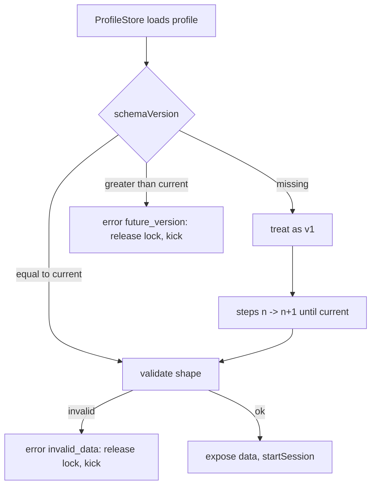

# ADR 0014: Pure per-version migration chain for player data

- Status: accepted by recommendation 2026-11-03, revisable
- Date: 2026-11-03
- Source: D-30 (follows ADR 0010, which deferred migrations to a separate pure module)

## Context

Player data is persisted by ProfileStore behind the `ProfileRepository` port (ADR 0010). The schema will change (this PR adds `sessionCount`). Profiles saved by older servers must be upgraded, and, during a staggered rollout, a profile written by a NEWER server can reach an older one. Silently downgrading it would destroy data. ProfileStore's `Reconcile` only fills missing keys from the template; it cannot rename, reshape or version anything.

## Options considered

| Option | Testable under Lune | Handles future versions | Handles reshaping | Cost |
|---|---|---|---|---|
| A. `Reconcile` only | Yes | No (keeps unknown data as is) | No | None, but unsafe on the first non-additive change |
| B. Migration inside the ProfileStore adapter | No (needs the engine) | Adapter-specific | Yes | Logic hidden in untestable code |
| C. Pure chain `migrate(raw) -> Result`, one step per version, called by `PlayerDataService.join` | Yes, with golden fixtures per version | Yes, typed `future_version` error | Yes | One module and one step per schema change |

## Decision

Option C. `src/shared/features/playerdata/PlayerDataMigrations.luau`:

- `steps[n]` validates a vN table and returns vN+1; `migrate` runs the steps from the stored version to `CURRENT_SCHEMA_VERSION`.
- Current-version data is validated and returned as the same table (idempotent).
- Data with a higher version returns `{ kind = "future_version", found, supported }`; data without `schemaVersion` is v1; bad types return `{ kind = "invalid_data", reason }`. Nothing throws.
- `migrateInPlace` writes the result into the live profile table (ProfileStore requires the identity of `Profile.Data` to survive) and leaves it untouched on failure. Fields outside the schema are kept.
- `PlayerDataService.join` calls the injected `migrate` right after loading. On failure it releases the session lock (so a newer server can load the profile), exposes no data and returns the typed error; `Main.server` kicks the player.
- Golden fixtures `tests/fixtures/playerdata/vN.luau` are frozen literals of what each version really saved. A test per step plus the full chain run against them. A new schema version adds a fixture, a step and tests; it never edits an old fixture.

## Consequences

- Positive: the riskiest persistence code is unit-tested without Studio; newer data is never degraded; the failure path is typed and frees the lock.
- Negative: the types are local structural aliases (`PlayerDataV1`, `PlayerDataV2`) that must stay structurally identical to `PlayerData` (the compiler checks it in `Main.server`; a test checks the version constants match). Every schema change costs a step, a fixture and tests. A player whose profile is from a newer server cannot join an older server until the rollout finishes. Unknown extra fields survive `migrateInPlace` but are not validated.
- Not covered: engine-level behavior of ProfileStore itself (R4, Execution API).

## What would change this decision

Many fields or many versions making per-step validation too verbose (then derive validators from a schema library, which needs its own ADR), or ProfileStore adding first-class versioned migrations that cover the future-version case.
