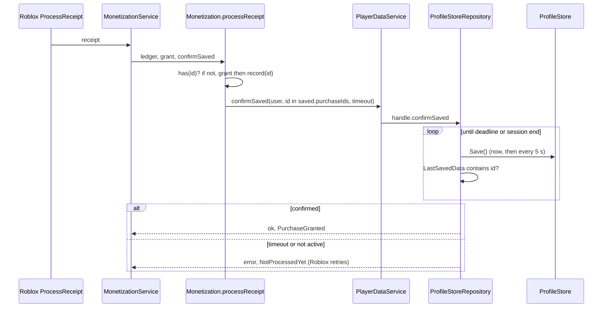

# ADR 0016: Report a purchase as granted only after its save is confirmed; bounded ordered ledger

- Status: accepted by recommendation 2026-11-03, revisable
- Date: 2026-11-03
- Source: follow-up to the risk recorded in `docs/ai-logs/2026-11-03-migrations-and-grants.md` (D-38)

## Context

`ProcessReceipt` must return `PurchaseGranted` only when the purchase will not be lost. Until now the receipt was recorded in the player's in-memory data and Roblox was told `PurchaseGranted` immediately; a crash before the next autosave would lose both the grant and the ledger entry while Roblox considered the purchase done (the player paid and got nothing). Also, `PlayerData.purchases` was an unbounded map, so profiles grew with every purchase.

## What ProfileStore offers (verified, no invented API)

Sources: the vendored `vendor/ProfileStore/ProfileStore.luau` (pinned commit in `vendor/ProfileStore/README.md`) and the upstream docs (page "Developer Products", section "Caching PurchaseId's") read through context7 (`/madstudioroblox/profilestore`).

- `Profile.LastSavedData` ("Last snapshot of Profile.Data that has been successfully saved to the DataStore; Useful for proper developer product purchase receipt handling", header comment, line 97). It is assigned from the `UpdateAsync` result (line 877).
- `Profile.OnAfterSave` fires after a successful save (line 924, inside the branch where the session still owned the profile). `Profile:Save()` only spawns the save and returns nothing (lines 1172-1191), so there is no return value or callback to await; confirmation means observing `LastSavedData` or `OnAfterSave`.
- Official pattern: keep a bounded list of recent PurchaseIds in `Profile.Data`, apply the grant if the id is absent, then loop `Profile:Save()` / `OnAfterSave:Wait()` until `LastSavedData` contains the id or the session ends; return `PurchaseGranted` only in the first case.

Not available: a "save and wait" function, a save promise, or a way to confirm a specific write other than inspecting `LastSavedData`.

## Options considered

| Option | Loss-proof | Complexity | Notes |
|---|---|---|---|
| A. Keep: grant, record, return Granted at once | No (crash window up to one autosave period) | None | The risk being closed |
| B. `Profile:Save()` then return Granted | No: `Save()` is asynchronous and may fail or be coalesced | Low | False confirmation |
| C. Confirm through `LastSavedData` containing the PurchaseId, with a timeout (official pattern) | Yes for data that reached the DataStore | Medium: a port method and an adapter loop | Chosen |
| D. Separate DataStore for receipts | Yes | High: two stores that can disagree about the grant | Rejected: the grant and ledger must share one atomic profile write |

## Decision

Option C.

- Port `ProfileHandle<T>` gains `confirmSaved(isSaved, timeoutSeconds) -> Result<nil, "not_active" | "timeout">`. It yields until a confirmed snapshot satisfies `isSaved`. `PlayerDataService.confirmSaved(key, isSaved, timeout)` delegates to the player's handle (`not_active` when no data is loaded).
- Adapter `ProfileStoreRepository` implements it with the official loop: check `LastSavedData` first (it survives the end of the session, so a final save still confirms), then `IsActive`, then the deadline; it calls `Profile:Save()` at the start and again every 5 s (an in-flight save may predate the grant), polling every 0.1 s. Clock and wait are injected (`Runtime`) so the loop is tested under Lune with a fake clock.
- Pure `Monetization.processReceipt(ledger, receipt, grant, confirmSaved)` returns `granted` / `alreadyGranted` only when the save is confirmed, `unconfirmed` when delivered in memory but not confirmed, `failed` when not delivered. `MonetizationService` maps `failed` and `unconfirmed` to `NotProcessedYet` (Roblox retries) and the rest to `PurchaseGranted`.
- Decision on memory after a timeout: the PurchaseId stays recorded in memory. A retry then finds it, does not grant again, and only waits for the save. Proven by `ReceiptDelivery.test` (coins stay at the delivered amount after the retry).
- Config: `saveConfirmTimeoutSeconds` (default 30, validated positive) and `purchaseLedgerSize` (default 50, validated positive integer).
- Ledger shape: `purchases: { [string]: boolean }` becomes `purchaseIds: { string }`, oldest first, so the oldest can be dropped. Recording past `purchaseLedgerSize` removes the oldest ids. That is schema v3: step `v2 -> v3` in `PlayerDataMigrations` with golden fixture `tests/fixtures/playerdata/v3.luau`.

## Consequences

- Positive: no purchase is reported done before it is in the DataStore; a failed or slow save causes a retry instead of a loss; the grant is never applied twice; profiles stop growing; the whole flow (including save outages) runs under Lune with fakes.
- Negative: `ProcessReceipt` yields up to `saveConfirmTimeoutSeconds` per receipt; a PurchaseId evicted from the window and retried later could be granted again (mitigation: the window of 50 far exceeds the receipts Roblox can leave pending, and the official example uses 100); the v2 ledger was an unordered map, so migrated entries are sorted by id, not by true age; `Profile:Save()` calls add DataStore writes (one per 5 s while waiting).
- Not verified without Studio / Execution API (R4, needs Victor's key): the real timing of `LastSavedData` updates, behavior when `UpdateAsync` is throttled, and the adapter against a real `ProfileStore`. Lune tests cover the logic with fakes only.

## What would change this decision

ProfileStore adding an awaitable save; Roblox changing the receipt retry or timeout semantics; real data showing more than the ledger window of unconfirmed receipts (then raise `purchaseLedgerSize`).

## Budget (added 2026-11-03; the decision above is unchanged)

**Does `Profile:Save()` coalesce?** No. In the vendored `ProfileStore.luau`, `Profile:Save()` only checks view mode and `IsActive()`, moves the profile in the autosave list and runs `task.spawn(SaveProfileAsync, self)` (lines 1172-1191). Every call is a separate save job and a separate `UpdateAsync`. The only protection is `UpdateQueue` (lines 344-375), which makes calls for the same key run one after another; it does not drop or merge them. So N calls to `Save()` are N `UpdateAsync` calls.

**Limit.** Roblox data store docs (`error-codes-and-limits.md`, read through context7 `/roblox/creator-docs`): standard data stores allow `60 + numPlayers x 40` read requests and the same for write requests per minute, at experience level, and `UpdateAsync` consumes from both budgets. The coordinator's brief said `60 + 10 x players`; the current docs say 40, so this section uses 40 and also shows the 10 figure. Per key, writes are limited to 4 MB per minute (a profile is a few hundred bytes, so this is not the constraint). ProfileStore's own autosave adds about 1 `UpdateAsync` per profile per `autosaveIntervalSeconds` (120 s).

**Worst case: 10 simultaneous receipts whose save never lands** (timeout 30 s, one `Save()` request every 5 s, requests at t = 0, 5, ... 25 = 6 per wait):

| Design | `UpdateAsync` in 30 s | Per minute | Budget, 1 player (100 / 70 with x10) | Budget, 10 players (460 / 160 with x10) |
|---|---|---|---|---|
| Each wait saves on its own (first version of this ADR) | 10 x 6 = 60 | 120 | over | inside |
| One shared `Save()` per profile per 5 s (adopted) | 6 | 12 | inside | inside |

With 10 purchases from 10 different players each profile has its own waits, so the count is 6 per profile, which fits both budgets. The risky case is many concurrent receipts on ONE profile in a small experience, which the first version would have multiplied by the number of waiters.

**Adjustment made (decision unchanged, mechanism tightened).** `ProfileStoreRepository` keeps one `lastSaveRequestedAt` per profile, shared by every `confirmSaved` wait on it: `Save()` is called only when 5 s have passed since the last request by any waiter. Cost: a receipt that arrives 1 s after another waiter's request waits up to 4 s more for the next save before it can be confirmed. Test: `tests/adapters/ProfileStoreRepository.test.luau`, "ten simultaneous receipts share one Save() per interval" (10 cooperative waiters on a virtual clock, expects 6 `Save()` calls in 30 s; the same test fails with 60 when the state is per wait, checked by mutation).

**Not verified without Studio:** the real experience-level counters, whether throttling queues or drops requests under load, and the actual cost of `Save()` when no data changed. If receipts and autosaves still approach the budget, raise `SAVE_RETRY_SECONDS` (currently 5) or lower `saveConfirmTimeoutSeconds`.
