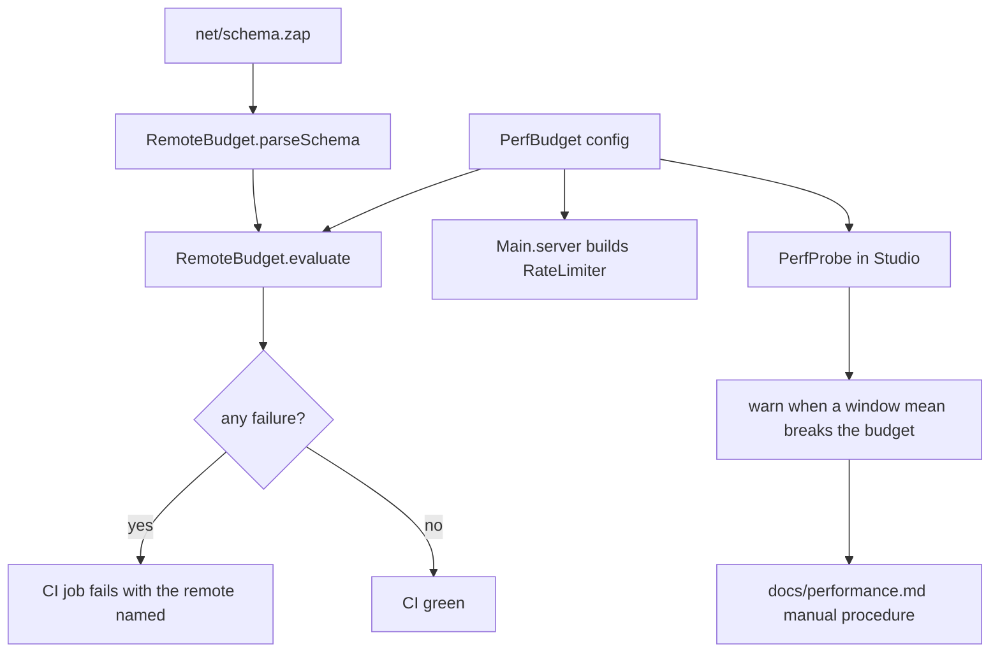

# ADR 0019: Performance budget: static remote-bandwidth calculator plus a dev probe

- Status: accepted by recommendation 2026-11-03, revisable
- Date: 2026-11-03
- Refs: ADR 0012 (rate limit), ADR 0015 (Zap), ADR 0017 (coverage gate)

## Context

A real Roblox game (Ultimate Soccer, about 9k CCU and about 50 thousand dollars) died from lag and nobody could fix it. The template already types remotes (Zap) and rate-limits them (RateLimiter), but nothing states how many bytes a remote may cost, how long a server frame may take, or how much memory a server may use. Without a number nobody can fail a build over lag.

NFRs of the template: **verifiable in CI without Studio** (headless gate), **cheap** (no paid services, CI minutes are budget), **one source of truth** for numbers, **honest** (a number without a source is labelled), **not a framework** (plain modules, ADR 0009), **no Roblox data-API calls** (their terms forbid scraping platform data).

## Options considered

| NFR | A. Manual checklist only | B. Static calculator + dev probe (chosen) | C. External APM/telemetry service |
|---|---|---|---|
| Fails CI on a regression | no | yes, for remote bandwidth | no (post-deploy) |
| Works without Studio | n/a | calculator yes; probe needs Studio | needs live traffic |
| Cost | none | none | paid or quota, new dependency |
| Catches CPU/memory | only if someone runs it | probe (Studio) plus manual procedure | yes, in production |
| Single source of numbers | prose | one Luau config | vendor dashboard |
| Maintenance | discipline | small pure modules, tested | account, SDK, data-use review |

- **A** is the floor, kept as `docs/performance.md`, but alone it relies on memory: the Ultimate Soccer failure mode.
- **C** answers a later question (what happens at 9k CCU); it needs a live game and an ADR per vendor. Roblox's own Performance Dashboard already covers production and is read by hand.
- **B** is the only option that turns a number into a red CI job today.

## Decision

Option B, with A as the manual procedure.

1. `src/shared/perf/PerfBudget.luau` is the single config: bytes budgets, the rate of every remote, runtime thresholds. Each number is tagged `sourced` (with the doc page) or `chosen, not sourced`.
2. `src/shared/perf/RemoteBudget.luau` (pure) parses `net/schema.zap`, computes the largest payload per event and multiplies it by the worst events in one second: for client to server `capacity + refillPerSecond` of that remote's RateLimiter, for server to client the declared `maxPerSecond`. `lune run scripts/perf-budget` prints the table and exits 1 on any remote or total over budget, a remote without a declared rate, an unbounded type, or a stale budget entry. `Main.server` builds the RequestPurchase limiter from the same table, so the number checked is the number running.
3. `src/server/dev/PerfProbe.luau` samples `Stats.HeartbeatTime`, `DataSendKbps`, `DataReceiveKbps` and `GetTotalMemoryUsageMb` and warns against the budget (`ProbeEvaluator`, pure). Off unless `Config.default.perfProbeEnabled` is true and the server runs in Studio.
4. `docs/performance.md` is the manual MicroProfiler and Developer Console procedure.

## Consequences

- Positive: a new remote cannot merge without a declared rate and a bandwidth under budget; one config for CI, the limiter and the probe; probe logic is tested (coverage 97.7 %).
- Negative: the byte model is static. It ignores Roblox packet overhead beyond a chosen `perEventOverheadBytes`, instancing, replication of properties and physics, which is most real traffic; only the manual procedure and the probe see those. The Zap sizes (u16 string prefix, 1-byte enum up to 256 variants) are modelled from Zap's format, not verified against its source. Unbounded types are rejected, so a schema using arrays or `Instance` needs the parser extended first (it fails loudly, never silently passes). The bandwidth and Kbps numbers are not from Roblox documentation.
- Neutral: the probe measures only inside Studio, where the server and client share a machine; it is a smoke alarm, not a load test.

## What would change this decision

Roblox publishing a per-player bandwidth figure (replace the chosen numbers and cite it), or the game reaching real traffic, which is the moment to add option C on top, not instead.
