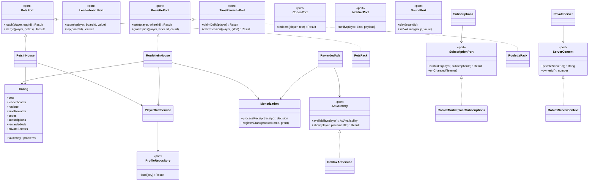
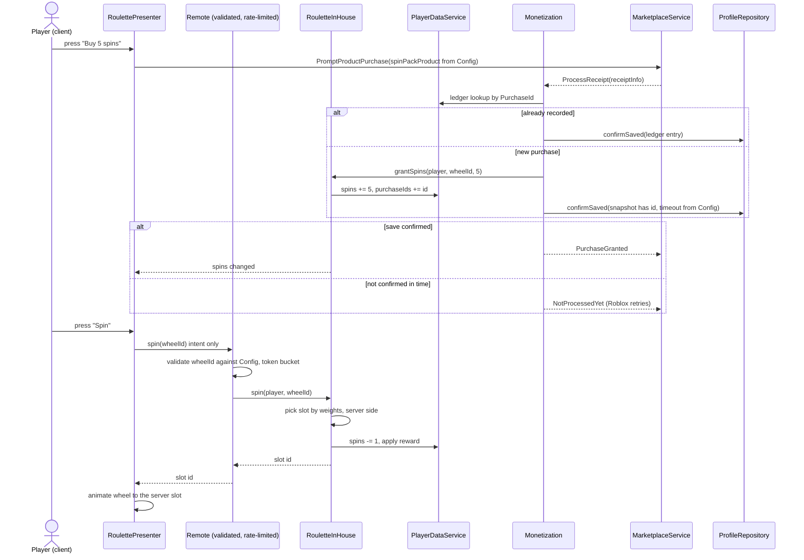

# ADR 0022: Game systems as config-driven feature modules behind ports

- Status: proposed
- Date: 2026-11-04
- Source: vault research `research/essentials-replacements-2026` and `research/rblx-essentials-spike-e`, vault decisions 0022 and 0023, vault issue #61

## Context

The factory ships three micro-games a week. Every game needs the same systems: pets, leaderboards, roulette, time rewards, promo codes, notifications, sound, menus and HUD, and (from game 1, by Victor's scope update of 2026-11-04) the full monetization set: experience subscriptions, rewarded video ads and private servers, next to the passes and developer products the template already has. The paid RBLX Essentials packs cover part of this and may be bought soon. Until then, and for whatever a pack does not cover, the systems are written here.

The research found no maintained open-source package for the gameplay systems (best candidates: 0 to 14 stars, several without a licence), and good ones for infrastructure only (Vide, React-Lua, Fusion, Nevermore, RbxUtil). This template has no package manager (ADR 0003).

Constraints that already hold: ProfileStore behind `ProfileRepository` (0010), validated and rate-limited remotes (0012, 0015), a purchase granted only after a confirmed save (0016), 75 % line coverage over pure code (0017), constructor DI and feature folders (0009).

## Options considered

1. **One module per system, each behind a port, all values from Config.** Adapters for the engine, a second adapter when a pack is adopted.
2. **A small game framework** (Knit-style services and controllers) hosting the systems.
3. **Copy the pack code into each game** and edit it.

## Decision

Option 1.

**Module boundary.** Each system is a feature folder `src/shared/features/<system>/` (pure logic, loads under Lune) plus a server adapter `src/server/adapters/<System>*.luau` for engine calls. A module exposes one port type in `src/shared/ports/`. Callers (other features, presenters, `Main.server`) depend on the port only. Pure logic never requires a Roblox service.

**Config-driven.** Items, prices, odds, timings, product ids, subscription ids and ad placements live in `Config` (typed, with a `validate` that reports every problem, as for products today). Nothing is hardcoded in a module. Ids stay `nil` until the game sets them (existing rule). Each ticket carries its schema sketch.

**Money path.** Every module that sells something uses the existing `Monetization` receipt flow: the grant is applied, the save is confirmed, then `PurchaseGranted` (ADR 0016). Subscriptions are the exception in shape: they are read, not received. Their benefits are reconciled from the live status, never trusted from saved data.

**Remotes.** Clients send intent only (open egg, spin, redeem text, request server). The server decides the outcome from Config and its own state, validates with `Validation` and limits with `RateLimiter`. Remotes are added to `net/schema.zap` and to `PerfBudget`.

**Pack plug-in (option C of the vault).** The port is the contract. A pack, once it passes the four conditions of vault decision 0022 (ProfileStore is the only data layer, confirmed save before grant, validated and rate-limited remotes, adapter at 75 % or more with the vendored code under `vendor/`), enters as a **second adapter of the same port**, chosen in `Main.server` at the composition root. Callers do not change. For persistence the adapter is the facade shim of vault decision 0023 (proposed). If a pack cannot meet a port without changing callers, the port is wrong and is fixed first.

**Third-party code.** No dependency is added by this ADR. If a package is adopted later (Vide for UI, say), a new ADR picks Wally or pesde, as ADR 0003 requires.

The pack classes (`PetsPack`, `RoulettePack`) are drawn to show where option C plugs in. They do not exist yet. Codes, time rewards, leaderboards, notifier and sound follow the same two-adapter shape.

## Consequences

- Positive: every system is testable under Lune; a pack is an adapter swap, not a rewrite; the receipt and save rules are enforced in one place; games differ by Config, not by code.
- Negative: two adapters per system for a while; the Config grows and `Config.validate` with it; the pack path stays unproven until the bundle files are read.
- Cost: a fixed set of ports to maintain. A port that cannot host a pack without changing callers is changed in a new ADR.

## What would change this decision

- A maintained open-source package for a system reaches real adoption and a permissive licence: it becomes an adapter, after the package-manager ADR.
- The vault decision 0023 is rejected: the pack adapters stop being a shim and the pack path narrows to the replacements only.
- Roblox changes a monetization API (subscriptions, ads, private servers): only the adapter changes.
