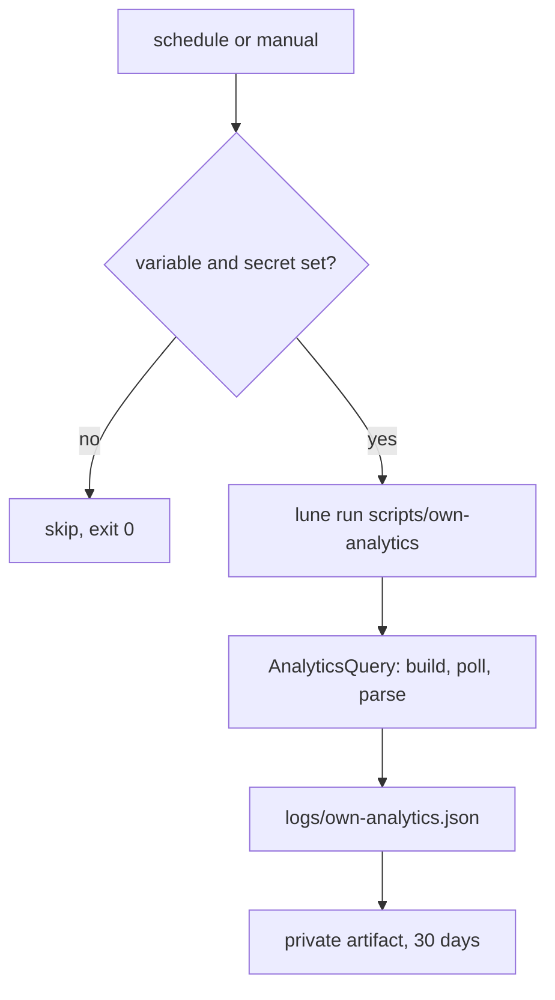

# ADR 0023: Own-game analytics through Open Cloud in CI, private artifact output

- Status: accepted by recommendation 2026-11-04, revisable
- Date: 2026-11-04
- Refs: vault decisions 0014 and 0021 (stage 1), ADR 0017 (coverage gate), ADR 0019 (no Roblox data-API scraping)

## Context

The kill review needs D1 and D7 retention, session length, revenue and the recommendation signals of the game's own universe. Creator Hub shows them by hand. The Analytics Query API (`POST https://apis.roblox.com/analytics-query-api/v1/universes/{id}/metrics`, header `x-api-key`, scope `universe.analytics:read` in the `universe-analytics` system) returns them as JSON for universes the key owner has access to (Roblox/creator-docs, `cloud/guides/analytics`, read 2026-11-04). Roblox's Creator Analytics clause says benchmarking information is confidential and must not be published. The key must never reach an agent or a log.

NFRs: key only as a CI secret; output private; zero cost; skip cleanly when unconfigured; pure logic testable under Lune without network; docs-only and draft behaviour of `ci.yml` untouched.

## Options

| NFR | A. Scheduled workflow, private Actions artifact (chosen) | B. Workflow commits to a private `metrics` branch or repo |
|---|---|---|
| Output stays private | Yes while the repo is private; artifact access follows repo access | Same, but history is permanent and a public fork or template flip would expose it |
| Retention control | `retention-days`, automatic expiry | Manual cleanup, rewriting history to delete |
| Needs write permission | No (`contents: read`) | Yes (`contents: write`, a push path to guard) |
| Queryable history | 30 days, downloadable | Unlimited, diffable |
| CI minutes | About 1 per day | About 1 per day plus a push |
| Risk of leaking values | Low | Higher: values become Git objects |

## Decision

Option A. `.github/workflows/analytics.yml` runs daily and on demand with `timeout-minutes: 5`, a read-only token and no checkout when `ROBLOX_UNIVERSE_ID` (repository variable) or `ROBLOX_ANALYTICS_KEY` (secret) is missing. `scripts/own-analytics.luau` (Lune) does the I/O; `src/shared/ops/AnalyticsQuery.luau` is pure and tested: request building, poll-path validation (the key can only go to the API host), response parsing, summaries, a value-free status line. Metrics: `DailyActiveUsers`, `ForwardD1Retention`, `ForwardD7Retention`, `ForwardD30Retention`, `AverageSessionLengthMinutes`, `DailyRevenue`, `PayingUsers` and the `RFY` play-through, bounce and day-1 playtime signals. Only error codes are logged, never bodies or values.

## Consequences

Positive: no committed benchmark values; no write token; the key is only in the step environment; a fresh game stays green.

Negative: history beyond 30 days lives only in Creator Hub (the API keeps up to four years, so a longer query can be rerun); someone must download the artifact to read it; if the repository becomes public the artifacts become public, so these games stay private; rate limits of the endpoint were not read, so the script spaces calls by one second and fails only when every metric fails.

Would change if: Victor wants a long local series (then B in a separate private repository, new ADR) or Roblox publishes a market-wide analytics endpoint.
