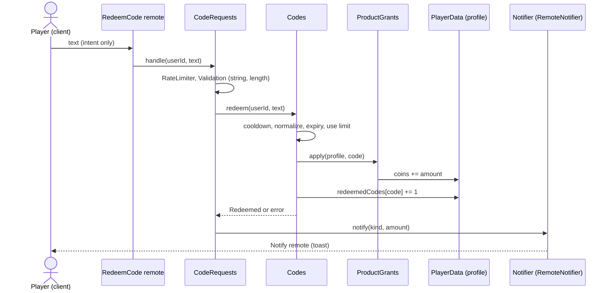

# ADR 0025: Engagement modules (codes, time rewards, notifications, sound)

- Status: accepted
- Date: 2026-11-04
- Implements: ADR 0022 (game systems as config-driven modules behind ports), issues #27, #28, #29, #30

## Context

ADR 0022 fixed the shape of every game system: pure logic in `src/shared/features/<system>/`, one port in `src/shared/ports/`, an adapter for the engine, all values in `Config`, remotes that carry intent only. This ADR records the decisions that were left open when the first four systems were built: where the player state lives, how rewards are granted, how the client side is split, and how the wire is kept in sync with `Config`.

## Options considered

1. **Four independent state tables in the profile, one schema bump (v3 to v4).** `redeemedCodes`, `timeRewards`, `settings`.
2. **One generic `engagement` table** keyed by system.
3. **Do not persist**: derive redeemed codes and the streak from DataStore keys of their own.

For the grant path:

A. **Reuse `ProductGrants`** (keyed by code, `daily:<day>`, `session:<id>`), the same module that delivers developer products.
B. **A new reward module** with its own kinds.

For the wire kinds of toasts:

X. **A Zap enum mirrored in `Config`** (`NotificationKind` and `NotificationsConfig.REQUIRED_KINDS`).
Y. **A free string** with a length bound.

## Decision

- **State: option 1.** One migration (v3 to v4, pure, fixture-tested) adds the three fields. Separate tables keep each system's invariants checkable by `readV4` and let a system be removed without touching the others. Option 3 splits a player's state across keys with no atomicity between the grant and its record; option 2 hides the shape from the validator.
- **Grants: A.** A reward is the same `{ kind = "coins", amount }` declaration as a product, applied by `ProductGrants`, so there is one place that knows overflow and amount rules. The record of the use (code count, last streak day) is written in the same synchronous step as the grant and only after it succeeded, so the profile never shows a reward without its record. Free rewards do not wait for `confirmSaved` (ADR 0016 covers purchases); both writes live in one profile table, so a lost save reverts both together.
- **Time: server clock only.** `os.time()` is injected as `now`. A day is a UTC day number; the daily is idempotent per day; a clock that goes backwards is refused. Session gifts are idempotent per session and kept in memory.
- **Codes: throttled twice.** The `RateLimiter` (from `PerfBudget`) drops floods; the `Codes` service adds the per-player cooldown, doubled after `failureThreshold` consecutive failures (behaviour taken from the free Codes pack, code written here).
- **Client split.** The toast queue, dedupe, expiry and the sound mixer and fades are pure and live in `shared`. Engine calls sit behind two ports (`ToastRenderer`, `SoundEngine`) implemented by thin client presenters in `src/client/presenters/`, which are excluded from the coverage gate like other engine files. The toast renderer shipped is the `SetCore` debug fallback; a game replaces it with its Studio-built UI.
- **Wire kinds: X.** Unknown kinds can then never be sent (the adapter refuses them and `Config.validate` reports a missing one). The cost is two lists to keep in sync, documented in `docs/architecture.md`.
- **Volumes** are stored as optional percentages; a player with no choice gets `Config.sound.defaultVolumes`, so the migration needs no Config.

## Consequences

- Positive: every system loads and is tested under Lune; adding a code, reward, toast or sound is a `Config` edit; a pack can be a second adapter of the same port.
- Negative: the profile grows by three fields; `NotificationKind` and `REQUIRED_KINDS` must be edited together; the toast and sound presenters are not covered by automated tests (engine code, Device Emulator check pending).
- Negative: the client-to-server budget now carries four more remotes (375 B/s of 512). Any further client remote needs its own review of that number.
- Not decided here: real asset ids, real code names, the final toast UI, and Studio-side checks of the presenters.

## What would change this decision

- A paid pack passes the four conditions of vault decision 0022: it becomes a second adapter of the same port.
- A reward kind other than coins (pets, boosts): `ProductGrants` gains the kind and `RewardConfig` validates it.
- Rewards that must survive a server crash between grant and save: they move behind `confirmSaved`.
