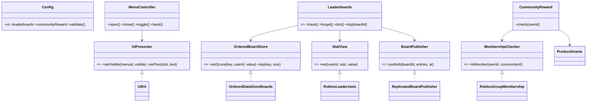
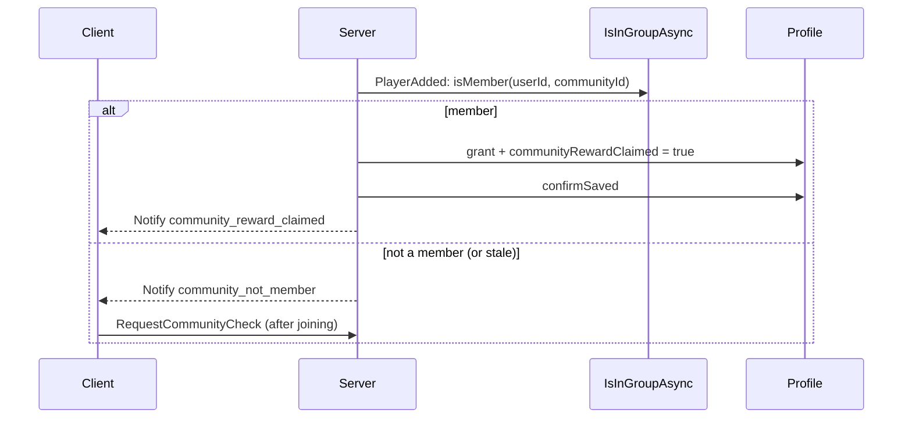

# ADR 0026: UI kit, leaderboards and community join reward

- Status: accepted (2026-11-04), implements issues #23, #25 and #36 under ADR 0022
- Date: 2026-11-04

## Context

Game A needs a reusable mobile-first UI, leaderstats with global boards, and an optional one-time reward for joining the game's community. The client to server budget is 512 B/s (ADR 0019) and was at 490.55 B/s, so every added remote has to be tiny, and the coordinator lowered four existing limiters to make room. The rules in `~/.claude/rules/luau.md` ("UI y dispositivos") apply: scale and tokens only, 44 pt touch targets, touch, keyboard and gamepad input, runtime prices, tested in the Device Emulator.

## Options considered

### UI

| Option | Fit to NFRs | Cost |
|---|---|---|
| A. Plain instances behind a `UiPresenter` port, tokens from Config | No dependency (ADR 0003), pure logic testable under Lune, the pack can plug in as another presenter | Imperative instance code in one thin presenter |
| B. Vide or React-Lua | Declarative, less presenter code | Needs a package manager ADR (0003); engine-only, cannot be tested under Lune |
| C. Import the free Studded UI kit trees | Fastest to look finished | Tokens and structure copied from another source (forbidden by the design rule), Studio-owned binary content, not Lune-testable |

Decision: A. Studded is kept only as a design reference: `theme.studs` selects a token variant (square corners, heavier outline) and nothing else.

### Leaderboards

| Option | Fit | Cost |
|---|---|---|
| A. In-house service over an `OrderedBoardStore` port, delivery by replicated values | No remote, no client write path; schedule and budgets testable with a fake clock and store | We write the schedule |
| B. Adopt a community leaderboard package | Less code | Unmaintained or unlicensed candidates (ADR 0022 research); not behind our ports |
| C. Remote that sends the top to each client | Simple to reason about | Spends the server to client budget per player and adds a remote surface |

Decision: A. Leaderstats are a view of `PlayerData`; global boards are read on a fixed schedule, cached and published as one `StringValue` per board under `ReplicatedStorage.Boards`.

### Community reward membership

| Option | Fit | Cost |
|---|---|---|
| A. `Player:IsInGroupAsync` in an adapter, stale `false` treated as "not yet" | No secret, no HTTP | Per-peer cache can delay a grant |
| B. Open Cloud `ListGroupMemberships` | Fresh answer | Needs an API key secret and `HttpService`; cannot be verified here |
| C. Trust a client "I joined" | None | Forbidden (the client sends intent only) |

Decision: A behind the `MembershipChecker` port, plus the pure `FallbackMembership` combinator so B can be chained after A without changing callers. B itself is not written: it needs a secret and a Studio test of the stale cache first.

## Decision

- **Remotes.** One new client to server remote, `RequestCommunityCheck` (no payload, 1 burst, 0.05/s, 8.4 B/s). No leaderboard remote exists. Two new `Notify` kinds. Four existing limiters were lowered (RedeemCode 2/0.2, ClaimSessionGift 2/0.1, SetVolume 2/1, RequestPrivateServerSetting 2/0.2). Client to server total: 352.45 of 512 B/s.
- **Data.** `communityRewardClaimed` is schema v5 (`v4ToV5` migration, golden fixture `v5`). The grant is rolled back if the save is not confirmed (ADR 0016).
- **Leaderboards budget.** `GetSortedAsync` allows 5 reads per minute per server plus 2 per player. Config validation requires the sum of `60 / refreshSeconds` over all boards to stay at or under 5, `refreshSeconds` at least 60 and `writeSeconds` at least 30. Joining reads nothing from the store. A reset cycle changes the store key per UTC period (weekly boards start on Monday).
- **UI tokens** are derived for this template and justified in `docs/design/DESIGN.md`; contrast is checked by `UiConfig.validate` against WCAG AA.
- **Ships off.** `communityReward.enabled = false` and `communityId` and `reward` are `nil`: whether a game may reward joining a community is an open [GAP] (no official rule found), so enabling it needs Victor to confirm the Community Standards and Terms text.

## Consequences

Positive: three modules behind ports with one wiring point each; no new dependency; the pure parts are covered by Lune tests; the budget went down, not up.

Negative and open:
- Presenters (`src/client/presenters/ui/`) and the engine lambdas in `Main.server` are not covered by Lune. They are checked only by `analyze` until someone runs them in Studio (Device Emulator on a small phone, a tablet and 1080p).
- The community reward supports coins only (the existing `RewardConfig`); a cosmetic reward needs a new grant kind. The Open Cloud membership adapter is not written.
- The client reads shop prices with `GetProductInfoAsync` and derives the discount from the two prices, so it cannot tell a Plus discount from another one.
- Board names are resolved on the client with `GetNameFromUserIdAsync`, which can fail or be slow; a failure falls back to the user id.
- Gamepad focus visuals rely on the engine default selection adornment.

What would change this decision: a package-manager ADR adopting Vide (UI), a measured need for fresher boards (more reads than the budget allows), or the Studio test showing the group cache never refreshes (then B joins the chain).
