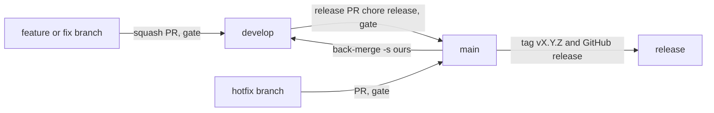

# 0029. develop and main, one CI run per change

- Status: accepted
- Date: 2026-11-06
- Deciders: Victor Ruiz

## Context

Victor asked on 2026-11-05 for two permanent branches in every project: `develop` collects the features, squashed one commit per PR, and `main` gets one commit per release with a changelog and a tag. He also asked for CI that does not repeat runs, because Actions minutes are budget.

Until now the template had only `main`. `ci.yml` ran the gate on each PR and again on the push to `main` after the squash merge. That second run tested a tree the PR had already tested.

## Options

| Option | Minutes per feature | Minutes per release | What it misses |
|---|---|---|---|
| A. Gate on PRs and on push to `develop` and `main` | 2 runs | 2 runs | nothing, at double the cost |
| B. Gate on every PR, no run on push | 1 run | 1 run | a feature merged after another without updating its branch is tested against an older `develop`; the release PR catches it |
| C. Gate on PRs into `develop` only, release PR without a gate | 1 run | 0 runs | the same gap as B, and nothing catches it before `main` |

## Decision

Option B. `ci.yml` runs on `pull_request` into `develop` or `main` and never on push. The release PR from `develop` to `main` runs the gate once, which closes the gap of two features tested apart. Releases are rare, so that run costs little.

Branch flow:

- Feature and fix branches go to `develop` by squash PR and are deleted after the merge. PRs into `develop` do not close their issues, so they are closed by hand.
- A release is a PR from `develop` to `main` titled `chore(release): vX.Y.Z - <title>`, squash-merged, so `main` gets one commit per release with the tree of `develop` (skill `github-integrado` §1). Then come an annotated tag, `gh release create --generate-notes`, and a back-merge with `git merge -s ours origin/main` into `develop`: the squash on `main` is not an ancestor of `develop`, and without the back-merge the next release PR conflicts. (Corrected on 2026-11-06, the day it was accepted: the first text said "merge commit", which contradicts the squash Victor asked for.)
- A hotfix goes to `main` by PR with the full gate and is back-merged into `develop` the same way.
- `main` stays the default branch, so Roblox Open Cloud jobs, the analytics schedule and the template links and the games stamped from it keep working.

## Consequences

- Positive: one run per change and one per release, with no push runs. A broken combination of features is caught before `main`.
- Negative: there is no CI on `develop` itself, so between two PRs it can hold a combination nobody tested. The next PR, or the release PR, tests it.
- Negative: the issue links need a manual close after each merge into `develop`.
- It would change if the repo got branch protection with required checks and a merge queue, which test the combination at merge time.
