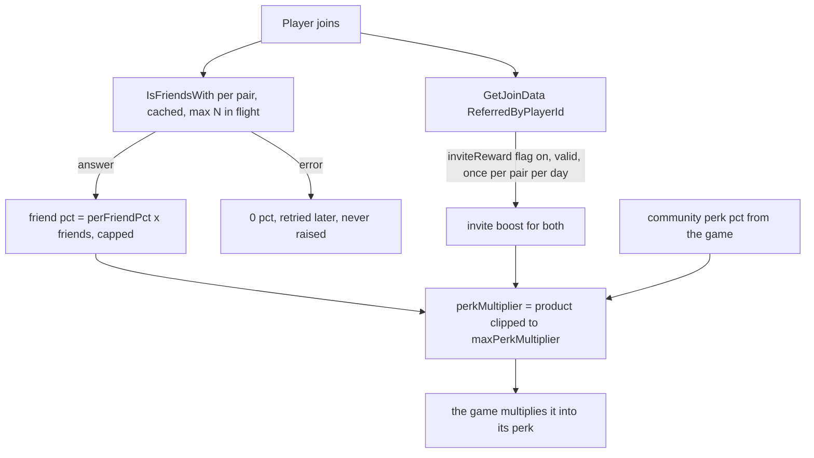

# 0030. Social layer: friend boost and invite reward as a configurable perk

- Status: accepted
- Date: 2026-11-07
- Deciders: Victor Ruiz
- Origin: plus-one-mining ADR 0041 (social layer), generalized. Covers the design part of issue #52.

## Context

plus-one-mining measured that players had no reason to bring friends. Friend boosts are a per-developer pattern, not a Roblox feature: a percentage per friend in the same server, with the friend answer cached because `IsFriendsWith` can fail. Invites use `SocialService:PromptGameInvite` and `Player:GetJoinData` (`ReferredByPlayerId`), per the invite-prompts and referral-system docs. Following ADR 0028, the platform pieces are used as they are and we write only the glue.

The game version multiplied "Mining Power". Every game in the factory has its own perk (income rate, luck, damage), so the template must not know which one.

NFRs: economy integrity (no double inflation), resilience (an API failure never blocks play or the join path), security and policy (server authority, rewards behind a flag), factory reuse (no game vocabulary in the module).

## Options

| Option | Reuse | Economy risk | Cost |
|---|---|---|---|
| A. Copy the game module with its mining names | Poor: every game renames and forks it | Same as the game | Low now, high per game |
| B. Pure social runtime that returns a perk multiplier; the game decides what the perk is | Good: the game multiplies the number into its own rate | Bounded by a configurable ceiling | One adapter per game (the wiring) |
| C. Template owns the perk (a currency or a stat) | Looks complete | The template would decide the economy | High, and wrong for most games |

## Decision

Option B. `SocialRuntime` combines the friend boost, an optional community perk percentage and the timed invite boost, multiplies them and clips the product to `SocialConfig.maxPerkMultiplier`. The result is a plain number (`SocialPerks.perkMultiplier`). The game multiplies it into whatever it calls its perk. Everything else is injected: friendship check, clock, ledger, flag, scheduling. The engine adapter is `server/adapters/SocialWiring`; the client prompt is `client/presenters/InvitePrompt`.

## Consequences

- Positive: any game reuses the module by wiring one multiplier; the join path cannot be broken by a failing social call.
- Negative: the game owns the HUD wording beyond `FriendBoostLabel.text` and the decision of what the perk is.
- Negative: the invite reward depends on a policy check; the flag `inviteReward` exists so it can be switched off from Experience Configs without a release.

## What is lost

A ready-made perk. Each game writes a few lines to apply the multiplier.

## What would change this decision

Roblox restricting incentivised invitations (switch the flag off); a second game needing a combination rule other than the product (then the rule becomes a strategy).
