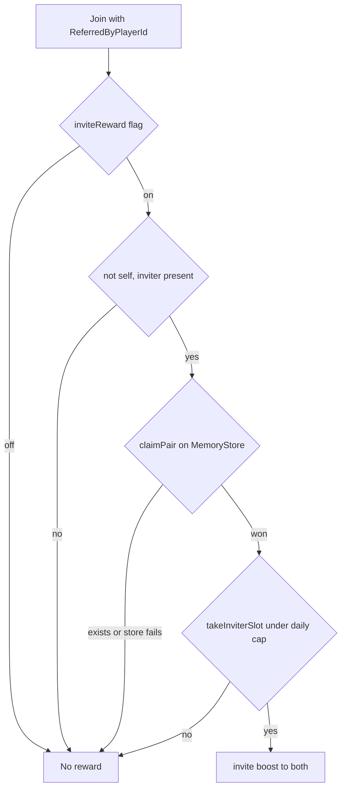

# 0031. Invite ledger on MemoryStore and parallel friend checks

- Status: accepted
- Date: 2026-11-07
- Deciders: Victor Ruiz
- Origin: plus-one-mining ADR 0045 (social follow-up), generalized. Refines [0030](0030-social-layer-friend-boost-and-invite.md).

## Context

The first version of the game social layer had two blockers found in design review. The "once per pair per day" record lived in one server memory and was keyed by direction, so server hopping with an alt account, or A inviting B and B inviting A, paid twice. `FriendBoost` walked its player table with `for ... in` while `IsFriendsWith` yields, which is undefined behavior when another player joins. Rewards also had no combined ceiling.

## Options

### Invite ledger

| Option | Cross-server | Atomic | Notes |
|---|---|---|---|
| A. Server memory | No | n/a | Farmable by server hopping. Rejected. |
| B. MemoryStore hash map, `UpdateAsync` claim | Yes | Yes (callback returns nil when the key exists) | Free quota, 24 h TTL equals the data lifetime. Chosen. |
| C. Field in the player profile | Per profile only | Needs both profiles loaded | Needs a schema migration. Rejected. |
| D. DataStore `UpdateAsync` | Yes | Yes | Permanent data for a daily fact. Rejected. |

### Friend reads

| Option | Calls | Notes |
|---|---|---|
| `IsFriendsWith` per pair, parallel, at most N in flight | N-1 per join | Chosen: cacheable and failable per pair. |
| `GetFriendsAsync` per player | 1 per join, paged | Returns the whole friend list to intersect with a few dozen players. Revisit if servers pass about 40 players. |
| Sequential `IsFriendsWith` | N-1 in series | A slow call delays every later pair. Rejected. |

## Decision

1. Ledger (`HashMapLedger`, port `InviteReward.Ledger`): key `invite:{day}:{min}:{max}` built only by `PairKey.new`, TTL 24 h, claim by `UpdateAsync` returning nil when the key exists, a counter `invite-count:{day}:{inviter}` capped by `SocialConfig.invite.dailyPaidPerInviter`. Pair first, inviter slot second, so a refused cap does not spend a slot. A failing store means no reward and no error. `InviteReward.memoryLedger` exists for tests only.
2. `FriendBoost`: players walked through array copies; questions in their own threads; an answer is stored only if both players are still present; a failed or non-boolean answer counts 0 and is retried by `refreshUnanswered`; counts are kept, so `boostPct` is O(1).
3. Retry loop in `SocialRuntime.start`: every `retrySeconds`, doubling up to `retryMaxSeconds` while pairs keep failing.
4. `beforeChange` runs before a multiplier changes so the game can settle anything paid at the old rate; `onChanged` runs after.
5. `maxPerkMultiplier` clips friend x community x invite. `perksFor` returns the same table until an input changes, so a hot path allocates nothing.

## Consequences

- Positive: one payment per unordered pair per day across servers; the join path cannot be broken by social calls.
- Negative: a MemoryStore outage means no invite rewards until it recovers (fail closed); MemoryStore has its own request quota; distinct alt accounts still earn up to the daily cap per inviter.

## What is lost

The simplicity of the in-memory ledger and uncapped stacking.

## What would change this decision

Roblox restricting incentivised invitations; `IsFriendsWith` being throttled or servers growing (use `GetFriendsAsync`); a ceiling that frustrates full parties (raise it in `SocialConfig`).
