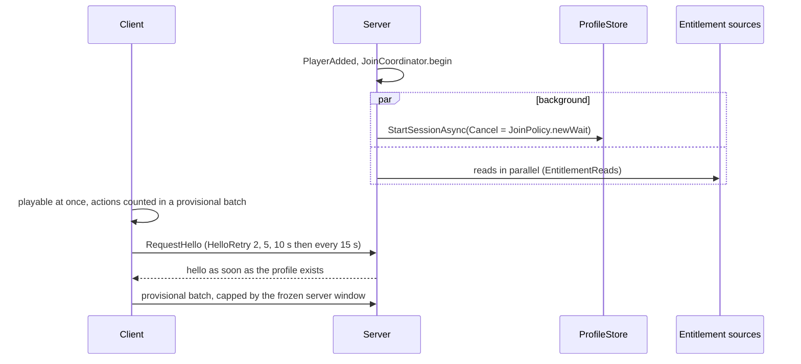

# 0032. Join architecture: data is background state

- Status: accepted
- Date: 2026-11-07
- Deciders: Victor Ruiz
- Origin: plus-one-mining ADR 0039 (join architecture), 0044 (implementation notes) and 0043 (Studio uses its own store), generalized.

## Context

plus-one-mining waited about a minute on join: the session lock (ProfileStore repeats at 5 s and steals at about 45 s) plus serial entitlement reads and a single hello. Measured in Studio: session 4.6-5.3 s, hello 6.5-7.4 s. The same shape would hit every game made from this template. Official guidance: a loading screen, `Cancel` when the player leaves, never `Steal` for normal loading, and a kick on session end.

## Options

| Option | Perceived wait | Data safety | Reuse |
|---|---|---|---|
| A. Shorten constants | Still blocks | Worse: steals earlier | None. Rejected as a patch. |
| B. Playable from frame 1, data as background state, provisional action batch, parallel entitlement reads, stateful hello | About 0 s to first action | Same: spending and saving wait for the profile; the batch is capped by the server clock | Good |
| C. Lobby place with teleport | Hidden behind a teleport | Needs release-before-teleport | Poor: second place |
| D. Loading screen that waits for data | Up to a minute in a lock conflict | Safe | Does not fix the complaint |

## Decision

Option B, as pure modules with injected effects:

- `JoinCoordinator`: starts the entitlement reads at PlayerAdded, marks the hello, applies entitlements before (they ride on the hello) or after (late change), runs the provisional batch (claim, credit, commit or abort) and keeps a `leaving` flag that stops every branch once PlayerRemoving fires.
- `EntitlementReads`: all reads at once with a deadline; a read that answers late is applied through `onLate`.
- `ProvisionalCredit`: one batch per session; both ends of the window are server clock readings; the cap is `maxPerSecond x (helloAt - joinAt)`, frozen at the hello; a batch before the hello or a second one is refused. The template does not know what an action is: `creditProvisional` is injected, so a game credits the batch through its normal action path and its normal validation.
- `HelloRetry`: the client asks again at 2, 5 and 10 s, then every 15 s, until the hello arrives.
- `JoinPolicy`: `newWait` builds the `Cancel` callback (player left, or our own 90 s limit), `guard` keeps errors off the PlayerAdded thread, plus the kick messages.
- `ProfileStoreName.pick`: Studio gets its own store name so a playtest never takes the live profile session lock (original ADR 0043). A mock store would stop measuring real latency, and turning API access off would prevent testing saving.
- Join probe (`ClientJoinProbe`, `ServerJoinProbe`, `ProbeLine`, `JoinProbeSink`): measure before changing constants. Lines go to the log; the sink persists them to a DataStore only on live servers with both flags on, and never stores profile data.

## Consequences

- Positive: the first action does not depend on DataStore or Marketplace latency; a missed hello is recovered; a frozen join ends in 90 s with a clear message.
- Negative: the game needs two client-to-server remotes (hello request and provisional batch) with entries in the remote budget (ADR 0019), and a client counter that reconciles.
- Negative: Studio progress is separate and starts fresh.

## Left to each game (not in the template yet)

- Passing `cancel` through `ProfileRepository.load` and `PlayerDataService.join`, and choosing the store name in `Main.server`: player-data changes need approval (CLAUDE.md), so they are tracked in a separate issue, together with PR #72.
- The remotes, the intro screen, and what an "action" or an "entitlement" is.

## What is lost

The simple model "everything is ready when you see the world".

## What would change this decision

If the join probe reads about 0 s, the cause is elsewhere (client, streaming) and only the parallel reads and the stateful hello stay.
