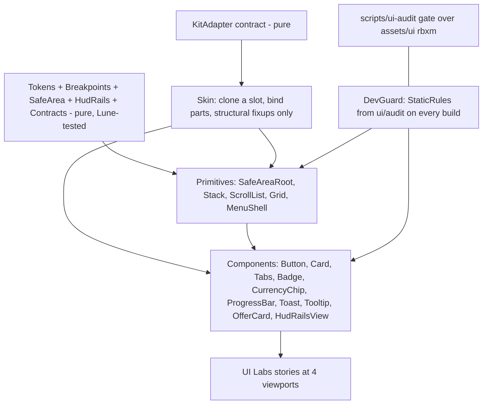

# 0035. UI system: imperative builders over kit Instance trees, rules in pure modules

- Status: superseded by [0071](0071-ui-belongs-to-the-art-owner.md) (2026-11-13)
- Date: 2026-11-08
- Deciders: Victor Ruiz (request of 2026-11-08 after playing +1 Mining on a phone: no padding, unreachable controls, overlaps)
- Origin: plus-one-mining ADR 0037 and 0047, `feat/ui-audit`. Refs #81.

## Context

Every game of the factory re-discovered the same UI bugs on a phone: lists without gap, scrollers that clip their last row, tappables under 44 px, texts that overflow, HUD tiles over the thumbstick, menus at 83 % of the screen. Each one was then audited and fixed by hand, game by game, which costs tokens and ships embarrassing builds. The goal is a system where a correct UI is the only UI that can be built, and a new game only adapts the theme.

NFRs, in priority order:

1. **Mobile-first correctness by construction**: the rules (gap, padding, 44 px, text fit, safe area, no overlap) must be impossible to forget, not documented.
2. **Reuse of kit trees**: the factory ships UI from `.rbxm` kits (Studded UI is the default skin; plus-one-mining ADR 0047 forbids re-tinting a kit). The system must bind to a kit's Instance tree, not replace it.
3. **Lune testability**: the gate runs `lune run scripts/test` and a 75 % line-coverage gate under the Luau CLI. Rules must live in pure Luau.
4. **Performance**: no per-frame work for static UI, few instances, no garbage per update (phones).
5. **Agent ergonomics**: an agent must build a screen with a handful of calls and get a loud error that names the broken rule.
6. **Licence and dependency cost**: ADR 0003 and 0028 require an ADR for any dependency; a package manager is not adopted.

## Options

All three libraries were measured on 2026-11-08 with `gh repo view` (licence, activity). Licence, push date and release come from that command. The capability columns are reasoned from the READMEs listed as sources in the `roblox-gui` skill and from the plus-one-mining research `C-open-source.md`; the READMEs were not re-read today, so treat those cells as informed judgement, not measurement.

| Option | Mobile correctness by construction | Reuses kit `.rbxm` trees | Lune testability | Performance | Agent ergonomics | Licence / cost |
|---|---|---|---|---|---|---|
| A. Imperative builders over kit trees (existing `Widgets`/`CardGridPanel` style), with the rules in pure modules and a dev-mode guard that runs the static audit on what was built | Yes if the primitives are the only way to build: gap, padding, canvas and 44 px are inside the constructors | Native: `Clone()` the kit piece and bind named parts | Rules and geometry pure and testable; the Instance layer is excluded from coverage like every presenter | No reconciliation, no per-frame cost | Plain function calls; failures are sentences | Zero dependency |
| B. Fusion (dphfox/Fusion, MIT, last push 2026-02-02, latest tag v0.3-beta from 2024-08) | Reactivity does not enforce layout; the same bugs are possible | Possible but it builds Instances itself (`New`); binding a cloned tree would use Fusion's hydrate mechanism (not verified against v0.3 today), on a beta API | Needs the engine for `New`; state objects testable, views not | Fine-grained updates; allocation per state object | A new mental model; beta | MIT; needs Wally and an ADR 0028 entry |
| C. Vide (centau/vide, MIT, last push 2026-10-26, no tagged release) | Same: reactivity, not layout rules | Has `create`/`source`; works on existing Instances | Same limit as Fusion | Good; small runtime | New model; no tagged release | MIT; Wally + ADR |
| D. react-luau (Roblox/react-luau, MIT, v17.0.1 from 2024-01, last push 2026-10-30) | Component model, not layout rules | Poor: React owns the tree, cloned kit trees fight reconciliation | Needs ReactRoblox for rendering | Reconciler cost on phones | Heavy; closest to what Roblox itself uses | MIT; largest dependency |

Reactive state is the one thing A lacks. The game UIs here are driven by a few server-pushed values through presenters that already receive plain updates (`ToastController`, `MenuController`, `ShopModel`), so there is no cross-component state graph for Fusion or Vide to simplify yet.

## Decision

**Option A.** Build the system as imperative builders over kit Instance trees, and move every rule into pure modules.

- **One rule set.** `ui/audit/StaticRules` (imported verbatim from plus-one-mining `feat/ui-audit`, commit 3963f3b) is the single source for the tree rules. The builders run it over what they built (`DevGuard.verify`), and the gate runs it over committed `.rbxm` pieces (`scripts/ui-audit`). Pure rules (`Contracts`, `HudRails`, `Breakpoints`, `SafeArea`) are tested in Lune.
- **Correctness by construction.** Tokens are the only source of numbers. Spacing and radius come by key, never by number. `Stack`, `ScrollList` and `Grid` cannot be built without a gap; a scroller always has an automatic canvas and a `UIPadding`; every tappable gets a 44 px `UISizeConstraint`; every text gets `TextScaled` plus a `UITextSizeConstraint`.
- **Kit-native.** A `KitAdapter` maps slots to kit paths and named parts. `Skin` clones and applies only structural fixups (touch floor, text fit, list gap, scroller canvas). It never re-tints and never touches a `UIStroke` `Thickness` or `StrokeSizingMode`. A slot the kit does not cover falls back to a plain piece from the tokens.
- **UIScale policy.** Never below 1, 1 on phones, growing only on desktop and console. A UIScale on the ScreenGui itself overflows scale-sized children, so the scaled frame is `1/scale` of the screen.

## Consequences

Positive:
- A new game changes tokens and picks an adapter; the layout rules cannot regress.
- No dependency, no package manager, no ADR 0028 entry.
- The audit rules are shared with the runtime audit of the game, so the gate and the dev guard agree.

Negative, what is lost:
- No reactive bindings. A screen that needs many interdependent values will hand-write updates.
- The Instance layer cannot run under Lune, so its correctness depends on the pure rules, the dev guard in Studio and a person reviewing the UI Labs stories. It is **unverified in the engine** until that review.
- `SpacingKey`, `TypeKey` and `DeviceClass` are plain strings, not literal unions: the stable solver (ADR 0008) widens singleton unions in loops and records. The accessors raise on an unknown key, so a typo fails at the first build instead of at compile time.

## What would change this decision

- A second game needing shared reactive state across five or more components: then Vide (small, MIT, active) behind its own ADR, wrapping the same primitives; the pure layer does not change.
- Fusion reaching a stable 1.0, or a measured defect in the builders that reactivity would remove.
- The UI audit showing the dev guard missing a class of bug that a declarative spec would catch.

## Links

plus-one-mining ADR 0037 (sizing and kit menus) and 0047 (kit-native theme); template ADR 0003, 0008, 0027, 0028; `docs/ui-system.md`; skill `roblox-gui`. Sources measured 2026-11-08: github.com/dphfox/Fusion, github.com/centau/vide, github.com/Roblox/react-luau (licence, push date, release); create.roblox.com/docs/ui; UI Labs docs (github.com/pepeeltoro41/ui-labs, `docs/en/docs/stories/function.md`).
