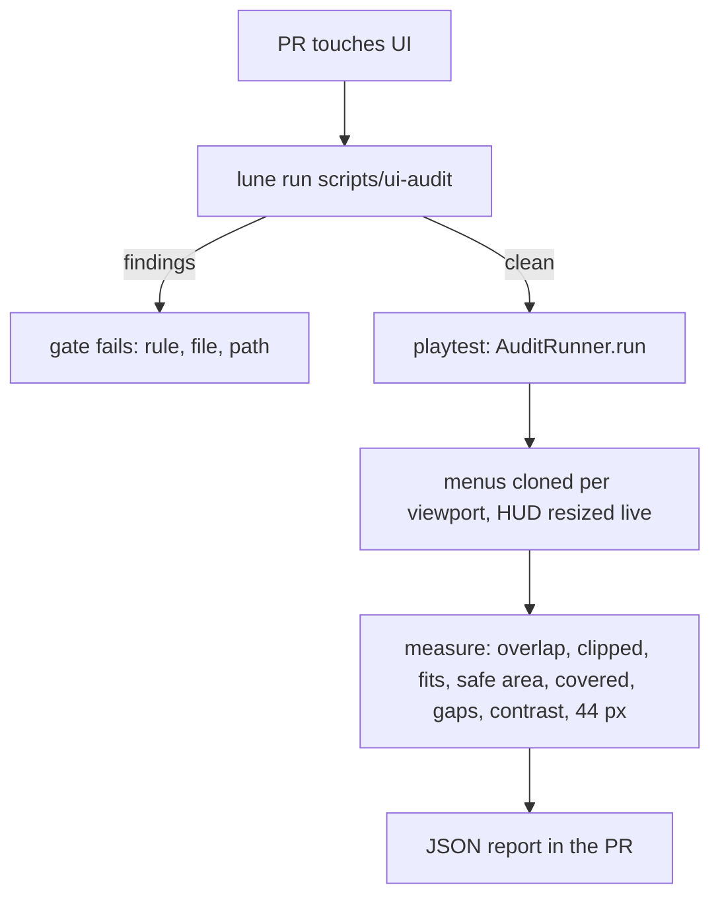

# 0039. Automated UI audit on every PR

- Status: superseded by [0071](0071-ui-belongs-to-the-art-owner.md) (2026-11-13)
- Date: 2026-11-08
- Deciders: Victor Ruiz (complaint of 2026-11-08 on +1 Mining Power; the audit is ported here so every game inherits it)

## Context

The private build (version 66) played on a phone showed basic slips: items in scroll lists touching
each other, a "Claim all" button hidden behind the panel art, rebirth lines under the strip and the
button, text that overflowed. Every one of them is measurable. The visual bar (skill
`roblox-barra-visual`, 38 criteria) existed as a checklist a person runs; nothing ran it on a PR.

NFRs: catches the slip before a phone does, cheap in CI minutes (budget), reusable by the next game
of the factory, no Studio needed for the part that can do without it, no change to the kit look
(ADR 0047).

## Options

| Option | Catches | CI cost | Reuse | Result |
|---|---|---|---|---|
| A. Checklist only, a person runs it | whatever they remember | none | the skill | what failed |
| B. Static audit over the `.rbxm` pieces (Lune) plus a runtime audit run in a playtest | spacing, scrollers, text fit, 44 px, kit strokes statically; overlap, clipping, TextFits, safe area, ZIndex inversion, gaps, contrast at the real layout | seconds in CI for the static half; the runtime half is one `execute_luau` | modules are generic, scenarios are per game | Chosen |
| C. Screenshot diff service | pixels, not causes | high, needs a render farm | medium | Rejected: no cause, no path, flaky on 3D |
| D. Library (e.g. a UI test framework) | partial | medium | medium | None measures `TextFits`, safe area and the ZIndex stack; a dependency needs its own ADR (0003) |

## Decision

Option B.

- Static: `scripts/ui-audit.luau` runs `StaticRules` over `assets/ui`, exits 1 per finding with
  rule, file and path. It runs in `ci.yml` after the unit tests and in the local gate.
- Runtime: `RuntimeAudit` (generic) and `AuditRunner` (this game's scenarios) in
  `src/client/presenters/ui/audit/`. Run in a playtest; the PR template asks for the result when
  the UI changed. Menus are cloned into a root Frame of each phone and desktop viewport; the HUD is
  measured live by resizing its frame, because it lays itself out from that size.
- The non-colour fixes (list gaps, canvas, padding, text fit) go in `tools/ui-restyle.luau` so a
  kit re-extraction keeps them. Kit colours, gradients and strokes are never touched.
- The rules are generic (`Finding`, `Geometry`, `StaticRules`, `RuntimeAudit`) and carry no game
  names, so the template and other games import them.

## Consequences

- Positive: the slips Victor reported fail a check with a path; the report is the PR evidence; a
  new menu inherits the rules for free.
- Negative: the runtime half needs Studio and a person to start it (Rojo drops on a file rename and
  the plugin reconnects by hand after each playtest); `TouchEnabled` and device insets cannot be
  faked, so the HUD touch variant stays covered by the `HudLayout` unit tests; menus are measured
  as clones, so layout driven by signals is not seen; thresholds (10 % overlap, 4 px gap, 98 %
  inside) are ours and were calibrated on this game only.
- What would reverse it: a headless engine that computes UI layout (then the runtime half moves into
  CI), or a measured false-positive rate that makes the report ignored.
