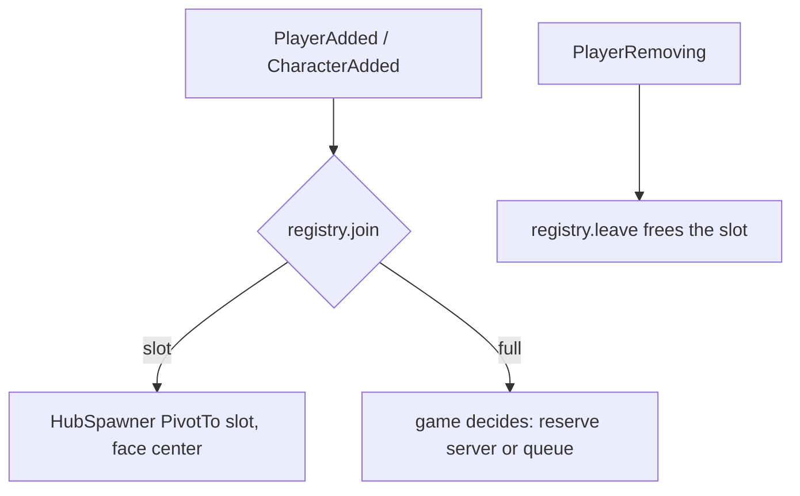

# 0040. Social hub scaffold: layout, slots and cap as data

- Status: accepted
- Date: 2026-11-08
- Deciders: Victor Ruiz
- Refs: #87, referent-features-matrix S01 and S04, vault ADR 0032 (win condition), vault note research/2026-11-08-win-condition.md

## Context

Win-condition criterion 3 asks that other players are visible in the clip, or that the game declares itself solo. Cut a Rock (about 26k CCU, 54 days) spawns players in a central hub; Rock In My Lawn plays co-op up to 6. Intentional co-play days is an official recommendation signal. The median server size of the 51 games under 90 days with 10k+ CCU in the Up-and-Coming sort was 12 on 2026-11-08 (one day, one sort, no causality). Ragdoll Physics reaches about 68k CCU with 1 player per server, so a hub is a choice the game declares, not a rule.

## Options

| Option | Notes |
|---|---|
| A. Document only (a place map in the README) | Nothing to test; each game reinvents spawn and cap logic |
| B. Pure layout and registry modules plus a thin server presenter (chosen) | Slots, cap, station placement and emote policy are Lune-testable; the place stays hand-built per game |
| C. Generate the hub place from code | Needs Studio to verify, couples the template to one look |

No open-source piece applies: ZonePlus-like libraries answer region queries, not slot assignment. The platform pieces are `Players`, `Humanoid.DisplayDistanceType` and the experience max-players setting.

## Decision

Option B. `features/hub` holds `HubLayout` (config types, validation, spawn rings, station positions, advice from the research), `HubRegistry` (lowest free slot, idempotent join, cap, arrive and depart hooks) and `HubEmotes` (allow-list and cooldown). `server/adapters/HubSpawner` seats the character and applies the name-tag policy. Stations are data (`id`, `kind`, polar position, optional `menuId`); the module never names a game. The cap is advice, not a ceiling beyond 100: `advise` warns above twice the median and at 1.

## Consequences

- Positive: spawn order, cap and station placement are deterministic and tested; validation fails the bootstrap on a plaza smaller than the cap or a station inside the plaza.
- Negative: the place, prompts and menus are still built by hand; the presenter is unverified in the engine (no Studio in this PR); name tags use the default humanoid display, not a custom billboard.
- Lost: no emote wheel UI and no animation mapping (a game wires them; the UI system primitives apply, ADR 0035).

## What would change this

Evidence that a hub without visible players performs the same, or a Studio-verified place generator.
