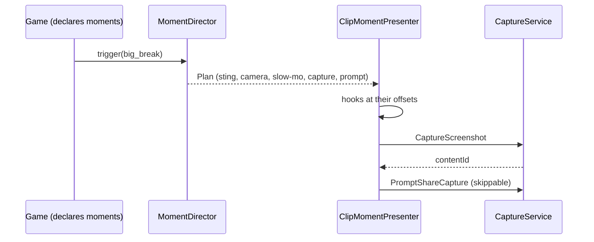

# 0042. Clip moment: a timed plan over CaptureService

- Status: accepted
- Date: 2026-11-08
- Deciders: Victor Ruiz
- Refs: #89, referent-features-matrix S12, vault ADR 0032 (criteria 2, 4 and 8), vault note research/2026-11-08-win-condition.md

## Context

Roblox Moments clips are captured by players (30 s maximum) and published to a feed; the game can only facilitate the moment, it does not control the feed ranking. The vault ADR 0032 makes a clip-worthy moment a gate for every game, and checklist criterion 8 asks for a skippable share prompt shown at most once per session.

Facts, with sources (read 2026-11-08 unless noted):

| Fact | Source | Label |
|---|---|---|
| `CaptureService:PromptShareCapture(captureContent, launchData, onAcceptedCallback, onDeniedCallback)` opens the native share sheet with an invite link; the launch data reaches users who join through it; ineligible devices are offered a download | create.roblox.com/docs/reference/engine/classes/CaptureService (via context7) | confirmed |
| `StartVideoCaptureAsync` records until `StopVideoCapture` or 30 seconds; voices are muted while recording; `captureParams` is non-operational | same page | confirmed |
| `CaptureScreenshot(onCaptureReady)` gives a temporary contentId usable for sharing; such screenshots are not readable from the gallery nor uploadable | same page | confirmed |
| Moments clips are up to 30 s, with music through a DistroKid partnership; access through Search and the More tab, Home planned | DevForum, September 2025 | confirmed in the vault note |
| Upload API and Recommendation API were announced for the end of 2025 | DevForum | GAP: not verified if released |
| Whether `CaptureService` can be called from the server | docs describe it as a client service; the declarations list no server restriction | GAP: treated as client only |
| Visits that come from Moments | no public figure | GAP |

## Options

| Option | Notes |
|---|---|
| A. Call the share prompt at the moment | The prompt covers the peak and the screenshot misses it |
| B. A pure planner that times sting, camera, slow motion, capture and prompt; a thin client presenter executes it (chosen) | Rate limits and opt-outs are testable; the engine part is a few calls |
| C. Always record a rolling video | `StartVideoCaptureAsync` mutes voices and has a 30 s cap; heavier and intrusive |

## Decision

Option B with a screenshot capture. `MomentDirector` turns `trigger(momentId)` into a `Plan` of steps (sting first, the peak after `stingLeadSeconds`, capture after the peak, prompt after the capture). The share prompt is limited to `promptsPerSession` (default 1) and `minSecondsBetweenPrompts`; effects have a cooldown; settings `effects` and `sharePrompt` opt out of each part, and the sting always stays. `ClipMomentPresenter` runs the plan; slow motion, camera kick and sting are hooks the game implements because the client has no global time scale.

## Consequences

- Positive: criteria 4 and 8 are checkable; a player can turn effects and the prompt off; no capture happens without the player seeing the native share sheet.
- Negative: the real capture and share path was not run (a step for Victor in Studio or a device); video capture is not used; the server must tell the client through a game-owned remote.
- Lost: no upload to Moments from inside the game (GAP above).

## What would change this

The Upload or Recommendation API shipping (the plan could end in an upload), evidence that the screenshot misses the peak on slow devices (then a short video), or a documented server entry point.
