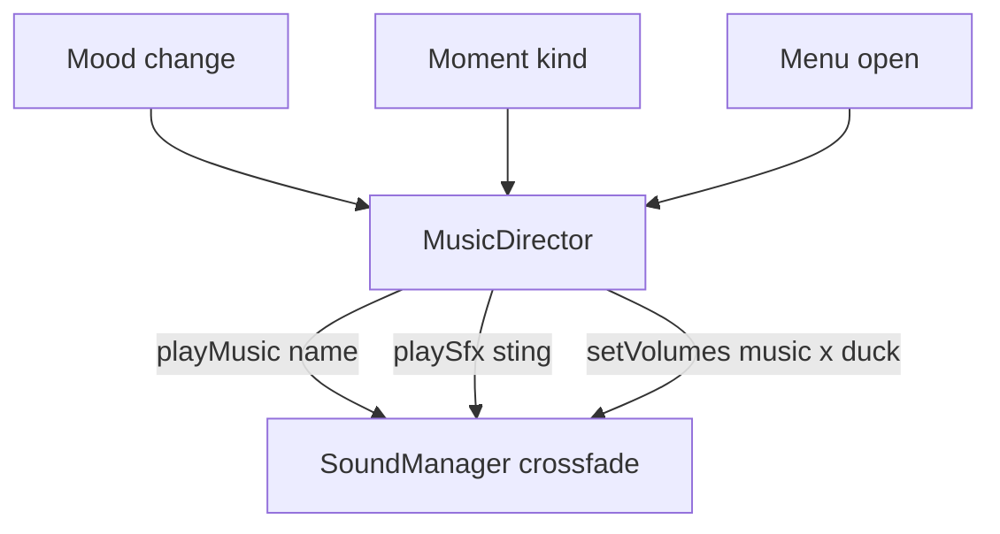

# 0042. Music director with moment stings and a licence manifest

- Status: accepted
- Date: 2026-11-08
- Deciders: Victor Ruiz
- Refs: #90, #62, referent-features-matrix E09 and S13, vault ADR 0032 (criterion 4), vault note research/2026-11-08-win-condition.md

## Context

Win-condition criterion 4: the audio id exists (never invented), its licence is noted, and the sound moment starts at or before the clip moment. The template already has a sound manager (ADR 0025: mixer, cross-fade, groups, ids from config). What is missing is the layer that picks a track by mood, plays a sting on a moment, ducks under UI, and records the right to use each id. The referent music style (phonk or edit style) is unverified: GAP in the vault note, no audio was analysed. Moments lets the player add music to the clip through a DistroKid partnership (DevForum, September 2025), so the music of the clip is the player, the music of the game is ours.

## Options

| Option | Notes |
|---|---|
| A. Extend `SoundManager` with moods and licences | Grows a module that only knows names and gains; mixes asset rules with policy |
| B. A director that sits on top of the manager plus a licence config keyed by the same names (chosen) | The manager and `SoundConfig` stay as they are; ids are never duplicated; the licence check is a separate validation |
| C. A music library (open source) | None found that fits the port; the engine part is already the sound presenter |

## Decision

Option B. `MusicConfig` holds licences per `SoundConfig` name (basis: cc0, cc_by, distrokid, original, roblox_library; a source; an attribution line for cc_by), playlists per mood, stings per moment kind and the duck settings; `validate(config, soundConfig)` fails when a used name has no licence, a basis is unknown, a source is empty or a playlist points at an unknown track. `MusicDirector` sets the mood (round robin, no immediate repeat), plays the sting for a moment kind and holds a duck, ducks for UI holders, and writes the music volume to the sound manager at the current duck factor; the player volume always wins. `manifest` returns the licence rows for a credits screen or a release check.

## Consequences

- Positive: no audio id ships without a recorded licence basis; stings can be aligned with the clip plan of ADR 0041 (`sting` at plan time 0, before the peak); Lune tests cover the playlist, the duck ramp and the validation.
- Negative: the licence entry is a claim, not a proof: the game owner checks the source; the stinger being audible at or before the moment needs a Studio capture with sound (not done here); looped tracks never end, so rotation needs unlooped tracks or a timer.
- Lost: no beat-matched transitions and no per-mood crossfade length.

## What would change this

Verified evidence of the referent music style (then moods and default stings can ship as presets), or a platform API that exposes licence data for library audio.
