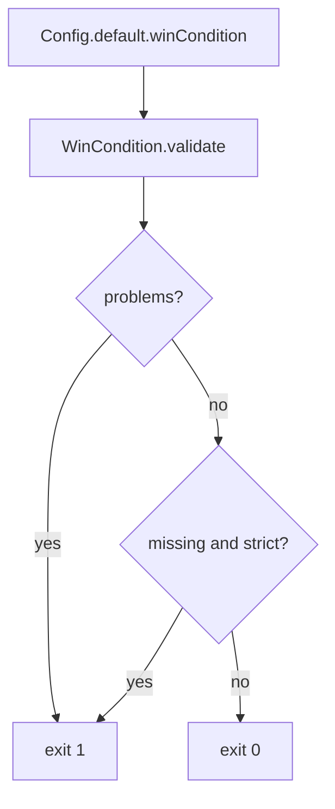

# 0043. Win-condition checklist and a pending-tolerant gate

- Status: accepted
- Date: 2026-11-08
- Deciders: Victor Ruiz
- Refs: #91, vault decision 0032 (outside this repo), referent-features-matrix S01 to S13

## Context

Vault decision 0032 makes a win condition a gate of pipeline stages 1, 7, 8 and 12: who sees which moment, through which borrowed channel, and why they join. A game stamped from the template should start with the checklist in its `docs/` and a way to prove its declaration is complete. The template itself has no game, so its declaration is empty by design.

## Options

| Option | Notes |
|---|---|
| A. Checklist as a document only | Nothing stops a game from reaching stage 7 with a 14-word hook or no measurement plan |
| B. Document plus a typed declaration in Config and a Lune check with a pending mode and a strict mode (chosen) | The empty template stays green; a game closes stage 1 with `--strict`; wrong values always fail |
| C. A strict gate in template CI | Turns the template red for being a template |

## Decision

Option B. `docs/win-condition-checklist.md` ships in the template (vault wikilinks resolved to plain references). `features/wincondition/WinCondition` types the declaration (`hypothesis`, `hookSentence` of at most 9 words, `shareableMomentIds`, `borrowedChannel`, `solo`, `funnyElement`, `measurementPlan`, `targetOwner`, `targetDate`) and separates `missing` fields from `problems`. `scripts/win-condition.luau` prints both and exits 1 on any problem; with `--strict` it also fails on missing fields. Template CI runs it in pending mode. `scripts/new-game.ps1` names the checklist and the strict command in its output. The cross-check of moment ids against the clip-moment config is available through the optional `knownMomentIds` argument and is wired by the game, because the clip-moment module is a separate feature.

## Consequences

- Positive: a stage 1 gate that a script can verify; the declaration is data a post-mortem can compare with the result; thresholds stay a proposal in the checklist, not constants in code (only the 9-word hook limit, which is the checklist rule).
- Negative: the check proves the declaration is complete and well formed, not that the hypothesis is good; the stage 12 numbers are still read by hand with a date.
- Lost: no automatic reading of Creator Analytics (no verified API for it).

## What would change this

Recalibrated thresholds after the first three games, or an Analytics API that lets stage 12 be read by a collector.
