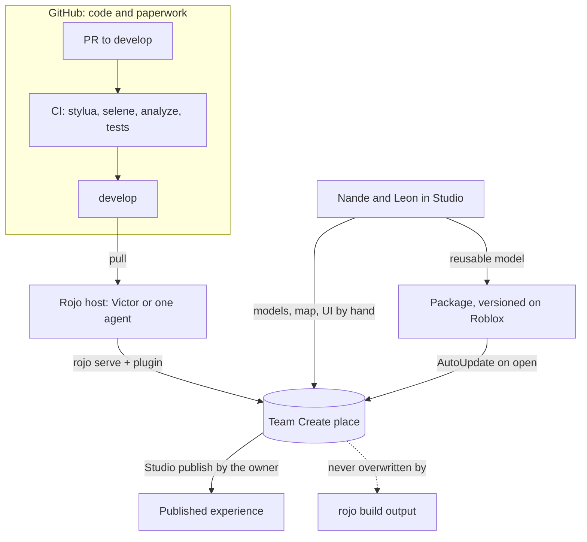

# 0045. Team Create for the world and art, Rojo for code

- Status: accepted
- Date: 2026-11-08
- Deciders: Victor Ruiz
- Supersedes: nothing. Refines [0002](0002-rojo-partially-managed.md) and [0013](0013-multi-agent-protocol.md) for a team that mixes humans in Studio with agents.
- Refs: REEL 104 (Agent Board method)

## Context

From 2026-11-11 three people work on the same game: Victor and two friends (Nande and Leon). The friends build low poly art and the map by hand in Roblox Studio. The code is written by agents and Victor through Rojo. Both must work at the same time on one place without erasing each other.

Facts, read on 2026-11-08:

- Rojo project files: `$ignoreUnknownInstances` says whether instances Rojo does not know about are deleted. Its default is `false` when `$path` is set and `true` otherwise (Rojo docs, `project-format`, read through context7). `init.meta.json` carries the same flag for folders on disk.
- Team Create: Live Scripting is on by default, so collaborators edit scripts together; Studio saves the project to the cloud every four minutes; only the owner can revert other editors' changes. For a user-owned experience, Edit access goes only to Roblox friends; a group-owned one uses group roles (create.roblox.com/docs/projects/collaboration).
- Packages: a package is a reusable group of instances. Publishing creates a new version; copies with AutoUpdate pick it up when the place opens; scripts inside an unmodified package are read-only; ownership cannot be transferred, so the owner (user or group) is chosen at creation; the `PackageLink` object must not be moved or deleted (create.roblox.com/docs/projects/assets/packages).
- DevForum threads on partially managed Rojo with a team (links in the sources below) agree on one pattern: Rojo owns scripts, the place owns everything else, and the safeguard is `ignoreUnknownInstances`. One team went further and merged the Studio place with the Rojo branch in CI with Remodel; they report it hard to track. No official guide covers "artists in Studio, scripters in Rojo". That part is community knowledge, not documented behaviour.
- ADR 0006 keeps `.rbxm`, `.rbxl` and `.rbxlx` out of Git (only `assets/ui/**/*.rbxm` is allowed). `rojo build` does not carry MeshPart, `SurfaceAppearance`, `EditableMesh` or `PartOperation` changes (ADR 0042 of the first game), so a place built from files is never a faithful copy of the art.

NFRs: nobody loses work, a friend with no Git can contribute art on day one, free plan (no LFS quota, no paid tools), reviewable code, the 3-person limit of the machine (ADR 0013).

## Options

| Option | Art stays safe | Friends need Git | Reviewable | Cost and risk |
|---|---|---|---|---|
| A. Partially managed Rojo on a shared Team Create place; art lives in the place; reusable models are Packages (chosen) | Yes: Rojo never deletes unknown instances | No | Code yes, art no | One Rojo host at a time; art history is Roblox's version history, not Git |
| B. Same split, plus every model exported as `.rbxm` into `assets/` and committed | Yes | Yes (export, commit, PR) | Binary diff, so no | Repeals ADR 0006 for art; merges of binaries; friends learn Git on day one |
| C. CI merges the Studio place with the Rojo branch (Remodel / Open Cloud) and publishes the result | Yes if the merge is right | No | Partly | A custom pipeline; the DevForum report calls it hard to track; more to maintain than 3 people can afford |
| D. Fully managed Rojo (`rojo syncback`) | No: lossy for meshes and appearance | Yes | Yes | Rojo itself calls the workflow incomplete (ADR 0002) |

## Decision

Option A.

1. **Rojo owns code only.** `default.project.json` maps `src/shared`, `src/server`, `src/client`, `src/replicatedfirst` (when it exists) and vendored code. Every service node keeps `$ignoreUnknownInstances: true`, and so does every folder Rojo mounts inside a service that art can also touch. A new Rojo mount of a folder that holds art needs a new ADR.
2. **The place owns the world and the art.** `Workspace`, `Lighting`, `Terrain`, `SoundService` content, the models under `ReplicatedStorage/Assets` and `ServerStorage/Assets`, and all UI built by hand are edited in Studio through Team Create and are not in Git. Nobody edits a Rojo-managed script inside Studio: the next sync overwrites it.
3. **Reusable models are Packages.** Props, pets, items and enemies that appear in many places are published as Packages owned by the experience's owner (Nande's group when it exists, see `docs/team-workflow.md`). The code refers to them by name under `ReplicatedStorage/Assets` and, when it needs an asset id, through config, never typed in a script (ADR 0006). Packages give versions and AutoUpdate without putting binaries in Git.
4. **Git keeps the paperwork, not the binaries.** Each model gets a line in `docs/art-log.md` or the PR that introduces it: name, author, date, source (made by hand, Blender, Studio generator) and licence. `.rbxm` stays ignored (ADR 0006) except the UI kit already allowed. A snapshot of the whole place is a manual `File > Save to File` kept by Victor outside the repo.
5. **One Rojo host.** In a Team Create session, only one person (Victor, or an agent under the Studio lock of ADR 0013) runs `rojo serve` and connects the plugin. Two plugins connected to one place fight over the same scripts. Everyone else sees the scripts arrive as normal Team Create changes.
6. **Publishing.** The place is published from Studio by its owner after the host's sync, never from a file built with `rojo build`, which would overwrite the art. `rojo build` stays a CI check and a way to open a clean local test place. Publishing and going public remain manual (ADR 0052).

## Consequences

Positive:

- Friends start on day one with Studio only; no Git needed for art.
- Code stays reviewable and gated; nothing in the art can break CI.
- Packages give versions and rollback for shared models without LFS.

Negative:

- Art and map history live in Roblox (version history, Packages), not in Git; they cannot be reviewed in a PR. The art log gives provenance, not diffs.
- A single Rojo host is a bottleneck. If Victor is away, an agent takes the host role under the lock.
- A script edited in Studio by mistake is lost at the next sync. The rule in `RULES.md` of each code folder and in `docs/team-workflow.md` is the only guard.
- Edit access to a user-owned experience is limited to Roblox friends. A group fixes that and is Nande's task before the first session.

## What would change this decision

- The friends or agents start producing art in volume that must be reviewed or rolled back by PR: move to option B for that folder with a new ADR.
- A real incident of art overwritten by a sync: add the CI merge of option C.
- Rojo publishes a supported guide for mixed Studio and file workflows, or syncback becomes lossless.

## Sources

- Rojo project format, `$ignoreUnknownInstances` and meta files: rojo.space docs (`project-format`, `sync-details`), through context7 `/rojo-rbx/rojo.space`.
- Team Create: https://create.roblox.com/docs/projects/collaboration
- Packages: https://create.roblox.com/docs/projects/assets/packages
- DevForum: https://devforum.roblox.com/t/partially-managed-rojo-git-workflow-in-teams/1381762 and https://devforum.roblox.com/t/how-to-make-rojo-stop-overwriting-instances/806786
