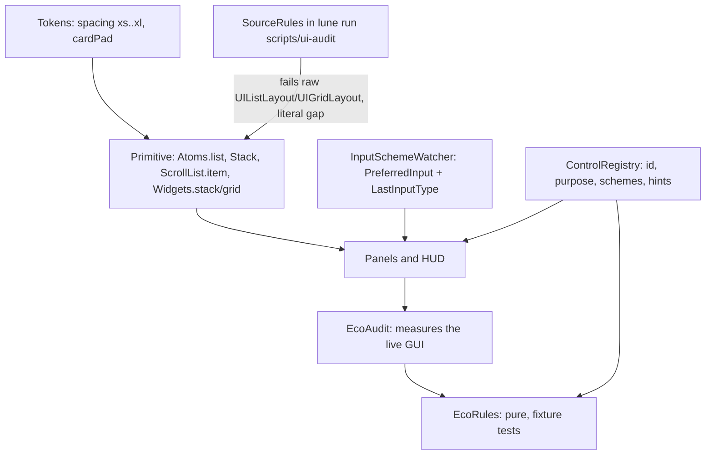

# 0045. UI spacing and platform-aware controls are born from the ecosystem

Status: accepted (2026-11-08). Extends 0035 (UI system) and 0039 (automated UI audit).

## Context

A game audited screen by screen kept shipping the same basic errors: list items glued together
with 0 padding, text flush to a card edge, a Run button on a PC where Shift exists, a label cut
mid-sentence. Each iteration fixed the screen and the error came back on the next one.

Root cause, measured in plus-one-mining (the game from this template):

1. The static audit (`scripts/ui-audit`) reads only the `assets/ui/**/*.rbxm` kit pieces. Every
   list built in code (24 `UIListLayout`/`UIGridLayout` in `src/`: HUD counters, the offer column,
   the two SurfaceGui boards, panels) was invisible to it.
2. The runtime audit runs by hand before a PR, only over menus and the HUD, with a literal 4 px
   floor. The world boards (SurfaceGui) were never a scenario, and 4 px passes a gap that still
   looks glued on a phone. Nothing measured the padding between a card and its own text.
3. Nothing knew which control belongs on which platform: the HUD built every button for every
   player, and no rule asked for a button's purpose.
4. `TextFits=false` was not a rule, so a label cut with `TextTruncate` passed.

## Options

| Option | Spacing and padding | Platform controls | Cost | Verdict |
|---|---|---|---|---|
| A. More review checklist items | by eye | by eye | zero code, but it is what failed | rejected |
| B. Runtime audit only, extended | measures the result | measures the result | needs a Studio playtest on every PR; the template has none | insufficient alone |
| C. Primitive that cannot be built wrong + source rule + pure rules over measurements + runtime collector | gap and padding are token keys; a raw layout fails the gate | a registry of controls with schemes; the audit fails an unregistered or misplaced one | one primitive, five rules, one registry | chosen |
| D. Roact/Fusion/React-lua component framework | by construction | by construction | a dependency and a rewrite of every presenter | rejected: ADR 0035 already chose imperative builders |

## Decision

Option C.

- **Spacing tokens** (derived from the product, `Tokens.default`): a 4 px grid tuned for a 390 px
  tall landscape phone. `xs 4` text lines inside one card; `sm 8` the minimum gap between sibling
  items and the card padding; `md 12` panel padding; `lg 16`, `xl 24` sections. 8 px is the
  smallest gap that still reads as two objects on a 5-inch phone at UIScale 1; 4 px does not.
- **One primitive**: `Atoms.list`/`Stack`/`ScrollList` (system path) and `Widgets.stack`/`grid`
  (theme path, asserts a gap above 0) are the only files allowed to create a layout.
  `ScrollList.item` makes a row with the card padding token.
- **Source rule** (`SourceRules`, in `scripts/ui-audit`): `UI-RAW-LAYOUT`, `UI-LITERAL-GAP`.
- **Measurement rules** (`EcoRules`): `UI-LIST-GAP` (siblings closer than the token),
  `UI-LIST-OVERLAP`, `UI-CARD-INSET` (text closer to the card edge than the padding token),
  `UI-TEXT-LOST` (label cut, unless the attribute `Truncatable` marks it on purpose),
  `UI-HUD-UNREGISTERED`, `UI-CONTROL-PLATFORM`.
- **Platform-aware controls**: `ControlRegistry` holds, per HUD button, its purpose and the
  schemes (`touch`, `keyboard`, `gamepad`) that show the button; the others get a key hint built
  from the configured keys ("Shift", "L3"). `InputSchemeWatcher` reads
  `UserInputService.PreferredInput` (Roblox, May 2025: `Touch`, `KeyboardAndMouse`, `Gamepad`) and
  listens to its change signal live; `LastInputTypeChanged` covers engines without the property and
  the documented case where a plugged gamepad does not flip `PreferredInput` until a button press.
  `TouchEnabled` is not used to pick a layout: a touch laptop would never see its keyboard hint.

## Consequences

Positive: a list without a gap cannot be written through the primitive and cannot be committed
through the gate; the same pure rules run in unit tests and in the playtest; a new HUD button
needs a stated purpose and platforms, or the audit fails.

Negative and what is lost: the runtime half still needs a Studio playtest (unverified in the
template, which has none); `SourceRules` is a text scan, so an instance created through a variable
class name escapes it; the allow list (`Atoms`, `ScrollList`, `Widgets`) is a debt marker for the
theme path, to be removed when `Widgets` is folded into the system path; the hint text on
keyboard is one label per control, not a full controls overlay.

What would change this: if Roblox ships a native control-hint API, the registry becomes a thin
adapter over it; if `Widgets` is retired, its entry leaves the allow list.
