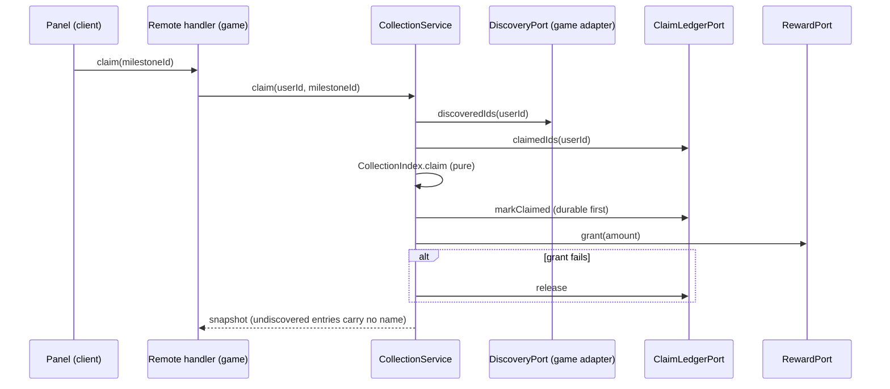

# 0046. CollectionIndex mold: discovery through a port, silhouettes, bar to a finite reward

Status: accepted (2026-11-09). Refs #128. Evidence: vault note `research/2026-11-08-atraccion-3d-por-frentes` and bar criterion W15.

## Context

The top 2026 collection games (Steal An Egg's Pet Index, "Unlocked 85/126" with a claim; My Anime Mine) make the index a reason to come back: undiscovered entries are black silhouettes, a bar leads to a reward, the player claims it. Plus One Mining shipped an Index with "???" names and a flat swatch, no bar, no tabs. The mold must be reusable by any game and must not let a client unlock an entry.

Questions of #128: does the bonus apply automatically or is it claimed; what happens when the catalog grows; silhouette from the mesh or a stored image.

## Options

| Option | Discovery | Silhouette | Reward | Lost |
|---|---|---|---|---|
| A. Client panel only, game reads its own data | decided by the client | per game | per game | a forged client unlocks; every game rebuilds the math |
| B. Pure model + server service with ports + thin panel | server, from persisted data via `DiscoveryPort` | icon image tinted black (slot replaceable) | milestones in config, `claim` or `auto` | one more layer; the game writes three small adapters |
| C. Store discovery in the mold (its own table in the profile) | mold-owned list | same | same | duplicates facts the game already persists (ore counts); a second source of truth and a schema change per game |

## Decision

Option B.

- Discovery is re-derived from persisted data on every call; the client never sends "I found X".
- The snapshot omits the name of an undiscovered entry, so the client cannot leak it. The silhouette is the entry's own icon image tinted black (the real shape). Games with models plug an ItemIcon or ViewportFrame through `renderIcon`.
- Rewards are milestones (`atFound`, `amount`) in config; `claimMode = "claim"` needs a claim step (ledger plus reward port, ledger written before the grant, as in ADR 0016); `"auto"` applies reached milestones with no remote, for games whose bonus is already derived from discovery.
- A catalog that grows keeps claimed milestones claimed; new entries only lower the fraction, and `validate` rejects a milestone above the catalog size. Ids a save keeps but the catalog dropped are not counted.
- Tabs appear only above `tabsAboveEntries` (20) and with more than one tab.

## Consequences

Positive: one tested rule set (100 % line coverage on the model and service); no forged unlock; a short game adapts three ports and a config. Negative: the claim path needs a remote and a ledger field in the game profile when `claim` is used; the silhouette depends on icons with transparency; the panel is unverified in the engine until a person checks it in Studio.

What would change this: a game that needs per-entry rewards (not milestones) or a rotating catalog would need a new ADR superseding this one.
