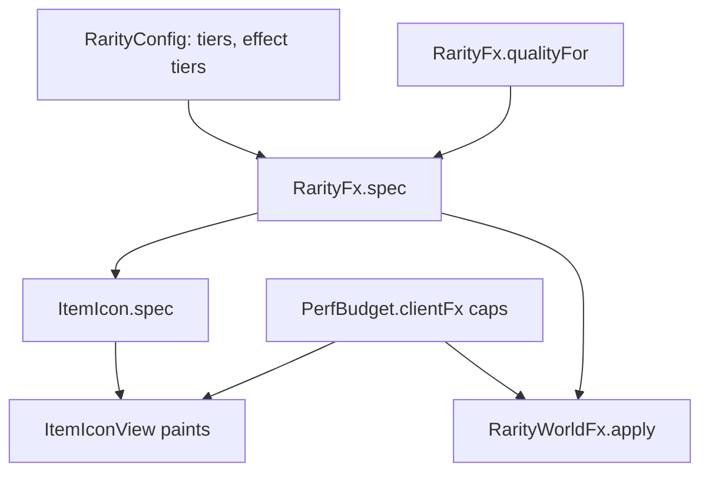

# 0048. ItemIcon and RarityFx: an image per item and one rarity language

Status: accepted (2026-11-09); the painting half (`ItemIconView`) is superseded by [0071](0071-ui-belongs-to-the-art-owner.md), the pure `ItemIcon` spec and the rarity language stay in force. Refs #124, #127. Bar: vault W12, W13 (`docs/bars/world-3d.md`).

## Context

Five sampled gameplays of 2026 (My Anime Mine, Cut a Rock, Steal An Egg, Drill to Earth's Core)
show every item in a grid with its own image, a rarity frame, a text label and, for high tiers,
an effect. A game from this template painted flat color squares. Evidence:
`research/2026-11-08-atraccion-3d-por-frentes` in the vault.

Two questions: how does a card get its image, and where does rarity live so a card and a rock
agree.

## Options

| Option | Phone cost | New skin without re-upload | Complexity | Verdict |
|---|---|---|---|---|
| A. Pre-rendered PNG portrait as `ImageLabel` | One texture per card | No: needs an upload | Low | Chosen |
| B. `ViewportFrame` + `WorldModel` per card | Heavy with many cards (docs advise creating on show only) | Yes | High | Rejected for lists |
| C. One shared viewport rendering on demand into an `ImageLabel` | One live model | Yes | High, async | Kept for a later inspect view |

Rarity source: (1) a config module read by icons and world (chosen); (2) a field per catalog item
(duplicates colors, drifts).

## Decision

- Icons use option A. No image id falls back to the swatch; locked items show the same image as a
  black silhouette. Spec is pure (`ItemIcon`), painting is `ItemIconView`.
- Rarity lives in `RarityConfig` (tier order, colors, the tier each effect starts at). `RarityFx`
  turns it into a spec used by cards and world parts. Glow from Uncommon, shimmer from Rare,
  particles only from Epic.
- Quality switch: `RarityFx.qualityFor` (setting wins; manual graphics level 1-4 is low; touch on
  automatic is low). Low keeps color, label and glow; drops shimmer and particles.
- Per-frame work is capped in `PerfBudget.clientFx`: one shared Heartbeat for all shimmers (max 8),
  at most 4 world emitters.

## Consequences

Positive: one rarity language; testable under Lune; phones pay one texture per card.
Negative: a new skin needs an image upload; touch defaults to low until a phone run says otherwise;
cap numbers are chosen, not measured; no rotation or zoom (a later mold).
Would change this: a measured phone budget that allows live viewports, or a catalog that adds items at runtime.
