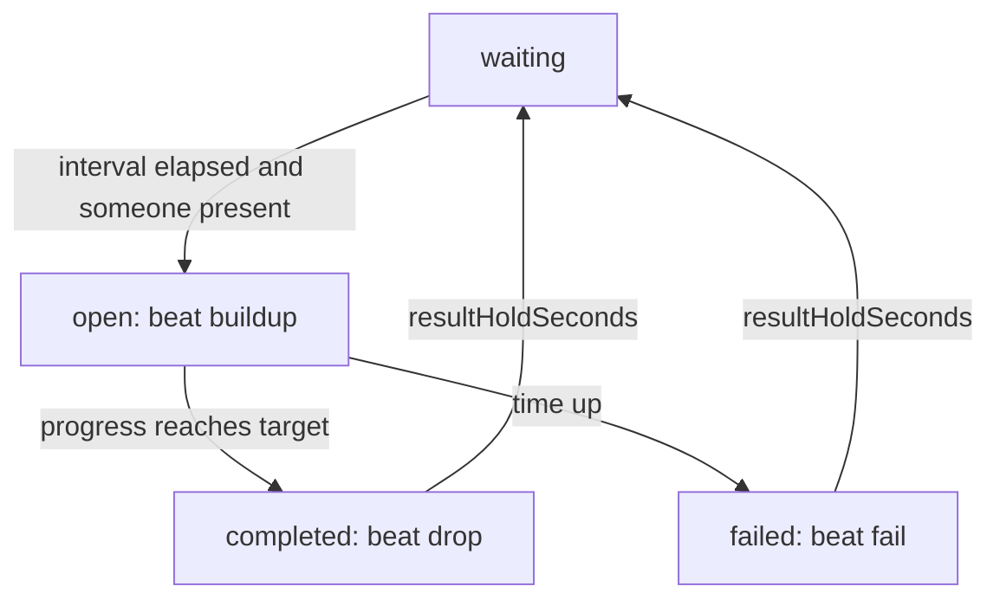
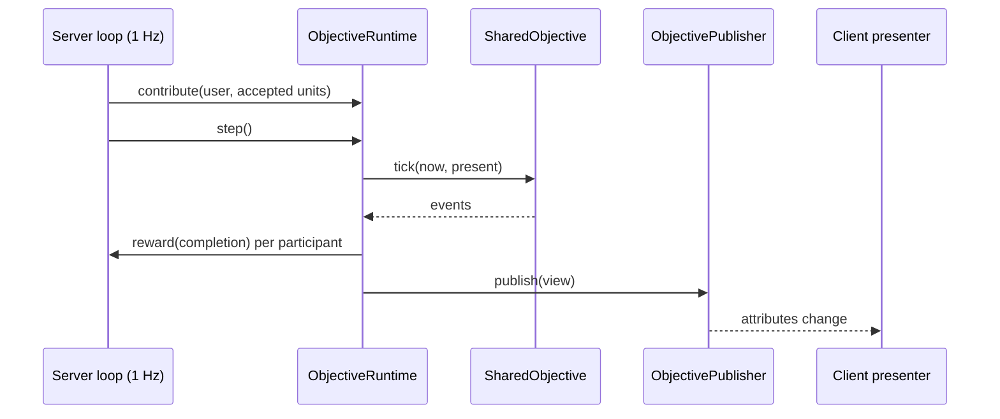

# 0049. Shared objective mold: a server-authoritative goal the whole server pushes

- Status: accepted
- Date: 2026-11-09
- Deciders: Victor Ruiz
- Refs: TPL-2 (post-mortem of game 1, stage 13), game 1 ADRs 0041, 0048, 0054 (Shared Vein and Mega Break), template ADRs 0009, 0030, 0042

## Context

Game 1 shipped a co-op event: every few minutes a shared target opens, everybody in the server pushes it, a shared bar fills, and the room gets a drop or a fail. It was written as `SharedVein` with swings, dynamite and boost minutes inside the state machine, and wired to Workspace attributes by a game-only file. Game 2 (incremental, co-op) needs the same loop with other units and other rewards, so it starts from a mold, not from a copy of mining code.

The template had nothing of this kind: `social/` holds friend boost and invites (per-pair, not per-room), and `clipmoment/` only times the hype of a moment that something else decides.

## Options

| Option | Notes |
|---|---|
| A. Copy `SharedVein` into each game and rename | Zero design work, but swings, dynamite and boost minutes leak into the rule, and every fix is done N times |
| B. Pure state machine with units and ranked completions, a runtime that drives it, and a publisher port (chosen) | Rewards stay in the game; the clock, players and transport are injected; Lune tests the whole life |
| C. Replicate every contribution to clients with a remote and let the client draw the bar | Smooth bar, but one remote event per unit costs bandwidth against `PerfBudget` and gives clients a write path |
| D. Reward tiers as config (boost minutes, item counts) inside the mold | Fewer lines in the game, but the mold must then know the economy of every game |

## Decision

Option B, under `features/sharedobjective`:

- `ObjectiveConfig` holds the numbers (interval, duration, first open, units per player, rate cap, minimum contribution, top count, hold time) and `problems` validates them. Defaults are neutral.
- `SharedObjective` is the state machine: `contribute`, `tick`, `view`. It emits `opened`, `completed` (ranked `Completion` list: user, rank, units, `top`) and `failed`. The target scales with the players present and never drops; an empty server stays closed; the first objective counts from the first present player; a per-player token bucket caps the rate.
- The **beat** (`idle`, `buildup`, `drop`, `fail`) is derived from the state and held `resultHoldSeconds` after the result. One string drives the build-up music, the drop sting and the result banner. `completed` counts finished objectives so a client reacts to two in a row.
- `ObjectiveRuntime` ticks the machine, pays through an injected `reward` sink, reports a missed payment through `onError`, and publishes through `ports/ObjectivePublisher`. `server/adapters/AttributeObjectivePublisher` writes attributes with an injected `set`, only when a value changes.

## Consequences

- Positive: a second game gets a shared goal by writing a config, a reward sink and a presenter; the rule is covered by Lune tests (rate cap, target never drops, tie order, hold of the beat, missed reward).
- Negative: the bar a client sees is as fresh as the publish rate (1 Hz); the presenter should interpolate. Contribution is accepted only through a server path the game already trusts, so the game must call `contribute` from that path.
- Lost: no per-tier reward table (option D) and no live per-unit stream (option C). Cross-server objectives (a global goal over many servers) are not covered: this is one server, one room.

## What would change this

A design that needs a goal across servers (then a MemoryStore-backed counter behind a port, a new ADR), a bar that must tick faster than once a second, or a second game needing a reward table shared by several games.
