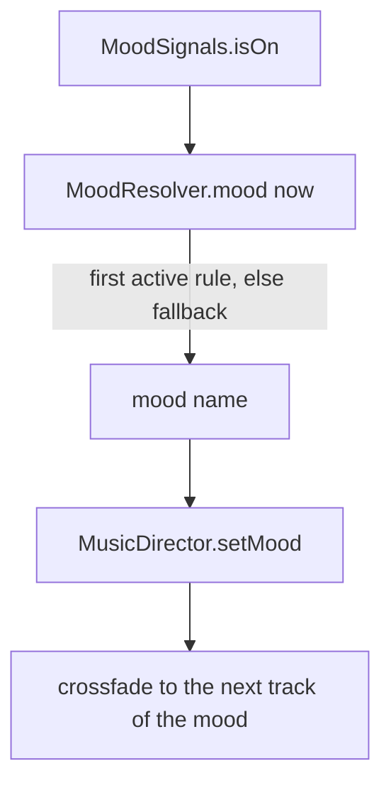

# 0050. Mood resolver: the music mood from game state through a signals port

- Status: accepted
- Date: 2026-11-09
- Deciders: Victor Ruiz
- Refs: TPL-2 (post-mortem of game 1, stage 13), game 1 ADR 0055, template ADRs 0043 (music director), 0049 (shared objective)

## Context

The template music director (ADR 0043) plays a mood when someone calls `setMood`, but nothing decides WHICH mood from what is happening. Game 1 wrote that decision as `MusicMoodResolver`: five hardcoded moods (hub, run, buildup, drop, rebirth) fed by `observeVein`, `observeRebirth` and `observeRunning`, with the timings in a mining-named module. Game 2 needs the same behaviours (a build-up while a shared goal is open, a drop after it, a run track that does not flicker) with other words.

## Options

| Option | Notes |
|---|---|
| A. Copy the game resolver and rename | Fast, but every new mood or event means new code and new `observe*` methods |
| B. A rules list in data (while, hold, sustain) over a `MoodSignals` port, one pure resolver (chosen) | New moods are config; the game only answers named on/off signals; Lune tests every transition |
| C. A generic finite-state machine with transitions declared as a graph | Expresses everything, but priorities and timeouts become many edges and the config is hard to read and validate |
| D. Let each system call `setMood` directly | No resolver, but two systems fight over the mood and nobody owns priority |

## Decision

Option B, in `features/music`:

- `ports/MoodSignals` has one method, `isOn(name)`. The game adapter maps its state to names (`objective_open`, `objective_won`, `moving`); the mold never sees where they come from.
- `MoodResolver` takes ordered rules, highest priority first, and a fallback mood. Three kinds cover game 1: `while` (active while the signal is on), `hold` (active for N seconds after the signal turns on, or off with `onFall`) and `sustain` (needs the signal for `enterSeconds`, lingers `holdSeconds`).
- Every rule is updated on every call, so a hold sees its edge even while a higher rule is active.
- `validate(rules, knownMoods)` fails on an unknown mood or fallback, an empty signal, an unknown kind, a negative time and a hold without a duration, so a rule cannot point at a mood with no playlist.

## Consequences

- Positive: game 2 states its moods in a list; the shared objective beat becomes two signals and three rules; behaviour is covered by tests of each kind and of priorities.
- Negative: signals are booleans; a level (a health percentage) needs the adapter to threshold it. Only one mood plays at a time; layered stems are out of scope.
- Lost: arbitrary transitions between specific moods (option C) and a mood decided by a number rather than a flag.

## What would change this

A design that needs layered or stem-based music (then the resolver returns a set of layers, a new ADR), or analog signals that cannot be thresholded in the adapter.
