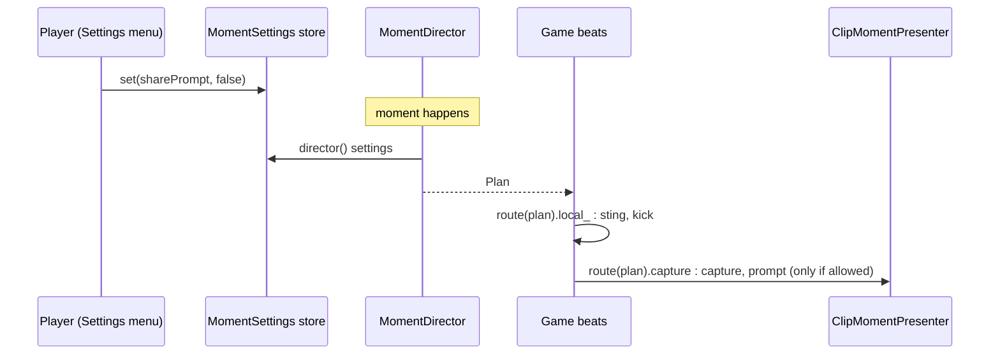

# 0051. Moment settings: opt-outs for effects, capture and share, and capture routing

- Status: accepted
- Date: 2026-11-09
- Deciders: Victor Ruiz
- Refs: TPL-2 (post-mortem of game 1, stage 13), game 1 ADR 0056, template ADR 0042 (clip moment over CaptureService), 0049 (shared objective)

## Context

ADR 0042 already ships the timed plan (`MomentDirector`) and the client presenter that captures and opens the native share sheet. It takes a `Settings` pair (`effects`, `sharePrompt`) but leaves open where those come from. Game 1 closed the loop (ADR 0056) with three Settings toggles, the rule that a prompt needs a capture, and a split of the plan: the game keeps its sting and camera kick, and only the `capture` and `share_prompt` steps go to the presenter. That wiring lived in a game file (`MegaBreakMoment.settings`, plus a presenter that filtered steps). Game 2 would copy it.

The share prompt is the native sheet, always skippable, and Roblox policy forbids forcing or rewarding sharing with game value, so the settings must not grant anything.

## Options

| Option | Notes |
|---|---|
| A. Leave it to each game | No code in the template, but each game re-derives "prompt needs capture", the defaults and the routing; the opt-out is easy to forget |
| B. A pure settings store with three toggles, a resolver to director settings, menu rows and a plan router (chosen) | One tested rule; persistence injected; the game only draws the rows and calls `route` |
| C. Make the director own the three toggles | Fewer pieces, but the director then depends on persistence and on a menu, and its tests grow |
| D. Reward the share to raise participation | Forbidden by policy; excluded |

## Decision

Option B, extending `features/clipmoment` (nothing is duplicated; ADR 0042 stays as is):

- `MomentSettings.rows()` gives the three rows a Settings menu draws (`effects`, `autoCapture`, `sharePrompt`), all on by default, with neutral wording.
- `MomentSettings.resolve` turns the toggles into the director settings; **a prompt needs a capture**, so it is dropped when either `sharePrompt` or `autoCapture` is off. The sting always stays (ADR 0042).
- `MomentSettings.new({ load, save, onError })` is the store. Both `load` and `save` are optional (session-only by default). Saved values are foreign data: only a real boolean replaces a default. A failed save and an unknown key go to `onError`, never silently.
- `MomentSettings.route(plan)` splits a plan into steps the game runs (sting, camera, slow motion) and steps for the capture presenter (capture, share prompt).

## Consequences

- Positive: the opt-out contract is one tested function; a game cannot ship a prompt that ignores the toggles by accident; persistence can be added without touching the director.
- Negative: the real capture and share sheet still need a hand check on a device (unchanged from ADR 0042); the default store is session-only, so a game that wants saved toggles must pass `load` and `save`.
- Lost: no per-moment opt-out (all moments share three toggles) and no video capture.

## What would change this

A documented server entry point for capture, an Upload API (the plan could end in an upload), or a policy change on rewarding shares.
