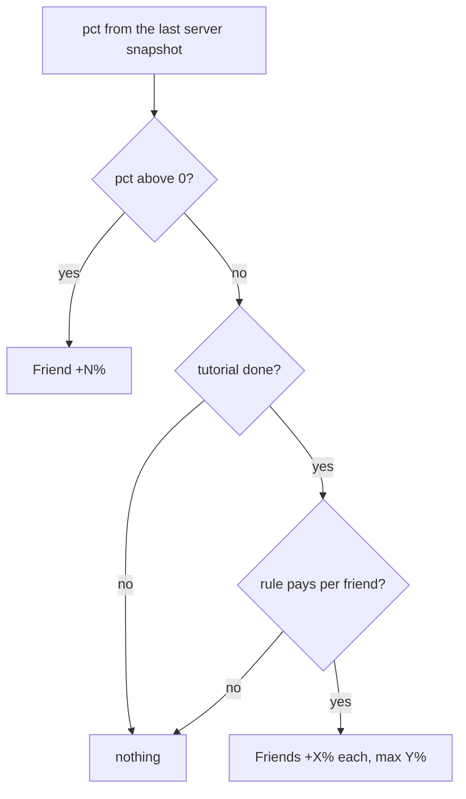

# 0052. Visible co-play hint: make the existing bonus visible, never pay it from the text

- Status: accepted
- Date: 2026-11-09
- Deciders: Victor Ruiz
- Refs: TPL-2 (post-mortem of game 1, stage 13), game 1 ADR 0057, template ADRs 0030 and 0031 (friend boost), 0049 (shared objective)

## Context

Playing with others is already paid: the friend boost gives a percent per friend present up to a cap (ADR 0030), and a shared objective grows its target with the players present (ADR 0049). What game 1 found is that a lone player cannot see it: the HUD showed "Friend +N%" only after a friend joined, so nothing explained why to invite, and the shared-goal tag did not say who was playing. The template shipped only `FriendBoostLabel.text`.

## Options

| Option | Notes |
|---|---|
| A. Raise the reward with players present | Changes value and the economy; needs server changes and schema updates; invisible until it pays |
| B. Make the existing bonus visible with pure text derived from the social config (chosen) | Client text only, no remote, no schema change, the numbers cannot drift from the rule |
| C. A new remote that publishes a bonus number | A new surface for a number the client can already derive |
| D. A tutorial popup that explains friends | Seen once, then forgotten; steals focus in the first minute |

## Decision

Option B, extending `social/FriendBoostLabel` (nothing is duplicated):

- `hint(pct, perFriendPct, capPct)` returns "Friends +10% each (max 50%)" while no boost is active and the rule pays something; `nil` otherwise.
- `roster(playersPresent, noun)` returns "3 players" from two players on (the noun is the game's own word); `nil` for a lone player.
- `pill(pct, config, tutorialDone)` decides what the HUD pill shows: the active boost first, then the hint once the tutorial is over, else nothing. The numbers come from `SocialConfig.friendBoost`, never from the view.
- Display only. The boost is granted by the server through the path that already validates the action; this text grants nothing and adds no remote.

## Consequences

- Positive: the social reason is on screen at zero friends and at a shared objective; pure functions are tested; no schema or `PerfBudget` change.
- Negative: the bar does not fill faster with more players (the target scales per player), so the reason shown is the friend boost only; making the objective faster is a value change and was left out. The text should be drawn with the UI system (spacing tokens, platform-aware controls); this mold ships no view.
- Lost: no measured effect on invites; the hint is a hypothesis to measure with analytics.

## What would change this

Evidence that the hint does not raise invites, or a decision to pay a bonus for players present (then through the server path that grants value, with the schema and `PerfBudget` updated).
