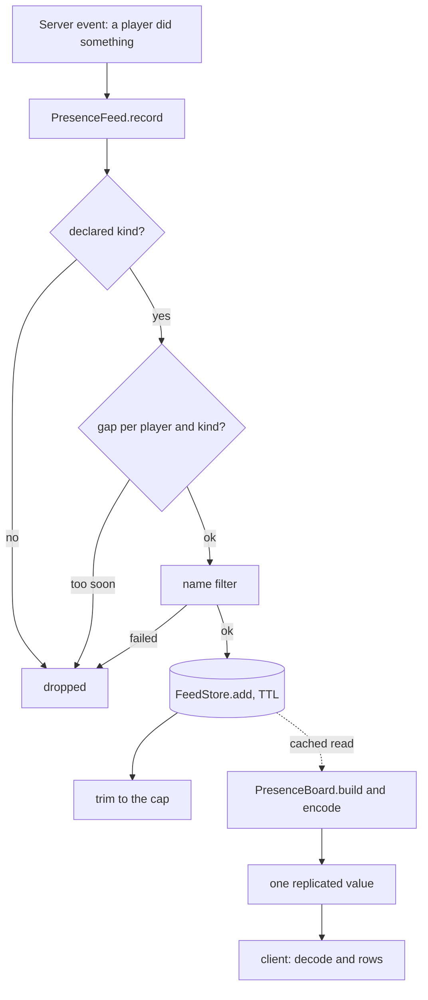

# 0053. Presence board: what other players did, from a capped feed behind a port

- Status: accepted
- Date: 2026-11-09
- Deciders: Victor Ruiz
- Refs: TPL-2 (post-mortem of game 1, stage 13), game 1 ADR 0058, template ADRs 0009 (plain modules, constructor DI), 0012 (remote validation), 0031 (invite ledger on MemoryStore)

## Context

A new game has zero concurrent players, and after launch most servers hold one. A solo player, or a clip taken solo, shows an empty world, and the co-op pieces need other people connected at the same time. Game 1 solved it with a "ghost" board: the last 24 hours of what players did in ANY server, shown on a wall. It was written against the game's own entry kinds (a depth, a break, a rebirth) with the wording inside the code. Game 2 needs the same wall with other facts.

Facts used (sources: create.roblox.com documentation for MemoryStore and TextService, as read for game 1 ADR 0058): a MemoryStore item lives at most 45 days; a sorted map keeps a sort key per item; names shown to every player must pass `TextService:FilterStringAsync(...):GetNonChatStringForBroadcastAsync()`.

## Options

| Option | Reads the last hours across servers | Notes |
|---|---|---|
| A. OrderedDataStore boards only | No: one number per user and no time | Good for an all-time wall, cannot answer "in the last 24 h" |
| B. MemoryStoreSortedMap feed behind a `FeedStore` port, with filter, TTL, cap and gap (chosen) | Yes: the sort key is the time and the TTL forgets old items | A few writes per minute at most; one cached read every 30 s per server |
| C. Invent activity with bots | n/a | Rejected: it shows something that did not happen |
| D. Publish the feed through a remote to clients | n/a | A new surface a client could abuse and a cost in `PerfBudget`; the board is replicated as one value instead |

## Decision

Option B, under `features/presence` with a port and two adapters:

- `ports/FeedStore`: `add(item, ttl)`, `recent(limit)`, `remove(key)`, typed results, server side only.
- `server/adapters/MemoryStoreFeed`: the port over a sorted map; the engine object is injected, every call runs under `pcall`, and foreign rows (non-text value, non-numeric sort key) are dropped. `server/adapters/TextServiceNameFilter` wraps the filter into a typed result.
- `PresenceConfig`: the game declares its **kinds** (`id`, `pick` = `max` or `newest`, rows, headline and detail templates with `{name}`, `{value}`, `{ago}`), plus the caps (entries, TTL, read cache, gap, name length) and the empty-state wording. `problems` validates all of it. No game word lives in the mold.
- `PresenceEntry`: a codec that trusts nothing (`kind|userId|value|at|name`, nil when malformed).
- `PresenceFeed`: `record` (declared kind, per player and kind gap, filter first, write, trim to the cap) and a cached `read` (a failed read keeps the cache and waits a full interval; expired, malformed and undeclared items are never returned). Failures go through `onError`.
- `PresenceBoard`: picks per kind in declared order, words the rows from the templates, encodes and decodes the replicated text, and gives an empty-state row.
- `InMemoryFeedStore`: the port in a table with a clock, for tests and a one-client Studio playtest; never production.

## Consequences

- Positive: game 2 declares kinds and wording as data, writes `record` calls where things happen, and gets a living wall in one-player servers; every rule (gap, cap, TTL, filter, foreign data) has a Lune test.
- Negative: the board is as fresh as the read cache (30 s by default); the engine wiring (a `StringValue` and the Studio seed) and the wall itself stay in the game because they depend on its rig and art; the real MemoryStore behaviour was not run from the template (adapter tested with fakes).
- Lost: no per-player history (only the last hours), no ranking beyond one best entry per `max` kind, and no cross-experience feed.

## What would change this

Memory budget or read limits changing in the MemoryStore documentation, a need for per-player history (then a DataStore-backed log behind another port), or a design that needs the feed to push to clients instead of a cached read.
