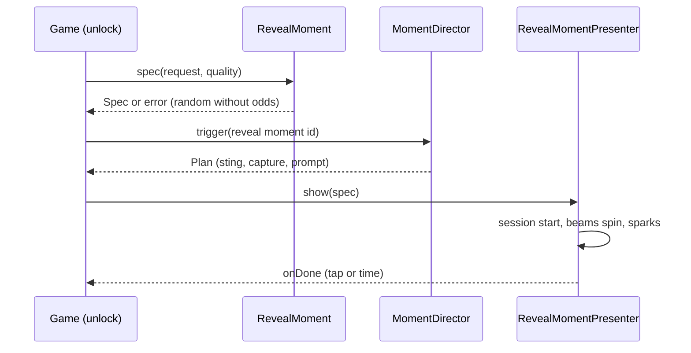

# 0054. Reveal moment: a short skippable unlock beat on top of the clip moment director

- Status: accepted
- Date: 2026-11-09
- Deciders: Victor Ruiz
- Refs: #129, ADR 0042 (clip moment), 0045 (spacing and text audit), 0048 (ItemIcon and RarityFx), vault bar W14, vault note research/2026-11-08-atraccion-3d-por-frentes

## Context

My Anime Mine reveals an Epic unit with light rays, a name banner and the rarity (youtu.be/u85SNxqBY_Y, 63,984 views, 2026-10-28); Steal An Egg announces biomes the same way. It is the beat players clip. The template has the clip moment mold (ADR 0042) and the item look (ADR 0048) but nothing that shows an unlock. Two questions from the issue: reuse the director beats or build a new timeline, and how the reveal respects the paid random item policy (odds visible).

## Options

| Option | Timing and share | New surface | Verdict |
|---|---|---|---|
| A. A new timeline inside the reveal (its own sting, capture and prompt timers) | Duplicates the prompt limits of ADR 0042 | A second place that can spam the share sheet | Rejected |
| B. A pure spec and session; the reveal declares a clip moment (`momentDef`) and the existing `MomentDirector` times the sting, capture and prompt (chosen) | One set of limits and opt-outs | One module, one presenter | Chosen |
| C. Only a toast with the item name | Nothing to clip | None | Rejected: it is the moment people clip |

## Decision

Option B. `features/reveal/RevealMoment` is pure and loads under Lune:

- `spec(config, rarity, request, quality, surface)` returns `Result<Spec, string>`. The icon comes from `ItemIcon.spec` (so `ItemIcon.thumb` ids work), the color and label from `RarityFx`, and the beams scale with the tier: none below `beamsFrom` (Rare), `baseBeams` at it, `beamsPerTier` more per tier, capped by `maxBeams` and `PerfBudget.clientFx.maxRevealBeams`. Low quality keeps `lowQualityBeamFactor` of the beams and RarityFx already drops the particles.
- A request with `random = true` and no odds in (0, 100] is refused, so a random unlock cannot be shown without its chance (paid random item policy, bar W14).
- `momentDef(id, config)` is the `MomentDef` the game registers with `MomentDirector`; the director keeps the prompt limits, the effects opt-out and the capture routing (ADR 0051).
- `session(spec)` is a clock: `start`, `tick`, `dismiss`, `blocksInput`. The reveal lasts `durationSeconds` (validated to 1.5 to 2.5), one tap ends it, and a tap in the first `tapGuardSeconds` is ignored so the tap that caused the unlock does not skip it. Input is blocked only while the state is `showing`.
- `client/presenters/RevealMomentPresenter` paints it on the overlay layer using UI tokens (spacing keys, type keys, `Atoms.label` with text fit) and `ItemIconView`. Strings come from the game.

## Consequences

- Positive: the reveal is checkable without Studio (beams per tier, odds rule, duration bounds, tap guard); no second share path; per-frame work is one `Rotation` write plus at most `particlesPerSecond` short tweens.
- Negative: the look (beam length, pop-in, sparks) was not run in Studio; sparks are UI frames, not world particles, so they sit on the overlay. The sting name is a hook the game supplies; a game with no sting gets a silent reveal.
- Lost: a 3D model viewport reveal. Kept for later (ADR 0048 option C).

## What would change this

A phone measurement that shows the beams or tweens cost frames (lower `maxRevealBeams`), or the game wanting to show a 3D model, which needs a shared viewport option.
