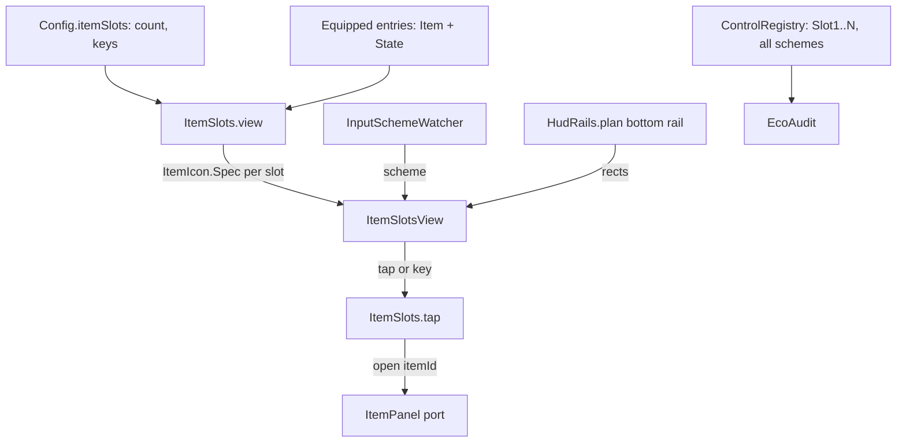

# 0055. Item slots mold: a hotbar of equipped items on the HUD bottom rail

- Status: accepted
- Date: 2026-11-09
- Deciders: Victor Ruiz
- Refs: #126, ADR 0035 (UI system), 0045 (spacing and platform-aware controls), 0048 (ItemIcon and RarityFx), vault bar W17 and W18, vault note research/2026-11-08-atraccion-3d-por-frentes

## Context

Cut a Rock and My Anime Mine show the equipped tool as an icon in a bottom slot (youtu.be/u85SNxqBY_Y, 63,984 views, 2026-10-28). A Roblox backpack tool has no icon on screen, so a player cannot see or value what they hold. The issue asks two things: replace the default backpack or sit beside it, and how the hint switches with the last input type.

## Options

| Option | Backpack | Layout | Hint per device | Cost | Verdict |
|---|---|---|---|---|---|
| A. Replace the CoreGui backpack (`SetCoreGuiEnabled(Backpack, false)`) and own the equip logic | gone | free | own | the game must reimplement equip, drop, ordering, gamepad | rejected: touches Roblox tool behaviour for a display feature |
| B. Slots beside the backpack, display plus tap plus key | stays, game decides | HUD bottom rail via `HudRails` | `InputSchemeWatcher` | one pure model, one thin view | chosen |
| C. Billboard or world slots | stays | n/a | n/a | not a HUD, fails the touch target | rejected |

## Decision

Option B. `ItemSlots` is a pure model (`features/itemslots/ItemSlots`) and a thin view (`client/presenters/ui/ItemSlotsView`).

- Slot count and keys live in `Config.itemSlots` (1 to 9), validated at boot.
- Each slot is an `ItemIcon.Spec`, so the image (`ItemIcon.thumb` ids work), the rarity frame (ADR 0048) and the level or count badge come from the existing molds.
- Tap or the bound key calls the `ItemPanel` port with the item id; the mold never knows what the panel is. An empty slot does nothing.
- Placement is the bottom rail of `HudRails.plan` (ADR 0045): token gap between slots (8 px), touch floor, centred between the side rails, and clear of the thumbstick and jump zones.
- Hints: keyboard number key ("1"), gamepad glyph ("L1"), touch none (the slot is the target). The view subscribes to `InputSchemeWatcher`, so the hint changes on `PreferredInput` or `LastInputTypeChanged`, the same frame the watcher fires.
- Each slot is registered in `ControlRegistry` for all three schemes: a slot shows what is held, so it is never swapped for a hint; the hint is drawn inside it.

## Consequences

Positive: the player sees and values what they hold; the same tokens, registry and audit rules apply as for any HUD control; a game adopts it with config plus one port.

Negative and what is lost: the Roblox backpack is not replaced, so a game that keeps it shows two bars unless it hides the CoreGui backpack itself; hints are one label per slot; the view is engine code, UNVERIFIED until a person checks it in Studio (Device Emulator at 1920x1080, 844x390, 667x375, 568x320).

What would change this: a native Roblox API for custom hotbars, or a game that needs drag to reorder (a new mold on top of this one).
