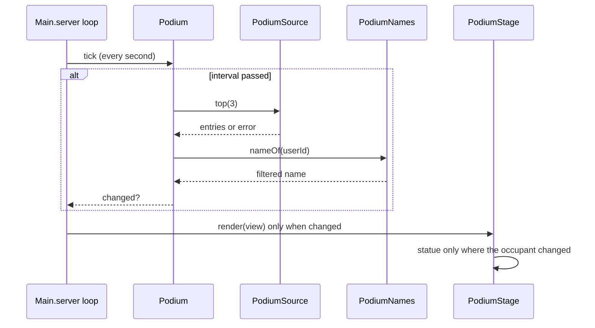

# 0055. Podium3D: the top three of a board as avatar statues on a 3-step podium

- Status: accepted
- Date: 2026-11-09
- Deciders: Victor Ruiz
- Refs: #50, ADR 0022 (leaderboards), 0026, 0048 (rarity language), 0053 (name filter), vault bar W19, vault note research/2026-11-08-atraccion-3d-por-frentes

## Context

Boards in the template are text (leaderstats, replicated strings). Victor's call: a leaderboard should also be a 3D thing in the lobby. The only evidence is one source (the rblx-essentials Leaderboards page, SINGLE SOURCE); no sampled gameplay showed a podium. No maintained open-source podium exists (issue #50 searched GitHub 2026-11-06).

## Options

| Option | Cost | Risk | Verdict |
|---|---|---|---|
| A. Client-built podium per player (each client loads avatars and draws plates) | N avatar web calls per server, per-client scripts | Divergent views, client code to maintain | Rejected |
| B. Server-built world instances, replicated by the engine; pure model and config in `features/podium` (chosen) | 3 avatar loads per refresh, ~90 parts, zero remotes | Look not run in Studio from this PR | Chosen |
| C. Static art with a text SurfaceGui only | Cheapest | Not the 3D object the bar W19 asks for | Rejected |

## Decision

Option B.

- `features/podium` is pure (Lune): `PodiumConfig` (words, unit, medal tiers, refresh, geometry), `PodiumLayout` (steps as numbers), `PodiumModel` (entries + names to three places; empty pedestals get the "Be the first" plate), `PodiumNames` (lookup + TextService filter, never a raw name), `PodiumSources` (the port over `OrderedBoardStore`, over an already cached top, and an in-memory fake), `PodiumFormat` (compact values), `Podium` (service with a refresh interval and a cache).
- `ports/PodiumSource` is the read port. A game with `Leaderboards` running uses `fromCache(leaderboards:top)` and adds no store read; `fromStore` is for a game that has no board cache.
- `server/adapters/PodiumStage` is the only engine code: steps, plates (SurfaceGui), statues via `Players:CreateHumanoidModelFromUserId`, scripts stripped, anchored, name tags off. With an idle animation id only the root is anchored and an Animator loops it; without one everything is anchored. An avatar that fails to load leaves its plate (degrades to text).
- Medal colors come from `RarityFx.spec` through `placeTierIds` (legendary, epic, rare by default), so the plate matches the cards.
- Failure policy: a failed read never throws. With a good view cached it is kept; with none, three empty pedestals. The next read waits a full interval.
- `PerfBudget.podium` holds `maxParts` (96), `minRefreshSeconds` (60) and `maxAnimatedStatues`; `lune run scripts/perf-budget` validates `Config.default.podium` against it.

## Consequences

- Positive: rules testable without Studio (96 % total coverage, podium files 86 to 100 %); no remote and no client script; per-frame client work is only the optional idle animation.
- Negative: the look (scale, plate legibility, animation on anchored root) was not run in Studio by this PR; the engine adapter is outside the coverage gate. Statues use the avatar as loaded (about 15 parts plus accessories), so the part cap is a report, not a guarantee.
- Lost: world particles on the podium (kept at zero to avoid client work); a client-side viewport variant.

## What would change this

A Studio or phone measurement showing the statues cost frames (cap `maxAnimatedStatues`, drop the animation), or a rule that avatar clones must be rebuilt less often than the refresh.
