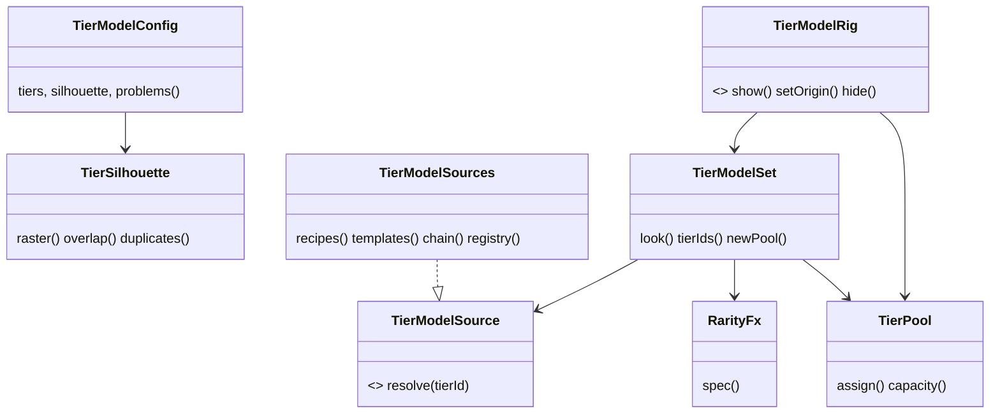

# 0057. TierModelSet: one distinct model, material and color set per tier

- Status: accepted
- Date: 2026-11-09
- Deciders: Victor Ruiz
- Refs: #130, ADR 0019 (performance budget), 0048 (rarity language), 0056 (podium, same shape of mold), vault bar W16, vault note research/2026-11-08-atraccion-3d-por-frentes

## Context

Cut a Rock (26.5k CCU) gives each rock tier its own silhouette (boulder, crystal, cluster) and a floating rarity tag; Drill to Earth's Core changes material and light per room. A game that only changes the tint of one model does not read as "a new tier" in a clip. Bar W16: every level, biome or node rarity has a distinct silhouette in a black and white threshold capture. Free assets may only come from sources the vault lists (Kenney, Quaternius, Poly Haven, all CC0); no ripped models.

## Options

| Option | Cost | Risk | Verdict |
|---|---|---|---|
| A. Part recipes only (procedural, built from `Part`s in data) | Zero licensing, owned, a handful of instances per node, easy to validate in pure Lune | Looks blocky next to sculpted meshes; art quality capped by what primitives can say | Chosen as the floor and the fallback |
| B. CC0 meshes only (Kenney, Quaternius) imported per tier | Better silhouettes with little work per model | Upload and moderation per mesh, triangle cost unknown to the pure core, a missing kit leaves a node empty | Rejected as the only path |
| C. Per-tier choice behind a port: a template if the kit has it, the recipe otherwise (chosen) | One extra port and a chain | The silhouette of a template is checked through a proxy, not the mesh | Chosen |

## Decision

Option C, with A as the guaranteed fallback.

- `ports/TierModelSource` is the port. `features/tiermodels/TierModelSources` ships `recipes` (procedural), `templates` (kit Package or ReplicatedStorage model by name, through an injected `find`) and `chain` (first success wins). A game chains `templates("kit")`, `templates("replicated")`, `recipes`.
- `TierModelConfig` is the data: per tier a `tierId`, material, three colors (primary, accent, glow), an optional `rarityId` and a `recipe`. `problems()` validates it and rejects two tiers with the same silhouette, as `PickaxeLadder` does for pickaxes.
- `TierSilhouette` is the black and white capture as a pure function: both a front and a side mask on a fixed frame in studs; two tiers clash only when they overlap more than `maxOverlap` in BOTH views. Cells are filled from the parts themselves (`TierSurface.contains`, exact at any rotation, sampled at half a cell), so a fan of thin leaning spikes keeps its gaps; a feature thinner than half a cell can be missed (amended by #157, which first used bounding boxes).
- `TierModelSet.look(tierId, quality, surfaceHex)` returns the model parts with colors resolved, the material, the budget cost and a `RarityFx.FxSpec` when the tier names a rarity, so a Rare rock glows like a Rare card.
- `TierPool` plus `client/presenters/world/TierModelRig` do the pooling: the rig builds parts once, per shape, sized from the largest recipe; a swap re-poses and recolors pooled parts and unparents leftovers. Templates are cloned once on first use. A test proves `created` does not move across 30 swaps.
- `PerfBudget.tierModels` holds `maxPartsPerNode` (24), `maxTrianglesPerNode` (600) and `maxVisibleNodes` (6); `lune run scripts/perf-budget` validates `Config.default.tierModels` against it and prints the cost per tier.

## Consequences

- Positive: each tier is a data row; duplicates fail the gate; a missing kit never empties a node; the cost per node is a number in the budget; the pure core is testable under Lune.
- Negative: the silhouette of a template is only a proxy (the recipe's), so a mesh model still needs a threshold capture in Studio; triangle counts per shape are "chosen, not measured"; `WedgePart` orientation and the rig are UNVERIFIED until a person runs the Studio checklist in `features/tiermodels/README.md`.
- Would change this: measured triangle cost on the poorest phone, or a kit mesh set that makes recipes redundant (then `templates` becomes the default and `recipes` stays only as a fallback).
