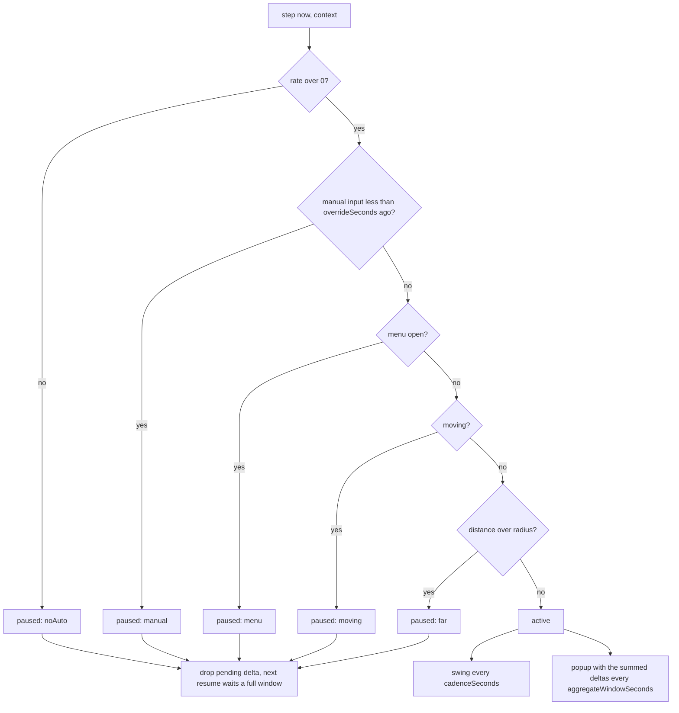

# 0058. AutoFeel: one hit-feel pipeline, two voices, and a pure scheduler for automatic mining

- Status: accepted
- Date: 2026-11-09
- Deciders: Victor Ruiz
- Refs: #159, ADR 0019 (performance budget), 0034 (hitfx), plus-one-mining ADR 0046 (hit feel); vault bar for animation and gameplay feel

## Context

An automatic miner (Auto Drill, Auto Tap) is paid by the server from time, in swings per second. The client never predicts it, so its only visuals were a spinning rig drill and a HUD light: the character stood still, the rock did not move and no number rose. A player who unlocks the drill, the thing they paid for, looks idle. A manual tap has the full feel (hit-stop, FOV kick, chips, popup, sound). The two paths must stack, because the drill is paid from time while manual swings go through a token bucket.

Referents checked on 2026-11-09 (frames and captions of public gameplays, 2 of the planned 3 to 5, low sample): Pickaxe Simulator (explicit "Auto Mine" toggle button on the HUD, the avatar walks to the ore by itself and keeps swinging, no hit-stop visible); a +1-style clicker (a per-second "+N" readout beside the click icon, not one popup per click). Limits: no Mining Simulator 2 footage with auto-mine visible (only how-to videos), frames are 1.5 fps so a freeze of 40 ms cannot be judged. Nothing found contradicts the design; two things were added (see Consequences).

## Options

| Option | What it is | Cost | Verdict |
|---|---|---|---|
| A. Replay every paid swing with the manual feel | A client prediction of the drill | Up to 12 swings per second of hit-stop and popups: unreadable, and it predicts what the server owns | Rejected |
| B. Fixed visual cadence plus aggregated server deltas (chosen) | The swing plays at a steady cadence, the popup shows the real delta of the last window | A visible swing is not tied to a paid swing; the number is true, the rhythm is staged | Chosen |
| C. Only a HUD counter and a better rig drill | Nothing on the character | Cheapest, but the character still looks idle, the complaint that started this | Rejected |

## Decision

Option B. `src/shared/features/autofeel/`:

- `AutoFeel`: `AutoFeelConfig` (every number), `profile(config, role)` for `manual`, `auto` and `observer`, `validate`, and the budget helpers. The auto profile keeps the grammar (swing, rock dip, chips, popup, sound) in a quieter voice: lighter swing weight, small rock reaction, an aggregated popup in its own color with a small mark, quieter pitch-shifted rate-limited sound, no hit-stop and no FOV kick. The observer profile is the LOD rule for other players: the swing only.
- `AutoFeelScheduler`: pure state machine. `noteManual(now)`, `noteDelta(amount)` (read from server snapshots, never guessed) and `step(now, context)` returning `{ active, paused, swing, popup }`.

Rules, each with a Lune test:

1. Cadence is `cadenceSeconds` (0.5 to 0.8 s validated), whatever the paid rate (1, 3 or 12 per second give the same swings).
2. One popup per `aggregateWindowSeconds` (0.8 to 2 s), the sum of the deltas inside it; nothing is shown when no delta arrived.
3. A manual swing overrides at once and the auto visuals return after `overrideSeconds`; the first auto swing after a manual one waits a full cadence.
4. Pause while the player moves, a menu is open or the rock is farther than `radiusStuds` (inclusive). Order of reasons: no drill, manual, menu, moving, far.
5. While paused or overridden the pending delta is dropped, and deltas that arrive while paused are ignored: the HUD counter still shows the truth, the popup never shows a pile after a walk.
6. Observers swing and nothing else: no popup, no sound, no rock work, no camera effect.

`PerfBudget.autoFeel` (maxPopupsPerSecond 1.25, instancesPerSwing 1, playersInView 12, maxInstancesPerSecond 30) and `scripts/perf-budget` print popups per second and instances per second for a full lobby and fail over the budget.

## Consequences

Positive: an auto miner reads as working and the lobby looks alive; the number in the popup is a real server delta; the engine side stays thin (the game applies a profile) and the rules are tested under Lune; no new remote.

Negative: the visible swing is staged, not tied to a paid swing; the swing weight of the default Animate `toolanim` cannot be set by the value, so a game that wants a lighter weight adjusts the new track locally (observers still see full weight); `toolanim` creates one StringValue per swing that replicates (about 18 per second for 12 auto miners at the default cadence, inside the budget).

From the research: (1) Pickaxe Simulator exposes an explicit Auto toggle, so a game may want one beside the status light; this mold does not add it (a game decision, issue to follow). (2) A per-second readout reads better than per-hit numbers for an automatic source, which supports the aggregated popup.

What would change this: if the paid rate gets low (one swing every few seconds), a staged cadence over-states the work and the cadence should follow the rate below a floor; if a game moves its rock around, `distance` needs a target that moves.
