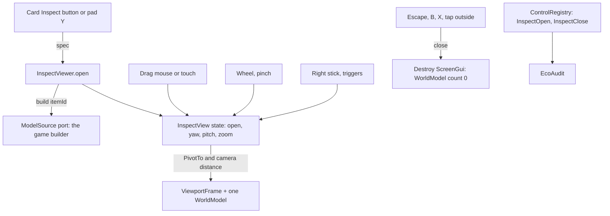

# 0060. InspectView mold: rotate and zoom one item in a ViewportFrame

- Status: accepted
- Date: 2026-11-09
- Deciders: Victor Ruiz
- Refs: #125, ADR 0045 (spacing and platform-aware controls), 0048 (ItemIcon and RarityFx), 0055 (ItemSlots), vault bar W12 to W20 and note research/2026-11-08-atraccion-3d-por-frentes

## Context

Victor asked to inspect skins and pickaxes. The sampled market shows an icon and a fixed detail card; none rotates the item (a gap, not a baseline). The issue asks three things: rotate the model or orbit the camera, one live `WorldModel` at a time, and whether touch pinch is worth its conflict with scroll frames. Acceptance: the `WorldModel` count in `PlayerGui` is 0 before opening, 1 open, 0 after closing; touch, mouse and gamepad work; open under 200 ms on the poorest client.

## Options

| Question | Option | Cost | Verdict |
|---|---|---|---|
| What moves | A. Rotate the model, camera fixed | Light and framing stay constant; one `PivotTo` per input | chosen |
| | B. Orbit the camera around a fixed model | The light on the model changes with the camera; pitch clamp and zoom both move the camera | rejected |
| Lifetime | A. Create the ViewportFrame, `WorldModel` and model on open, destroy the whole ScreenGui on close | One model build per open | chosen |
| | B. Keep a hidden viewport alive | Fails "0 after closing", costs memory while idle | rejected |
| Model source | A. A `ModelSource` port the game implements over its own builder | One more port | chosen |
| | B. Load a mesh from the catalog inside the mold | Duplicates the game builder; the viewer could differ from the item in hand | rejected |
| Pinch | A. Pinch on the viewport only (`TouchPinch`), drag with one finger | The viewport sits in a modal, not in a `ScrollingFrame`, so no scroll conflict | chosen |
| | B. No pinch, buttons for zoom | Two more touch targets on a 568x320 screen | rejected |

## Decision

A pure `InspectView` state module plus a thin `InspectViewer` presenter and a `ModelSource` port.

- Every input is a function `State -> State` in `InspectView`; yaw wraps, pitch and zoom clamp, sticks and triggers have deadzones, all from `Config.inspect`, validated at boot.
- The WorldModel count is a function of the state (`worldModelCount`: 1 open, 0 closed) and `PerfBudget.inspect.maxWorldModels` caps it; `perf-budget` checks the config and the cap.
- Input: mouse drag and wheel and touch drag and pinch on the viewport, the right stick and the triggers polled on `Heartbeat`, and Escape and the pad back button through `ContextActionService` at high priority (the right stick is sunk so the camera does not move).
- Controls: the close X and the card Inspect button are shown on touch and keyboard; the pad shows the hint ("B", "Y") in their place. Both are registered in `ControlRegistry`.
- Layout uses the tokens (gap 8 px or more, 44 px touch floor) and a panel of 80 % by 86 % of the screen capped at 720x520.

## Consequences

Positive: any game gets a rotating viewer from one config, one port and one presenter; the viewer shows the item in hand because the game builder is the source; nothing stays alive after closing.

Negative and what is lost: each open pays one model build (a clone of a cached template when the game caches); Escape also opens the Roblox menu in some contexts, so that engine behaviour needs a Studio check; the presenter is engine code, UNVERIFIED until a person checks it in Studio (WorldModel count 0, 1, 0; 568x320, 844x390, 1327x472; each input scheme).

What would change this: a measured open time over 200 ms (cache the built model, lower `maxParts`), or a game that needs two items side by side (a second viewer would need a higher `maxWorldModels`).
