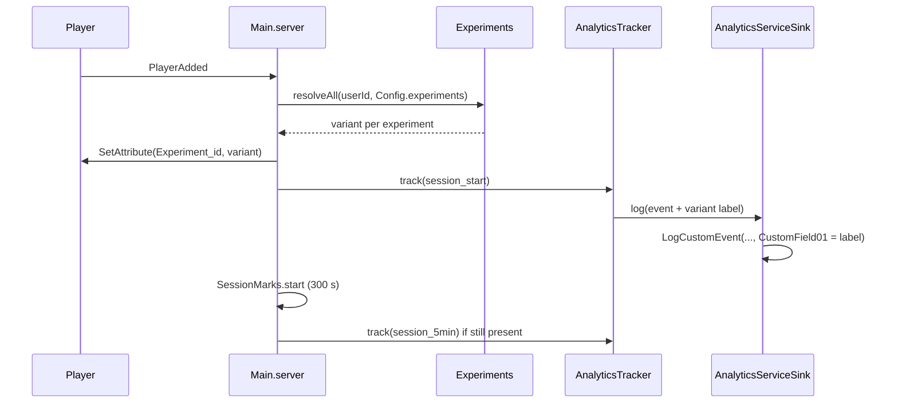

# 0064. Onboarding experiments: deterministic server-side assignment and a 5-minute mark

- Status: accepted
- Date: 2026-11-09
- Deciders: Victor Ruiz
- Refs: #173, vault decision 0038 (`decisions/0038-test-cohort-gate-before-growth.md` in vruizz22/roblox-vault, "the 250 gate"), ADR 0009 (injected engine services), ADR 0062 (property tests)

## Context

Decision 0038 says no ads until a cohort of 200 or more organic new users has D1 of 10 % or more, and that 3 or 4 onboarding variants per week are tested against the current one as control. That needs three things the funnel lacked: a per-player variant that is stable across sessions and servers, the variant id on every funnel event, and a 5-minute mark event so 5-minute retention can be split by variant.

## Options considered

| Option | Stable across servers and sessions | Needs storage | Reproducible in tests | Cost |
|---|---|---|---|---|
| A. Hash of UserId plus experiment id, on the server | yes | none | yes | one pure module |
| B. Random pick stored in the player profile | yes | profile field and migration | needs a seeded rng | schema change, can lose the pick on a failed save |
| C. Roblox Experience Configs / flags per player | yes | external | no | Config is global, not per player |
| D. `math.random` per join | no | none | no | a player changes variant every session, the cohort data is useless |

## Decision

Option A.

- `src/shared/features/experiments/Experiments.luau` (pure, loads under Lune). `assign(userId, experimentId, variants) -> variantId` hashes `"<userId>:<experimentId>"` with 32-bit FNV-1a plus a murmur3 finalizer (raw FNV-1a has weak low bits) and walks the cumulative weights. All 32-bit multiplies go through `mul32`, which keeps intermediates under 2^53 because Luau numbers are doubles. No `math.random`.
- Experiments are declared in `Config.default.experiments`: `funnelExperimentId` and a list of `{ id, active, variants = { { id, weight } } }`. The first variant is the control. An inactive experiment resolves to the control for everyone. `Experiments.validate` runs inside `Config.validate`. The shipped default is one experiment, `onboarding`, inactive.
- Changing the experiment id reshuffles players (the id is part of the hash), so each weekly round uses a new id.
- Server: on `PlayerAdded` the variant of every declared experiment is set as the Player attribute `Experiment_<experimentId>`. The client only reads it. Nothing is persisted.
- Analytics: `FunnelEvent.variant` carries `"<experimentId>:<variantId>"` of the funnel experiment. The adapter sends it as `customFields[CustomField01]` of `AnalyticsService:LogCustomEvent(player, eventName, value, customFields)` (checked against the Creator Docs: custom fields are string values, three keys, 8000 combined values before grouping into "Other"). The key name is injected so the adapter still loads under Lune.
- New funnel event `session_5min`, fired once per session 300 s after join if the player is still in (`SessionMarks`, scheduler injected).

## Consequences

Positive: the cohort can be split by variant on every funnel step and on 5-minute retention; assignment is the same on every server with no storage; the module is pure and has chi-square, weight, determinism and property tests.

Negative and limits: the hash and its finalizer are now part of the contract, so changing them reassigns every player (it would need a new experiment id). Only one experiment (`funnelExperimentId`) is stamped on events; running two funnel experiments at once needs a second custom field. Custom field cardinality counts toward the 8000-value limit, so ids must stay few. A player who plays under an inactive experiment is labeled `onboarding:control`, which keeps the control cohort measurable from day 0.

What would change this: if the game needs per-player targeting (by country or spend), a Config-driven or remote-config source replaces the hash input, not the event contract.
