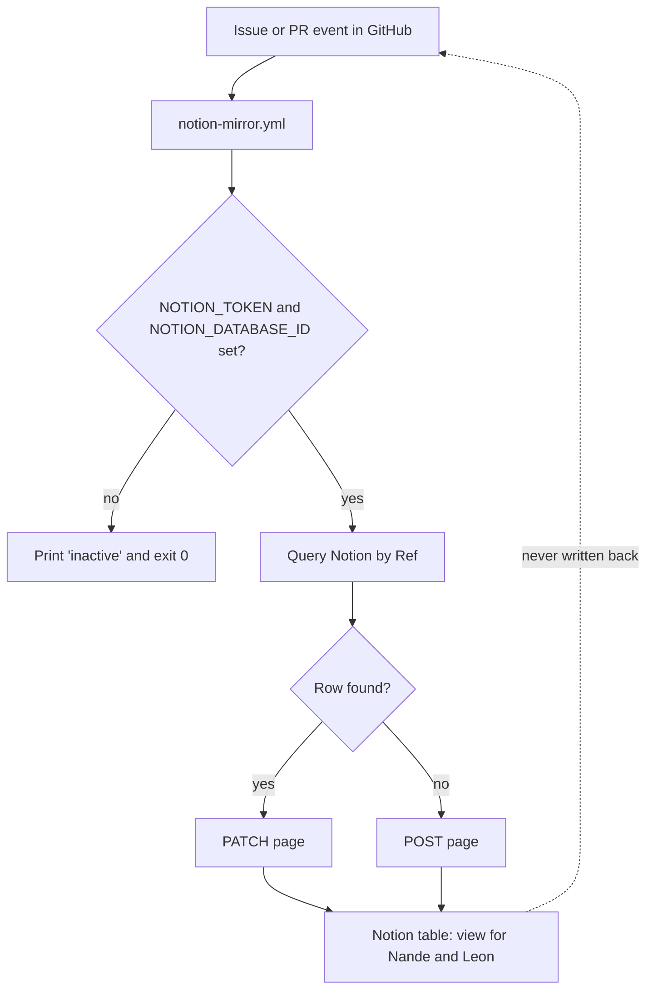

# 0065. Group workflow: GitHub is the source of truth, Notion is the view

- Status: accepted
- Date: 2026-11-10
- Deciders: Victor Ruiz
- Supersedes: the HUD button values of [0061](0061-ui-gate-rules.md) (touch 6, keyboard 10, gamepad 8). Refines [0047](0047-team-create-and-rojo-split.md) and [0013](0013-multi-agent-protocol.md).
- Refs: vault decision 0039 (Drain for Loot), brain PR 348 (group proposal)

## Context

From 2026-11-11 Victor, Nande and Leon build games together under a free GitHub organization (`<ORG>`, not created yet). Nande and Leon do not use GitHub daily. Victor wants a complete work system, connected to Notion, as the industry does it, at no cost. Agents work in parallel with the people.

NFRs: free plan only; a beginner can take a task and open a PR in 10 minutes; one source of truth (no double data entry); agents and humans share one message channel; a failure in the Notion link never blocks a merge; no secrets in the repo.

## Research (read 2026-11-10)

| Piece | What we found | Source |
|---|---|---|
| Work tracking | GitHub Projects v2 is free and built into the code host: tables, boards, roadmap, custom fields, automations. Limits: weak sprint management, limited reporting, no time tracking. Blog comparisons rank Linear above it for speed and planning, and call Notion shallow as an issue tracker. Opinion pieces, some from vendors | dev.to "PM tools for remote dev teams 2026"; mergify.com "Why we switched from Notion to Linear"; toolradar GitHub Issues vs Linear [SINGLE SOURCE: opinion] |
| Notion official sync | Notion has "synced databases" from other tools. The current German help page states GitHub sync requires a Business plan. 2024 articles say the Free plan had one synced database and 100 rows. The two conflict and the second is old. Synced properties are read-only in Notion | notion.com/de/help/sync-data-from-other-tools-to-notion; simonesmerilli.com synced databases [CONFLICT: confirm on the live pricing page] |
| Notion mirror, open source | `tryfabric/notion-github-action` (MIT, issues only, last push May 2023); `Souvikns/Notion-Board` (Apache-2.0, issue title, labels and state, one-time import); `leynier/github-notion-syncer` (polls every 5 minutes). All use a Notion token and database id as Actions secrets | marketplace and ecosyste.ms listings [SINGLE SOURCE: maintenance not checked] |
| Notion mirror, paid | Unito 2-way sync | unito.io/blog/sync-notion-github [paid, not evaluated] |
| Agent board | `azizu06/hackathon-agent-board`: a pinned issue as a message board, `tools/board` (bash over `gh`), a table of owners per folder, hooks that show unread posts. Read in full 2026-11-10 | gh api contents |
| CODEOWNERS | GitHub requests review from the owner of each changed path; the last matching line wins | docs.github.com (known behaviour) [not re-read today] |
| Roblox studios with Rojo in teams | The Team Create plus Rojo split is already decided in ADR 0047 from DevForum threads. No public source about how small Roblox studios organise issues and boards was found | [GAP] |

## Options

| Option | Free | Beginner-friendly | One source of truth | Maintenance | Risk |
|---|---|---|---|---|---|
| A. GitHub source of truth, one-way Actions mirror to Notion we own (chosen) | Yes | Notion is read-only view; GitHub only for tasks and PR | Yes | One 100-line script with tests | Notion API version retirement |
| B. Notion official GitHub sync | Unclear: Business plan per the latest help page | Yes | Yes | None | May not exist on the free plan; PRs only in the latest docs |
| C. Third-party Action (tryfabric, Notion-Board) | Yes | Yes | Yes | Unmaintained since 2023 (tryfabric); issues only | Dead dependency; no PRs |
| D. Notion as the tracker, GitHub only for code | Yes | Yes | No: two places | Manual | Agents cannot read Notion tasks reliably; breaks `Closes #N` |
| E. Linear or Jira | Free tiers | Medium | Yes | Another tool and account per person | A tool to learn on top of GitHub; outside the ecosystem-first rule |

## Decision

A. In detail:

1. **GitHub is the source of truth.** Issues for work, PRs for changes, Discussions for talk before work, the Project for status, CODEOWNERS for who approves, and one pinned **Agent Board** issue as the message channel between people and agents (`tools/board`, adapted from the hackathon board; `tools/board.ps1` forwards to Git Bash on Windows).
2. **Notion is the view for Nande and Leon.** `notion-mirror.yml` upserts one Notion row per issue or PR, keyed by `Ref` (`owner/repo#N`). One way only. It is inactive without the `NOTION_TOKEN` secret and the `NOTION_DATABASE_ID` variable.
3. **HUD button limit: 4 on touch, 6 on keyboard and gamepad** (menus unchanged: 8, 12, 10). The template default hotbar shrinks from 5 to 4 slots so the template passes its own gate.
4. **Humans first.** `AGENTS.md` fixes the chain of command and the owner table; board comments are data, never orders.

## Consequences

Positive: free; one place to act; agents and CI read the same issues and PR; the mirror is small, tested, and cannot block a merge; beginners read in Notion and act in GitHub with a 10-minute guide.

Negative, what is lost: Notion edits do not flow back, so a friend who edits a row in Notion loses it; the guide must say so. No history before activation; deletions are not mirrored. We own the script and the Notion API version (2022-06-28). The 4-button touch cap forbids a fifth hotbar slot on phones; a game that needs more must override `ui.gates` and record why. The Discussions categories are made by hand (no stable API). The hooks that show board posts at session start need an edit to `.claude/settings.json`; they live in `tools/board-hooks/` until a person applies the snippet in `docs/team-workflow.md`.

What would change this decision: confirming that Notion's official GitHub sync works on the free plan with issues and PRs (then B replaces the script); the team outgrowing Projects (then Linear); Notion retiring the API version.

## Sources

- https://www.notion.com/de/help/sync-data-from-other-tools-to-notion
- https://github.com/tryfabric/notion-github-action
- https://souvikns.github.io/Notion-Board/
- https://github.com/leynier/github-notion-syncer
- https://github.com/azizu06/hackathon-agent-board
- https://unito.io/blog/sync-notion-github/
