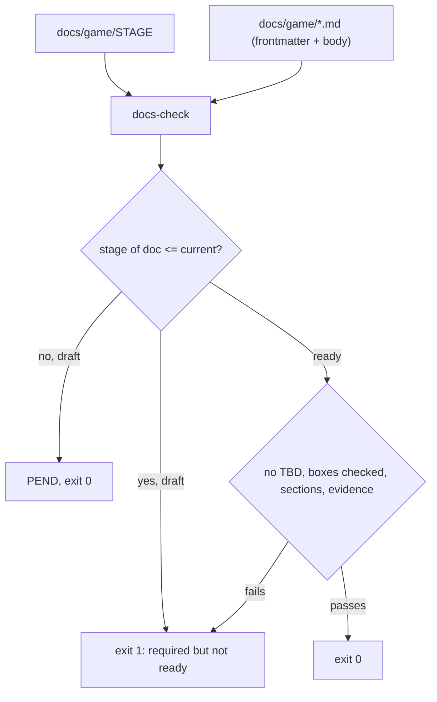

# 0068. Game documentation scaffold in `docs/game/` and the `docs-check` gate

- Status: accepted by recommendation 2026-11-12, every choice below is reversible
- Date: 2026-11-12
- Deciders: Victor Ruiz (asked to leave the recommended options applied)
- Refs: #197, vault note `research/2026-11-12-scaffold-de-documentacion-de-juego.md` (outside this repo), ADR 0044, ADR 0026, ADR 0037, ADR 0065

## Context

The factory ships two games a month with a team of three plus agents. The pipeline and the grill already hold the order of work, but they leave decisions, not documents: the agent that builds a game has no per-topic design file to read without the meeting, and nothing proves a design document is complete. The research compared six approaches against the project NFRs (N1 team of three with agents, N2 two games a month, N3 Roblox, N4 everything as issues in a Project, N5 documents an agent can read and validate, N6 context cost).

| Approach | Verdict against the NFRs |
|---|---|
| A. Monolithic GDD | One file, hard to split into issues, not validated by section |
| B. One-sheet plus ten-pager | Ten pages per game does not fit two games a month |
| C. Claude Code Game Studios (MIT) | Plates and gates fit N5, but 49 agents and 72 skills, no Roblox, breaks the context ceiling |
| D. Roblox Creator Hub guidance | Right content on prototyping and analytics, defines no documents |
| E. One-page brief plus prototype | Fast, leaves systems unwritten |
| F. Our grill, spec, epics, stories | Meets N1 to N4 and N6; misses N5 |

## Decision

F plus the molds of C plus the prototype of E, validated by our own script. Six closed questions were answered with the option the research recommended. Each is reversible; the cost of reversing is stated.

| # | Question | Chosen | What is lost | What would change it |
|---|---|---|---|---|
| 1 | Where do design documents live | (a) The game repo, `docs/game/` | The vault `lint-frontmatter.mjs` does not validate them; `docs-check` covers it | The agent no longer reads the repo, or a document must be shared across games |
| 2 | Is a greybox prototype of the loop a gate between design and build | (a) Yes, with the abandon criterion written before playing, at most one day | One day of the 7 to 10 per game; the gain is learning early that the loop is not fun (hypothesis of the source video, unmeasured) | Two games in a row where the prototype never changed the verdict |
| 3 | Adopt the molds of Claude Code Game Studios or write from zero | (a) Adopt trimmed molds with the MIT notice in `THIRD-PARTY.md` | Style coherence until the molds are fully trimmed and translated | A license change in the source, or molds that keep needing rewrites |
| 4 | One file per system or one `systems.md` | (a) A file only for systems with formulas; the rest are sections of `systems-index.md` | Uniformity | A game where sections stop being enough to implement from |
| 5 | Build `docs-check` in the template | (a) Yes. In Luau for Lune, not Node (see below) | A development cost that was not measured | A false-positive rate that makes people bypass it |
| 6 | `Etapa` as a Project field or as labels | (a) Project field `Etapa` plus two new area labels, `area:diseño` and `area:qa` | Filtering by stage outside the Project, for example in the repo issue list | The Project stops being the planning surface |

### Why the validator is Luau and not Node

The research suggested Node by analogy with the vault's frontmatter linter. This template gates everything with Lune (`scripts/win-condition`, `ui-audit`, `perf-budget`, `coverage_report`); the only `.mjs` file is the Notion mirror, which is CI plumbing. A Luau check keeps one toolchain (Rokit pins Lune), runs inside `lune run scripts/test` for its own tests and needs no `package.json`. The cost: frontmatter parsing is a small hand-written reader of flat `key: value` lines instead of a YAML library; nested YAML is rejected on purpose.

### Shape

- `docs/game/*.md`: 18 molds, each with frontmatter (`doc`, `stage`, `owner`, `status`, `as_of`, `sections`, optional `revisit`), the questions to answer, the "ready" criterion and an evidence section. `docs/game/STAGE` holds the current stage (0 in the template, so the template stays green, as ADR 0044 does for the win condition).
- `scripts/DocsCheck.luau` (pure) and `scripts/docs-check.luau` (Lune entry): documents at or below the current stage must be `ready`; a `ready` document must have no pending marker (unless the line cites `#N`), no unchecked box, every declared section and evidence made of a link or an explicit `[GAP]` list item.
- `.github/ISSUE_TEMPLATE/documento.yml`: one `tipo:docs` issue per document. `.github/labels.json` declares `area:diseño` and `area:qa`; `.github/workflows/labels.yml` applies them when that file changes on `develop`.
- CI: a `game-docs` job runs only when `docs/game/` or the checker changes (docs-only PRs skip the heavy gate by ADR 0029, so without this job a document would never be checked).
- Community reward: `community.md` is a document of the tree because the studio uses one Roblox group for all its games (id 405835365), on top of the mechanics of ADR 0026 (one-time reward) and ADR 0037 (lasting perk).

## Consequences

- Positive: a game is born with its design tree; "ready" is verified, not declared; each document maps to one issue and then to epics and stories; the cost is seconds of CI only when documents change.
- Negative: the check proves a document is complete and cites evidence, not that the design is good or the link is alive; the `ready` criteria are proposals that the first game to use them must calibrate; molds add 18 files to every stamped repo; the label workflow does not fire for the very first push of a stamped game (labels exist only after the file changes on `develop`).
- Lost: the director gates of Claude Code Game Studios and its console and certification coverage, which do not apply to Roblox.

## What would change this

A team larger than three people (second-agent approval gates), leaving Roblox, per-genre molds fed by post-mortems (the next step of the research), or the first game showing that a criterion should be stricter or looser.
