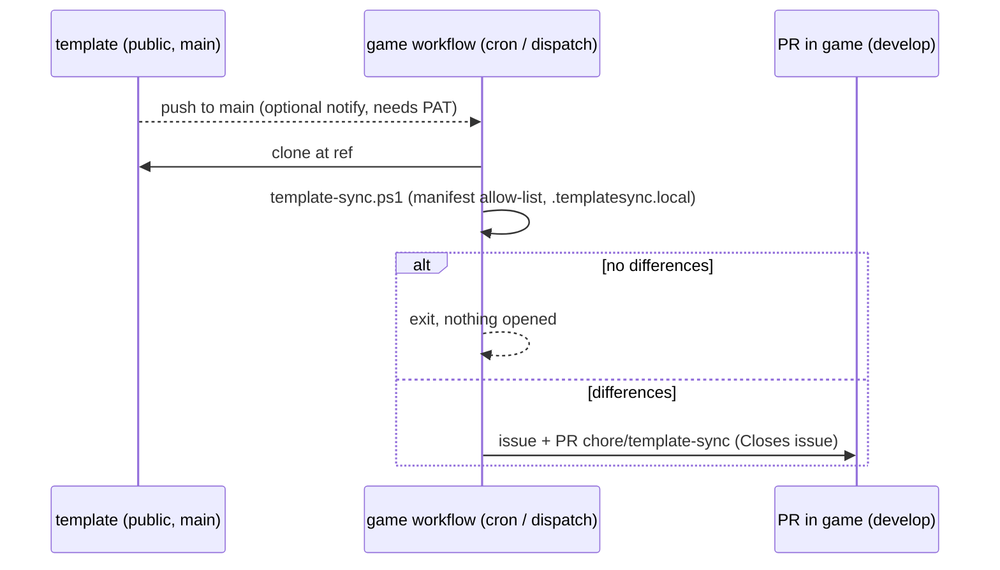

# 0069. Template sync: manifest, daily pull and a reviewable PR in each game

- Status: accepted 2026-11-12, reversible
- Date: 2026-11-12
- Deciders: Victor Ruiz (task brief)
- Refs: #210, drain-for-loot PR #20 (the manual copy that motivated this), ADR 0066, ADR 0068

## Context

Games are stamped from this template (`gh repo create --template`, `scripts/new-game.ps1`) and then drift: a fix to `docs-check` or to a gate does not reach them. Bringing `docs/game/`, docs-check and the `game-docs` job to drain-for-loot took a hand-made PR. Needs (NFR):

- N1 GitHub Free, private games, no paid plan.
- N2 Cheap CI minutes.
- N3 Never overwrite game code or filled game documents.
- N4 Reviewable PR, never a direct merge.
- N5 Multiplatform tooling (pwsh 7 on Windows and Linux).
- N6 No hardcoded list of games; no cross-repo secret required to work at all.

The template is public, so any game can read it with its own `GITHUB_TOKEN`. Games carry no topic; GitHub records the origin in the `template_repository` field of each repo (`gh repo create --template`).

## Options evaluated

| Option | N1 | N2 | N3 | N4 | N5 | N6 | Verdict |
|---|---|---|---|---|---|---|---|
| copier `update` | yes | per run | good 3-way merge | needs a script around it | Python dependency | needs `.copier-answers.yml`, games were not born from copier | rejected: migrating every game to Jinja templating is larger than the problem |
| cruft | yes | per run | 3-way merge | same | Python dependency | needs cookiecutter metadata, same migration | rejected, same reason |
| actions-template-sync (AndreasAugustin) | yes | per run | **merges everything**, default `-X theirs`, deny-list only | opens a PR per game | action, ok | pull model, needs only a PAT for workflow files | rejected: a deny-list means a new game folder gets overwritten by default |
| repo-file-sync-action (BetaHuhn) | yes | central job | copies listed files only | PR per repo | action, ok | **repos are listed in the central `sync.yml`**; needs a PAT with write on every game | rejected: breaks N6 |
| **Own manifest + pull from each game** (chosen) | yes | one ~1 min job/day/game | allow-list only, game exclusions | PR from `chore/template-sync` | pwsh 7 | discovery by `template_repository`; works with `GITHUB_TOKEN` | chosen |

actions-template-sync is the closest tool; the difference is the direction of the default. Its deny-list syncs anything not ignored and resolves conflicts for the template. Here the manifest is an allow-list, so a game's own code is untouched by construction.

## Decision

1. `/.templatesync` (versioned in the template) lists the globs the template owns, with `!` exclusions; the last match wins. A game adds `!` lines in its own `.templatesync.local`.
2. `scripts/template-sync.ps1` compares the game with a template checkout and copies only owned files that differ. It never deletes; paths the template no longer has are reported.
3. `scripts/template-sync-pr.ps1` clones the template at `ref` (default `main`, the released state), runs the comparison on a branch cut from the game's `develop`, and if nothing differs it opens nothing. Otherwise it opens an issue (label `template-sync`) and a PR to `develop` that `Closes` it. One PR at a time: a later run refreshes the branch `chore/template-sync` and comments. It never merges.
4. Trigger: `.github/workflows/template-sync.yml` in every game (stamped from the template), daily cron plus `workflow_dispatch` with an optional `ref`; it calls the reusable `template-sync-run.yml` of the template, so the logic updates without touching the games.
5. Fast path (optional): `template-sync-notify.yml` runs on push to the template's `main`, lists the org repos whose `template_repository` is this template and dispatches their `template-sync`. It needs the org secret `TEMPLATE_SYNC_TOKEN`; without it the job exits at once.
6. Discovery of games is the `template_repository` field, so a repo stamped by `new-game.ps1` is covered with no configuration. A repo born another way (a fork, a copy) is outside until it is given the caller workflow.

## Token

- No token is needed for the daily cron: the game reads the public template and pushes its own branch with `GITHUB_TOKEN` (the repo setting "Allow GitHub Actions to create and approve pull requests" must be on).
- Limits of `GITHUB_TOKEN`: it cannot push files under `.github/workflows/` and PRs it opens do not trigger CI. Without a PAT, workflow files are listed in the PR body as "not applied".
- `TEMPLATE_SYNC_TOKEN` (org secret, optional): fine-grained PAT on the org with contents, pull requests, issues, workflows and actions write on the game repos. It enables workflow updates, CI on the sync PR and the fast path. Creating it is a Victor action.

## Consequences

- Positive: a template change reaches every game as a small PR within a day; the game decides by reviewing; exclusions are explicit and versioned in the game.
- Negative: a game that edited an owned file sees its change as a diff to reject or exclude; the first sync of an old game can be large; deletions are manual; the caller workflow must exist once in games stamped before this ADR; a `main`-based sync lags `develop` until the next release (use the `ref` input to follow `develop`).
- Would change this: a game count that makes a daily job per game costly; the need for 3-way merges of owned files (then copier); GitHub allowing `workflow` scope on `GITHUB_TOKEN`.

