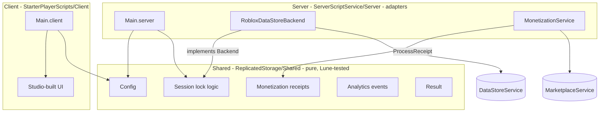
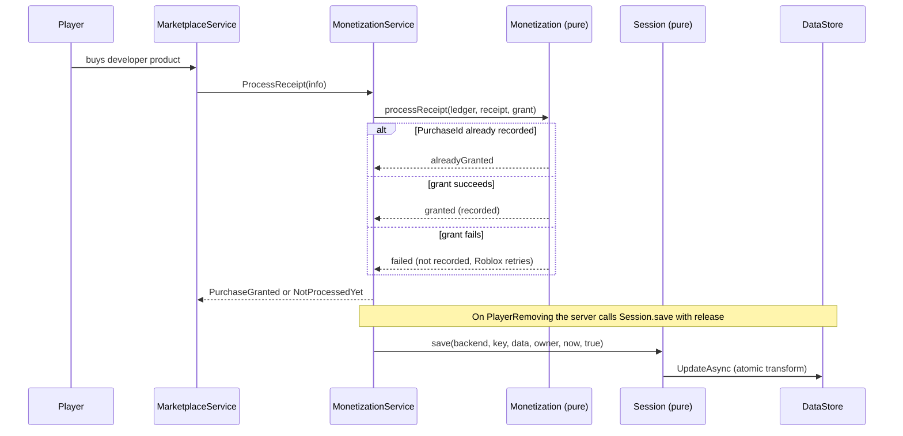

# Architecture

## Principle: pure core, thin adapters

Decisions are made by pure modules in `src/shared` (values in, values out, storage injected). Server and client scripts only adapt engine services to those modules. This is the hexagonal split applied to Roblox: ports are Luau types (`Session.Backend`, `Monetization.ReceiptLedger`), adapters are in `src/server`.

## Data flow: purchase and save

## Tradeoffs

- Pure modules cannot `require` siblings by Roblox instance path and also load under Lune, so they declare a local structural `Result` alias instead of importing `Result.luau`. Cost: a small duplicated type. Benefit: CI tests without Studio.
- The session wrapper is ProfileStore-style but self-written ([ADR 0003](adr/0003-no-package-manager-yet.md): no dependencies). It does not yet handle migrations, session-lock heartbeats or DataStore throttling; add them with tests when a game needs them.
- Engine adapters are untested until the Luau Execution API is wired ([ADR 0005](adr/0005-tests-lune-then-luau-execution.md)).
- The ledger must be persisted inside the player's saved data so "processed" survives server restarts; the template only ships the in-memory ledger.
