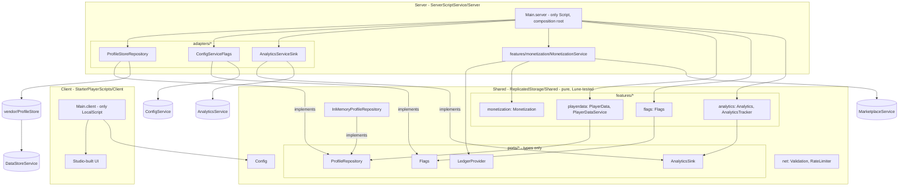
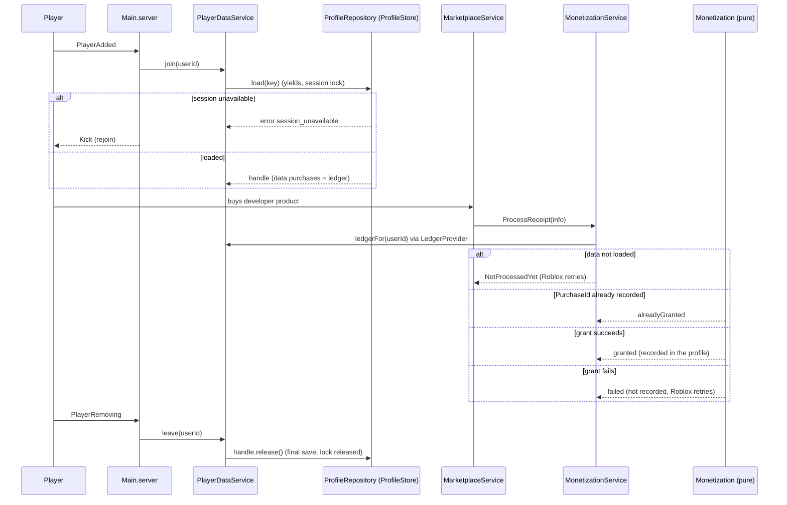
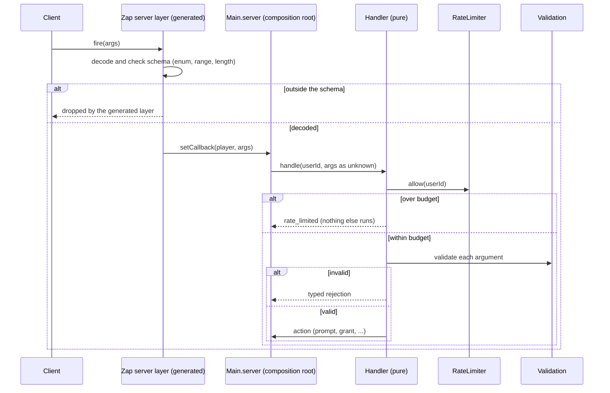
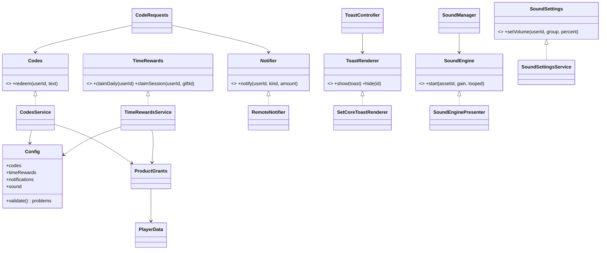
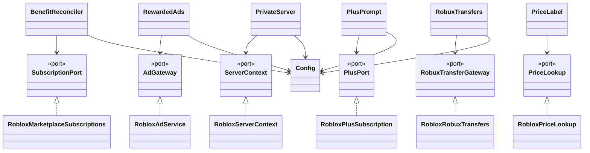

# Architecture

## Principle: pure core, ports, thin adapters

Decisions are made by plain Luau modules with constructor dependency injection ([ADR 0009](adr/0009-plain-modules-constructor-di.md)). No framework (Knit and Roact are archived). Features depend on **ports**: Luau types that describe an external service. **Adapters** implement ports over engine services or vendored libraries. One Script per side (`Main.server`, `Main.client`) is the composition root: the only place that builds adapters and wires events.

Ports (all in `src/shared/ports`, types only):

| Port | What it hides | Production adapter | Test double |
|---|---|---|---|
| `ProfileRepository` | player data with session locking | `ProfileStoreRepository` (ProfileStore, [ADR 0010](adr/0010-profilestore-behind-profilerepository.md)) | `InMemoryProfileRepository` |
| `Flags` (`FlagSource`) | live-ops flags | `ConfigServiceFlags` (Experience Configs, [ADR 0011](adr/0011-flags-port-experience-configs.md)) | a table-backed source |
| `AnalyticsSink` | funnel event delivery | `AnalyticsServiceSink` (`LogCustomEvent`) | a recording sink |
| `LedgerProvider` | per-player purchase ledger (monetization) | built in `Main.server` from the player's profile | a table ledger |



Dependency direction: `adapters -> ports <- features`. A feature never requires an adapter or an engine service. `src/shared` never requires `src/server`.

## Folder structure (why each level)

```
src/
  shared/                    -> ReplicatedStorage/Shared. Loads under Lune: no engine services.
    Config.luau  Result.luau   typed config; typed Result
    ports/                   types only: what features need from the outside world (ProfileRepository, Flags, AnalyticsSink, LedgerProvider, SubscriptionPort, AdGateway, ServerContext, PlusPort, RobuxTransferGateway, PriceLookup)
    features/<feature>/      one folder per capability; the template stays genre-agnostic
    net/                     remote helpers: Validation, RateLimiter (ADR 0012)
    perf/                    PerfBudget config, RemoteBudget calculator, ProbeEvaluator (ADR 0019)
  server/                    -> ServerScriptService/Server
    Main.server.luau         the ONLY server Script; builds adapters, injects, connects events
    dev/                     PerfProbe: Studio-only sampler, off by flag (ADR 0019)
    adapters/                implementations of ports over engine services / vendored libs
    features/<feature>/      server-only services (need engine services, e.g. MonetizationService)
  client/                    -> StarterPlayerScripts/Client
    Main.client.luau         the ONLY LocalScript; binds behavior to Studio-built UI
vendor/                      pinned third-party code with LICENSE and provenance (ProfileStore)
types/                       Roblox definitions for luau-lsp analyze (data, ADR 0007)
tests/                       mirrors src: tests/features/<feature>, tests/net; harness.luau
```

## Data flow: join, purchase, leave



## How to add a remote event

Remotes are generated from `net/schema.zap` (Zap, [ADR 0015](adr/0015-remote-layer-codegen.md)); the server edge stays ours ([ADR 0012](adr/0012-remote-validation-and-rate-limit.md)).

1. **Schema.** Add an `event` to `net/schema.zap` (direction, reliability, named params). A remote carries intent only: never a price, a result or a player id. Prefer enums and bounded ranges over free strings and numbers.
2. **Regenerate.** `pwsh scripts/generate-remotes.ps1`, then commit `src/shared/net/generated/`. CI regenerates with the pinned Zap and fails on `git diff --exit-code`.
3. **Handler.** Write a pure module under `features/<name>/` with injected deps: rate limit first (`net/RateLimiter`), then `net/Validation` on every argument typed `unknown`, then the action. See `features/monetization/PurchaseRequests`. Wire it in `Main.server` only (`net.<Event>.setCallback`), and call `forget` on PlayerRemoving.
4. **Budget.** Add the remote to `src/shared/perf/PerfBudget.luau` (`clientRemotes` with the limiter you use, or `serverRemotes` with its max sends per second) and run `lune run scripts/perf-budget`: an undeclared or over-budget remote fails CI (ADR 0019).
5. **Tests.** A suite in `tests/` registered in `scripts/suites.luau`: valid request, invalid payload, rate-limited, and the malformed-payload path.



Keep the schema enum of product names equal to `Config.default.developerProducts`. The handler also checks the names against Config, so a product missing from the schema is unreachable, not unsafe.

## Engagement modules

Codes, time rewards, notifications and sound (ADR 0025, implementing ADR 0022). Pure logic in `src/shared/features/`, one port each, engine code only in `src/server/adapters/` (`RemoteNotifier`, `RemoteSoundPush`) and `src/client/presenters/` (`SetCoreToastRenderer`, `SoundEnginePresenter`). `Main.server` and `Main.client` are the only places that wire them.



Remotes (all in `net/schema.zap` and `PerfBudget`): client to server `RedeemCode`, `ClaimDailyReward`, `ClaimSessionGift`, `SetVolume` (intent only, each behind a `RateLimiter` and `Validation`); server to client `Notify`, `SoundSettings` (no client-callable handler). Player data v4 adds `redeemedCodes`, `timeRewards` and `settings` (migration `v3ToV4`).

How to add a code, a reward, a toast or a sound: README, "Engagement modules". What is forbidden: same section. Two lists must change together when a toast kind is added: `NotificationKind` in `net/schema.zap` and `NotificationsConfig.REQUIRED_KINDS`.

## Monetization surfaces

Five revenue modules sit on top of the receipt flow, each one a pure feature behind one port with an engine adapter (ADR 0022 on the `docs/game-systems-adr` branch, PR #22, and [ADR 0024](adr/0024-plus-prompt-robux-transfers-and-runtime-prices.md)). `Main.server` is the only place an adapter is chosen, so a paid pack becomes a second adapter of the same port and callers do not change.

| Module | Pure logic (`src/shared/features/`) | Port (`src/shared/ports/`) | Adapter (`src/server/adapters/`) | Remote | Config key |
|---|---|---|---|---|---|
| Experience subscriptions | `subscriptions/BenefitReconciler` | `SubscriptionPort` | `RobloxMarketplaceSubscriptions` | none (the client prompts with the engine API) | `subscriptions`, `subscriptionPollSeconds` |
| Rewarded video ads | `rewardedads/RewardedAds` | `AdGateway` | `RobloxAdService` | `RequestRewardedAd` | `rewardedAds` |
| Private servers | `privateserver/PrivateServer` | `ServerContext` | `RobloxServerContext` | `RequestPrivateServerSetting` | `privateServers` |
| Roblox Plus prompt | `plus/PlusPrompt` | `PlusPort` | `RobloxPlusSubscription` | `RequestPlusPrompt` | `plusPrompt` |
| Robux transfers | `robuxtransfers/RobuxTransfers` | `RobuxTransferGateway` | `RobloxRobuxTransfers` | `RequestRobuxTransfer` | `robuxTransfers` |
| Runtime prices (support) | `pricing/PriceLabel` | `PriceLookup` | `RobloxPriceLookup` | none | none (no display price in Config) |



Rules that hold for all five:

- **Config-driven.** Every price-free value (ids, labels, caps, cooldowns, bounds) comes from `Config`, and `Config.validate` reports each problem. Ids stay `nil` until a game sets them. A disabled surface is not validated; an enabled one must be complete.
- **Opt-in and off by default.** Rewarded ads, private servers, the Plus prompt and Robux transfers ship with `enabled = false`.
- **Intent-only remotes.** Each remote carries a name or a number the server re-checks (rate limiter, then `Validation`, then Config bounds). All four are in `net/schema.zap` and in `PerfBudget`.
- **Money path.** Nothing is granted from a remote. Rewarded ad rewards are Config developer products delivered by `ProcessReceipt` after a confirmed save (ADR 0016). Subscription benefits are reconciled from the live status and never read from saved data. The Plus sign-up bonus is credited by the platform. Transfers grant nothing.
- **Subscriptions.** Status is re-read on join, on `UserSubscriptionStatusChanged` and on a poll (`subscriptionPollSeconds`), because the engine fires the event only after the purchase modal closes, so a Store tab purchase made mid-session is found by the poll. The first answer for a player always calls `apply`, so a benefit persisted by an old session is revoked. A lookup failure keeps the previous state and is logged. A legacy game pass owner keeps the benefit.
- **Rewarded ads.** Availability (`GetAdAvailabilityNowAsync`) is a client-only call owned by the client script that holds the button; every `notReady`, `interrupted` or ineligible outcome is a normal result, so the button just hides. The disclosure text and button label come from Config. A daily cap counts completed ads per server and day (not persisted across servers).
- **Private servers.** The platform sells them and sets the price in Creator Hub. `expectedMonthlyPrice` is only for the release checklist and is never shown. `TeleportInitFailed` retries `Failure` and `Flooded` up to `teleportRetries` times, and nothing else.
- **Prices.** Never a literal: read through `PriceLookup` and format with `PriceLabel.format` (Plus subscribers pay 10 to 20 percent less). A test fails if `Config.default` holds a price-like number.

### How to add an item

- **A subscription:** add `{ name, subscriptionId, benefits, replacesPassName? }` to `Config.default.subscriptions` (id from Creator Hub), then replace the default `apply` in `Main.server` if the benefit is more than an attribute. Test: extend `tests/features/subscriptions/BenefitReconciler.test.luau`.
- **A rewarded ad placement:** create the developer product and the Creator Hub placement, add the product to `developerProducts` with its grant, add `{ name, placementId, rewardProduct, label }` to `rewardedAds.placements`, add the name to `AdPlacementName` in `net/schema.zap`, run `pwsh scripts/generate-remotes.ps1`. Turn `enabled` on only when the experience is eligible.
- **A private server setting:** add `{ name, min, max, default }` to `privateServers.settings`, the name to `PrivateServerSettingName` in the schema, regenerate, and act on it in `onSettingChanged` in `Main.server`.
- **A Plus placement:** add the name to `plusPrompt.placements` and `PlusPlacementName` in the schema, regenerate.
- **A pack instead of the in-house adapter:** write a second adapter of the same port (at least 75 percent coverage, ADR 0022) and change the one line in `Main.server` that builds it.

### Forbidden

A literal price or a price-like number in `Config` or a UI (the test fails); a grant from a remote or from a client "ad finished" signal; trusting saved subscription status; prompting Plus or opening an ad without a player request; a transfer reward that skips the ledger; an engine call outside `src/server/adapters/`; a remote that carries a price, a reward or a user id of the caller; a fake id in `Config`.

## Leaderboards and community reward

ADR 0026 (its UI kit half is superseded by ADR 0071: the template draws no UI). Pure logic in `src/shared/features/{leaderboards,community-reward}` plus the UI-facing models in `src/shared/features/ui`; engine code in `src/server/adapters/` (`OrderedDataStoreBoards`, `RobloxLeaderstats`, `ReplicatedBoardPublisher`, `RobloxGroupMembership`) and `src/client/presenters/GameUiBridge.luau`, the attach point of the game UI. The class and sequence diagrams are in the ADR.

- **Ports**: `UiPresenter` (implemented by the game UI), `Leaderboards`, `OrderedBoardStore`, `StatView`, `BoardPublisher`, `MembershipChecker`. Callers depend on the port types only, so a pack adapter plugs in later.
- **Config keys**: `leaderboards` (leaderstats, writeSeconds, boards), `communityReward` (enabled, communityId, reward, recheckCooldownSeconds, promptJoin).
- **Remotes**: one new client to server, `RequestCommunityCheck` (no payload). Boards travel as replicated `StringValue`s under `ReplicatedStorage.Boards` and leaderstats as the engine folder, so there is no leaderboard remote. Two `Notify` kinds were added (`community_reward_claimed`, `community_not_member`).
- **Data**: schema v5 adds `communityRewardClaimed` (`v4ToV5`). The grant is kept only after `confirmSaved`.
- **Leaderboard schedule**: no store read on join; writes every `writeSeconds` and only for changed values; one read per board every `refreshSeconds`; a failed read keeps the cache and waits a full interval.
- **Adding a menu item**: add a product to `developerProducts` (the shop lists it), a gift to `timeRewards.sessionGifts` (the rewards screen lists it) or a board to `leaderboards.boards`; no presenter edit.

## Performance budget

One config (`PerfBudget`) feeds three consumers: the CI calculator, the client remote limiters in `Main.server` (RequestPurchase, the monetization remotes and RequestCommunityCheck); the client to server total is 352.45 of 512 B/s after ADR 0026, and the Studio probe. Flow and alternatives: [ADR 0019](adr/0019-performance-budget.md); manual procedure: [performance.md](performance.md). The calculator is static and sees only remote payloads, not replication or physics traffic.

## Tradeoffs

- **Types duplicated across ports and features.** Modules that must load under Lune cannot `require` siblings by Roblox instance path, so each declares a small local structural alias (`Result`, `ProfileHandle`). Cost: duplication, kept honest by the compiler (a structural mismatch fails `analyze`). Benefit: CI tests without Studio.
- **Ports live in `shared`, not `server`.** The research placed ports in `server/ports`. We keep them in `shared/ports` so pure feature services and tests can name the port types without engine paths. The client ignores them. Cost: server-only contracts are visible to the client's `Shared` folder (types only, no code).
- **ProfileStore is vendored, not rewritten** ([ADR 0010](adr/0010-profilestore-behind-profilerepository.md)): one more third-party file to audit and bump, in exchange for a battle-tested session lock. The port limits the blast radius if it is replaced.
- **Adapters are tested with fakes under Lune; the real engine is not** ([ADR 0005](adr/0005-tests-lune-then-luau-execution.md), [ADR 0009](adr/0009-plain-modules-constructor-di.md)). Each adapter takes its engine service by constructor (`tests/adapters/`), so the translation logic is covered; behavior against the real services and ProfileStore waits for the Luau Execution API. The port contract test (`tests/features/playerdata/ProfileRepository.contract.luau`) is ready to run against the real adapter.
- **`Profile:Save()` is asynchronous** in ProfileStore, so `handle:save()` returns ok once the save is scheduled; failures arrive through `ProfileStore.OnError` (to wire per game).
- **Migrations are a pure chain, not ProfileStore hooks** ([ADR 0014](adr/0014-pure-migration-chain.md)): `PlayerDataService.join` runs `PlayerDataMigrations.migrateInPlace` before exposing data; a newer-schema profile fails the join instead of being downgraded.
- **A receipt waits for its save** ([ADR 0016](adr/0016-confirmed-save-before-purchase-granted.md)): `ProcessReceipt` yields up to `saveConfirmTimeoutSeconds` until `Profile.LastSavedData` holds the PurchaseId, then answers; otherwise Roblox retries. The ledger keeps the last `purchaseLedgerSize` ids (schema v3).
