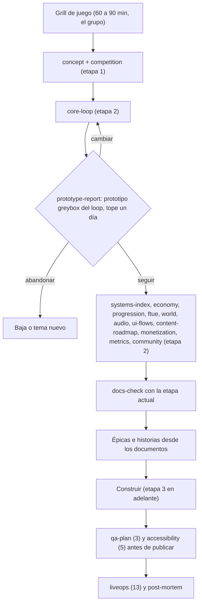
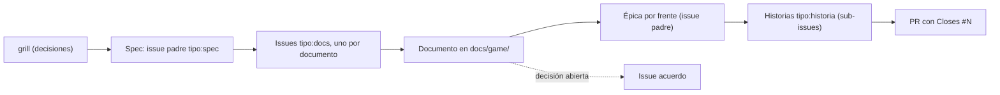

# Documentación de juego (`docs/game/`)

Todo juego nacido de esta plantilla trae aquí su árbol de documentos de diseño, como moldes vacíos. Cada molde dice qué preguntas hay que responder, cuándo está "listo" y de dónde sale la evidencia. Un documento no se declara listo: lo comprueba `lune run scripts/docs-check`. La decisión completa y lo que se pierde con cada elección están en [ADR 0068](../adr/0068-game-docs-scaffold-and-docs-check.md).

Qué es: el diseño que el agente que construye lee sin salir del repo. Qué no es: el estado del juego, el mercado ni el post-mortem (viven en el vault, `games/<slug>/`), ni el sistema visual (vive en [`docs/design/DESIGN.md`](../design/DESIGN.md)), ni el TDD (`docs/architecture.md`, `docs/adr/`, `docs/requirements.md`).

## Flujo



## Documentos, etapa y quién los llena

`stage` es la etapa desde la cual el documento debe estar listo. `revisit` (opcional) es la etapa en que se vuelve a mirar. Los dos viven en el frontmatter del archivo.

| Documento | Etapa | Quién lo llena | Preguntas que fuerza |
|---|---|---|---|
| [grill](grill.md) | 1 | El grupo decide; el agente conduce y redacta | Agenda de la sesión, corte automático, pre-mortem y presupuesto de rendimiento y carga |
| [concept](concept.md) | 1 | El grupo decide; el agente redacta | La frase, el gancho filmable y los pilares con su "no" |
| [competition](competition.md) | 1 | Agente | Tres referentes medidos con fecha y la única diferencia |
| [core-loop](core-loop.md) | 2 | El grupo decide; el agente redacta | Cinco verbos, segundos por vuelta, qué es permanente |
| [prototype-report](prototype-report.md) | 2 | El agente construye; una persona juega | Criterio de abandono escrito antes de jugar y veredicto |
| [systems-index](systems-index.md) y `systems/` | 2 | El agente redacta; el dueño del frente aprueba | Qué cubre ya el template, qué falta, dependencias |
| [economy](economy.md) y `balance/*.csv` | 2 | Agente; Victor valida | Fuente y sumidero por moneda, EV de todo azar |
| [progression](progression.md) | 2 | Agente | Metas corto, medio y largo, y qué hay tras el último nivel |
| [ftue](ftue.md) | 2 | El agente redacta; una persona prueba | Segundo exacto de la primera acción y embudo con eventos |
| [world-and-narrative](world-and-narrative.md) | 2 | El agente redacta; Leon y Nande aprueban | Estilo, zonas, origen de cada modelo; "sin narrativa" si no aplica |
| [audio](audio.md) | 2 | El agente redacta; una persona elige | Origen y licencia de cada pieza, nunca un id inventado |
| [ui-flows](ui-flows.md) | 2 | El agente redacta; Nande y Leon aprueban | Flujo de pantallas y destino de cada botón del HUD |
| [content-roadmap](content-roadmap.md) | 2 | El grupo decide | Qué entra, qué queda fuera, cabe en 7 a 10 días |
| [monetization](monetization.md) | 2 | El agente redacta; Victor aprueba precios | Contexto de compra, EV, nada roto sin pagar |
| [metrics](metrics.md) | 2 | Agente | Eventos, D1, D7 y el umbral de abandono por número |
| [community](community.md) | 2 | El grupo decide; el agente redacta | Recompensa por unirse al grupo del estudio (ver abajo) |
| [qa-plan](qa-plan.md) | 3 | El agente redacta; lo revisa otra sesión | Matriz sistema a prueba, casos borde, dispositivos |
| [beta-testing](beta-testing.md) y molde [`_informe-sesion-beta.md`](_informe-sesion-beta.md) | 10 | El agente redacta y procesa; Victor aprueba el Drive; prueba una persona del grupo | Ronda por versión SemVer en el celular: grabación, guion, hallazgos por minuto y carpeta de Drive |
| [accessibility](accessibility.md) | 5 | Agente | Nivel comprometido y cada excepción justificada |
| [liveops](liveops.md) | 13 | El grupo decide | Cadencia que se puede sostener y un evento de ejemplo |

Ya existen y se enlazan, no se duplican: `docs/design/DESIGN.md`, `docs/architecture.md`, `docs/adr/`, `docs/requirements.md`, `docs/roadmap.md`, `docs/milestones.md`, `docs/ai-logs/`, `docs/win-condition-checklist.md`.

### Recompensa de comunidad

El estudio usa un solo grupo de Roblox para todos sus juegos: [id 405835365](https://www.roblox.com/communities/405835365). [`community.md`](community.md) declara qué recibe quien se une y cómo se muestra, sobre la mecánica que ya trae la plantilla: [ADR 0026](../adr/0026-ui-kit-leaderboards-community-reward.md) (recompensa única de unirse) y [ADR 0037](../adr/0037-community-perk.md) (beneficio duradero de miembro).

## Estructura de un documento

Cada archivo tiene el mismo esqueleto, que `docs-check` entiende:

| Parte | Para qué sirve |
|---|---|
| Frontmatter: `doc`, `stage`, `owner`, `status` (`draft` o `ready`), `as_of` (fecha al dejarlo listo), `sections`, `revisit` | Etapa, quién lo llena y estado |
| `## Preguntas que debe responder` | Lo que el documento obliga a decidir |
| `## Respuestas` y las secciones propias | El contenido. Una respuesta sin cerrar se escribe `TBD` |
| `## Criterio de listo` | Casillas `- [ ]`; todas `- [x]` al cerrar |
| `## Evidencia` | Al menos un enlace (nota del vault, URL, ruta de prueba) o un `[GAP]` explícito como ítem de lista |

Los comentarios HTML (`<!-- ... -->`) no cuentan como contenido: sirven para dejar instrucciones en un molde.

## Cómo se corre el validador

```
lune run scripts/docs-check            # etapa leída de docs/game/STAGE (0 si no existe)
lune run scripts/docs-check 2          # fuerza una etapa
lune run scripts/docs-check 13         # todo debe estar listo
```

- Los documentos con `stage` menor o igual a la etapa actual deben estar `ready`; los de etapas posteriores salen como `PEND` y no fallan.
- Un documento `ready` falla si queda un `TBD`, `TODO`, `por definir` o `sin decidir` (salvo que la línea cite un issue como `#12`), una casilla sin marcar, una sección declarada ausente, una fecha `as_of` inválida o una evidencia sin enlace.
- Código de salida 1 ante cualquier hallazgo. Corre en CI en un job propio cuando cambia algo de `docs/game/` o del validador.
- La etapa avanza editando `docs/game/STAGE` en el mismo PR que cierra la etapa anterior.
- Los archivos que empiezan con `_` son moldes para copiar (`systems/_sistema.md`) y `README.md` y `THIRD-PARTY.md` no se validan.

Lo que **no** comprueba (queda a la revisión de la persona): que el contenido sea bueno, que los enlaces respondan, que un número del vault siga vigente.

## Cómo se parte cada documento en issues



1. **Documento a issue `tipo:docs`.** Escribir o actualizar un documento es trabajo y se rastrea con el formulario [Documento de juego](../../.github/ISSUE_TEMPLATE/documento.yml). Se cierra cuando `docs-check` pasa para ese archivo y la persona dueña aprobó.
2. **Documento a épica.** Un documento de sistemas, economía, UI, audio o mundo genera una épica por frente. Entre 6 y 9 épicas y entre 30 y 60 historias para 7 a 10 días; más que eso indica alcance excesivo. La épica enlaza el documento por su ruta; cada historia cita la sección que implementa y toma de ahí sus criterios de aceptación.
3. **Decisión sin cerrar.** Va a un issue `acuerdo`; no genera trabajo hasta cerrarse.

### Etiquetas y campos

El estado, la prioridad, el tamaño y la iteración viven en el Project, no en etiquetas.

| Eje | Dónde | Valores |
|---|---|---|
| Tipo | Etiqueta | `tipo:spec`, `tipo:docs`, `tipo:historia`, `tipo:tarea`, `tipo:bug`, `tipo:investigación`, `acuerdo` |
| Frente | Etiqueta `area:*` | `código`, `arte`, `ui`, `economía`, `audio`, `crecimiento`, `infra`, y las nuevas `diseño` y `qa` (declaradas en [`.github/labels.json`](../../.github/labels.json)) |
| Dueño | Etiqueta | `owner:victor`, `owner:nande`, `owner:leon`, y `agent` si lo hace un trabajador |
| Etapa 0 a 13 | Campo del Project `Etapa` (selección única) | 0 a 13 del pipeline |
| Documento | Campo del Project `Documento` (texto) | Ruta bajo `docs/game/` |

### Milestones por juego

Cuatro, no catorce. Las fechas salen de las respuestas 11.4 y 12.3 del grill.

| Milestone | Etapas | Se cierra cuando |
|---|---|---|
| M1 Documentado | 0 a 2 | `docs-check 2` en cero, prototipo con veredicto "seguir" y épicas creadas |
| M2 Jugable | 3 a 9 | La puerta local en verde y `qa-plan` ejecutado |
| M3 Publicado privado | 10 y 11 | Página y monetización creadas (con los pasos manuales de Victor) |
| M4 Veredicto | 12 y 13 | Post-mortem escrito con el veredicto del día 7 |

## Publicación: privado primero, público solo en la major final

La experiencia vive en el grupo del estudio ([id 405835365](https://www.roblox.com/communities/405835365)), no en una cuenta personal, y se publica en **privado** para que la prueben los admin del grupo. Roblox deja una experiencia nueva accesible solo a su creador y a quien tenga permisos por rol; el acceso por rol se ajusta por experiencia, y hay además una lista de hasta 10 testers invitados (documentación `production/publishing/publish-games-and-places.md`).

1. **Cada release completo sale primero en privado.** Major, minor y patch pasan por el grupo antes de cualquier otra audiencia.
2. **Solo la major final pasa a público**, cuando el veredicto del día 7 lo permite. Después salen minor y patch, también privados primero.
3. **El testeo privado es una etapa aparte del testeo por el MCP de Studio.** El MCP de Studio comprueba el juego en el editor (playtest, consola, entrada, captura); el testeo privado lo hacen personas reales del grupo sobre la experiencia publicada, con compras reales de prueba de pases y productos. Una etapa no sustituye a la otra.
4. **Qué solo funciona en público** (y se prueba al pasar a público): los servidores privados exigen experiencia pública, y los anuncios inmersivos y el video con recompensa piden juego público y un mínimo de 2.000 visitantes únicos al mes. La lista "Creado antes de publicar" de [`monetization.md`](monetization.md) dice qué existe antes.
5. Lo que decide el paso a público (cuestionario de contenido, ícono, miniaturas, precios finales) es de Victor; no se automatiza.

## Cómo agregar o cambiar un documento

1. Copia el molde (o `systems/_sistema.md` para un sistema con fórmulas), ajusta `doc` y el frontmatter.
2. Abre el issue con el formulario y enlázalo en la PR con `Closes #N`.
3. Responde, marca las casillas, pon `status: ready` y `as_of`, y enlaza la evidencia.
4. `lune run scripts/docs-check` debe salir con código 0 antes de pedir la aprobación.
5. Un molde nuevo para todos los juegos va a la plantilla con su ADR; un cambio de criterio de "listo" se calibra con el primer juego que lo use y se corrige en la misma PR.

## Prohibido en esta carpeta

- Copiar tokens o paletas de otro repositorio (el sistema visual se deriva del dominio en `docs/design/DESIGN.md`).
- Inventar un número, un id de audio, un id de pase o una cifra de mercado. Lo no medido va como `[GAP]`.
- Declarar `ready` para que pase el validador: la evidencia es el enlace, no la frase.
- Dejar una decisión abierta sin su issue `acuerdo`.

## Dónde están las pruebas

`tests/scripts/DocsCheck.test.luau` prueba las reglas; `lune run scripts/test` las corre. El entrypoint es `scripts/docs-check.luau` y la lógica pura `scripts/DocsCheck.luau`.

Material adaptado de terceros: [THIRD-PARTY.md](THIRD-PARTY.md).
