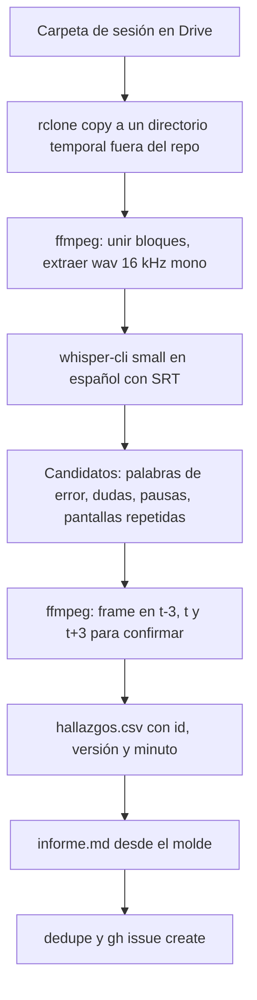

# Beta testing móvil por versión

Cada versión SemVer del juego (0.1.0, 0.2.0, ...) tiene una ronda completa de beta testing con personas reales del grupo, jugando en su celular (iPhone o Android) y grabando desde ese mismo celular. Esta guía se escribe para que quien no estuvo la primera vez la ejecute desde cero y obtenga lo mismo. La investigación, las alternativas comparadas y las fuentes están en la nota del vault enlazada al final; aquí solo queda lo que se hace.

Qué es: el procedimiento de una ronda por versión, desde preparar la build hasta tener issues. Qué no es: el testeo por el MCP de Studio (es otra etapa, ver [README](README.md#publicación-privado-primero-público-solo-en-la-major-final)), ni el plan de QA automatizado ([`qa-plan.md`](qa-plan.md)), ni un reclutamiento de desconocidos.

## Preguntas que debe responder

1. ¿Qué personas prueban este juego y en qué celular y sistema operativo?
2. ¿Dónde está la carpeta de Drive del proyecto y quién la creó?
3. ¿Cómo sabe quien mira un video en qué versión estaba el juego?
4. ¿Qué mide la ronda de la versión actual y qué número dice que salió bien?
5. ¿Los resultados de la prueba de humo de grabación (paso B2) quedaron escritos?

## Respuestas

1. TBD
2. TBD
3. La versión se muestra en pantalla y se dice en voz alta en la calibración; ver pasos B3 y B6.
4. TBD
5. TBD

## Material

| Qué | Para qué | Si falta |
|---|---|---|
| Celular del tester con la app de Roblox al día | Jugar y grabar | No hay sesión: no se sustituye por emulador |
| Cuenta del tester con acceso a la experiencia privada del grupo 405835365 | Entrar a la build | Pedir al admin que revise el rol en el grupo |
| Cargador conectado durante la sesión | Una grabación de 1 hora gasta batería y calienta | Sesiones de 20 minutos con pausa |
| Wi-Fi estable | Subir los videos a Drive | Se sube después, el celular no se apaga hasta terminar |
| Más de 10 GB libres en el celular | Evita cortes de grabación (umbral a ajustar en B2) | Liberar espacio antes de empezar |
| App de Google Drive en el celular, con la sesión iniciada y acceso a la carpeta | Subir | Instalarla y probarla en B2 |
| Auriculares (cableados si hay) | Que el micrófono no recoja el sonido del juego | Se puede sin ellos; el audio del tester queda peor |
| Ficha de sesión (`_informe-sesion-beta.md` copiada) | Anotar todo en un solo lugar | Se rehace desde el molde |
| Un equipo con `ffmpeg`, `whisper-cli` y `rclone` para el agente | Procesar | Ver sección de procesamiento |

## Roles

| Rol | Quién | Hace |
|---|---|---|
| Preparador | Victor o un agente | Define la versión, crea la carpeta de sesión en Drive (con el sí de Victor), entrega la ficha y la tarjeta de guion |
| Tester | Nando u otra persona del grupo | Juega, piensa en voz alta, graba, sube |
| Procesador | Un agente (skill `beta-testing` del claude-toolkit) | Transcribe, saca hallazgos con minuto, escribe el informe y abre los issues |
| Revisor | Una persona o sesión que no procesó | Revisa la severidad de los hallazgos S0 y S1 antes de abrir issues |

Sin supuestos de género: en los informes se usa el nombre de la persona o "tester".

## Estructura de Drive

Carpeta nueva `35-beta-testing` dentro del Drive del estudio (propuesta; **no existe todavía**, la crea el preparador cuando Victor lo apruebe). Se numera junto a `30-video`, que es material para redes.

```
35-beta-testing/
└── <slug-del-juego>/                        proyecto
    └── <version>/                           0.1.0, 0.2.0 ... una ronda completa por versión
        ├── 00-version.md                    tag de git, PlaceVersion de Roblox, alcance probado, fechas
        ├── 99-resumen-de-version.md         hallazgos juntos de todas las sesiones y veredicto
        └── AAAA-MM-DD_sNN_<tester>_<equipo>/   sesión
            ├── raw/                         A.mp4, B.mp4, C.mp4 tal como salieron del celular
            ├── audio/                       audio.m4a (archivo) y audio.wav (para whisper)
            ├── transcript/                  transcript.srt y transcript.txt
            ├── sesion.json                  versión, equipo, sistema, app de Roblox, método, consentimiento, desfase de cada bloque
            ├── cuestionario.md
            ├── hallazgos.csv
            └── informe.md                   copiado del molde
```

Por qué cada nivel: el proyecto separa juegos; la versión ata cada hallazgo a una build (un arreglo se juzga en la versión siguiente); la sesión separa personas y fechas. El tester sube solo a `raw/` de su sesión.

## Paso a paso por versión

| Paso | Quién | Hace | Criterio de aceptación | Si falla | Queda en |
|---|---|---|---|---|---|
| B1 | Preparador | Congela la build: tag SemVer en git, publicación privada en el grupo, anota el `PlaceVersion` | El tag existe y la experiencia privada abre con esa build | No se arranca la ronda sobre una build sin tag | `00-version.md` |
| B2 | Preparador y tester | Prueba de humo de grabación de 10 minutos en el celular del tester (solo la primera vez, o si cambia el celular o el sistema) | Se oyen voz y sonido del juego en la grabación, 20 minutos sin corte, el bloque sube a Drive; MB por minuto anotados | Ajustar según "Si se corta" abajo; si persiste, otro método (nota del vault, sección 3) | Ficha de sesión, sección Prueba de humo |
| B3 | Preparador | Crea la carpeta de sesión en Drive y comparte con el tester solo su carpeta | El tester ve `raw/` y puede subir | Revisar el permiso de la carpeta | Drive |
| B4 | Tester | Lista previa: No molestar activo, modo de bajo consumo apagado, cargador, voz de Roblox apagada, orientación bloqueada, notificaciones ocultas | Todas las casillas de la ficha marcadas | No se graba hasta marcarlas | Ficha |
| B5 | Tester | Lee la línea de consentimiento y la acepta | Casilla de consentimiento marcada con la fecha | Sin consentimiento no hay grabación | Ficha y `sesion.json` |
| B6 | Tester | Calibración: inicia el bloque A y dice en voz alta la fecha, la hora, el modelo del celular, la versión de la app de Roblox y la versión que muestra el juego | El video de los primeros 30 segundos tiene la voz clara | Repetir la calibración | Primer minuto del bloque A |
| B7 | Tester | Juega siguiendo el guion de sesión, en bloques de 20 minutos como máximo, pensando en voz alta | Bloques A, B y C grabados, o los cortes anotados con el minuto | Si se corta, reiniciar la grabación, decir "bloque B parte 2" y seguir | `raw/` |
| B8 | Tester | Responde el cuestionario, escrito o hablado | 10 respuestas | Las vacías se marcan "sin respuesta" | `cuestionario.md` |
| B9 | Tester | Sube los bloques con la app de Drive y espera el aviso de subida completa | Los archivos aparecen en `raw/` con tamaño mayor que cero | Reintentar con Wi-Fi; no borrar del celular hasta confirmar | Drive |
| B10 | Procesador | Descarga, transcribe, saca hallazgos con minuto y escribe el informe (ver procesamiento) | `hallazgos.csv` e `informe.md` completos | Hallazgo sin frame que lo confirme queda "fuente única" | Carpeta de sesión |
| B11 | Revisor | Revisa los hallazgos S0 y S1 | Cada uno confirmado o degradado con razón | Sin revisor no se abren issues S0 y S1 | `hallazgos.csv` |
| B12 | Procesador | Abre los issues, enlaza el informe en el PR o el resumen de la versión, escribe `99-resumen-de-version.md` | Cada hallazgo S0 a S2 tiene issue; el resumen tiene veredicto | Dedupe contra issues abiertos antes de crear | GitHub, Notion (espejo de Tareas) y Drive |
| B13 | Preparador | Borra el video crudo del celular y, con el sí de Victor, aplica la retención de `raw/` | El celular sin los bloques | Esperar el informe aceptado | Ficha |

La ronda de una versión se cierra cuando todas las sesiones previstas pasaron por B13 y `99-resumen-de-version.md` existe.

### Si se corta la grabación

1. Confirma el indicador de grabación al empezar cada bloque (barra o píldora roja en iPhone, ícono de grabación en Android).
2. Causas reportadas: calor, modo de bajo consumo, poco espacio, en iPhone con pantalla de 120 Hz (ProMotion) también cortes sin causa publicada. Quita el modo de bajo consumo, libera espacio y baja el brillo.
3. Mantén bloques de 20 minutos; un corte cuesta un bloque, no la hora.
4. Si el segundo intento también se corta en menos de 20 minutos, para y cambia de método (nota del vault).

### Cómo grabar, por sistema

**iPhone.** Ajustes, Centro de control, agrega Grabación de pantalla (una vez). Antes de cada bloque: mantén pulsado el botón de grabar, confirma que el micrófono esté en rojo y que el destino sea Fotos; pulsa Iniciar grabación y abre Roblox cuando termine la cuenta de 3 segundos. Para parar, toca la píldora roja o el Centro de control.

**Android.** Desliza dos veces desde arriba hasta Ajustes rápidos, agrega Grabación de pantalla (una vez). Elige "Audio del dispositivo y micrófono" (en Samsung: "Sonidos multimedia y micrófono"), inicia y abre Roblox. Si el video queda sin sonido del juego, la app puede bloquear la captura interna: anótalo en la ficha, se resuelve en B2.

**Subir.** Abre la app de Drive, toca el más, Subir, elige Fotos y videos (iPhone) o el archivo de la galería (Android), entra a la carpeta `raw/` de tu sesión y confirma. Deja la app abierta con Wi-Fi hasta ver el aviso de subida completa.

## Protocolo de pensar en voz alta

Se usa el método concurrente: la persona dice lo que ve, espera y no entiende mientras juega. Quien prepara no ayuda ni explica durante un bloque. Esto se lee al tester antes de empezar:

1. Probamos el juego, no a ti. Nada de lo que hagas está mal.
2. Di en voz alta lo que miras, lo que esperas, lo que te confunde, lo que comprarías y cuándo te aburres.
3. Si pasan 10 segundos callado, di lo que piensas, aunque sea "nada".
4. Anuncia cuando cambias de pantalla ("ahora la tienda").
5. No pidas ayuda en un bloque. Di tu duda en voz alta y sigue; se responde después.
6. Si algo se rompe, di "bug" y qué pasó. No pares la grabación.

## Guion de sesión

Una hora de juego más cierre, unos 75 minutos en total.

| Min | Paso | Resultado |
|---|---|---|
| 0 a 5 | Lista previa, consentimiento y calibración (B4 a B6) | Inicio del bloque A |
| 5 a 10 | Calentamiento: describir en voz alta la pantalla de inicio del celular, sin el juego | Nivel de micrófono confirmado |
| 10 a 30 | Bloque A: primera vez, sin ayuda, meta llegar a la primera recompensa | Hallazgos de primera sesión (FTUE) |
| 30 a 50 | Bloque B: tres tareas (comprar algo, usar la mecánica principal 5 minutos, encontrar la recompensa de la comunidad) | Hallazgos por tarea |
| 50 a 55 | Bloque C: juego libre, "qué harías si nadie te mirara" | Señales de retención |
| 55 a 65 | Cuestionario (B8) | `cuestionario.md` |
| 65 a 75 | Subida y revisión (B9) | Archivos en `raw/` |

Las tareas del bloque B se reescriben por versión según el alcance de `00-version.md`.

## Cuestionario

1. ¿Cuál era la meta del juego, con tus palabras? (abierta)
2. En los primeros 5 minutos, ¿qué tan claro estaba qué hacer? (1 a 5)
3. ¿Qué tan divertido fue? (1 a 5)
4. ¿Qué tan difícil fue? (1 muy fácil, 3 justo, 5 muy difícil)
5. ¿Lo abrirías mañana otra vez? (sí, quizá, no) y por qué. (abierta)
6. ¿Qué estuvo a punto de hacerte salir y en qué momento? (abierta)
7. ¿Qué quisiste comprar y no pudiste, o no entendiste? (abierta)
8. ¿Algo molestó en el celular: botones chicos, pulgares tapando, lag, calor, batería? (abierta)
9. ¿Qué le dirías a un amigo sobre el juego? (abierta)
10. ¿Se rompió algo que olvidaste decir en voz alta? (abierta)

## Hallazgos

**Id:** `F-<versión>-<sesión>-<mmss>`. Ejemplo: `F-0.2.0-s01-1234` es el minuto 12, segundo 34 de la sesión 1 contra la build 0.2.0. En una sesión con varios bloques el minuto cuenta desde el inicio del primer bloque, con los desfases de `sesion.json`.

**Severidad** (va en el título del issue como `[S1]` y en el cuerpo; los repos no tienen etiquetas de severidad):

| Severidad | Significa | Ejemplo |
|---|---|---|
| S0 bloqueante | No se puede seguir, cierre del juego, pérdida de datos, compra sin entregar, atasco | Compra de Robux y nada entregado |
| S1 mayor | El loop funciona mal o la persona no sabe qué hacer ahora | Dos minutos sin hallar el botón de vender |
| S2 menor | Molestia con salida alternativa | Botón tapado en un celular pequeño |
| S3 pulido | Cosmético o gusto | Sonido muy alto, texto |

**Tipo** (columna del CSV, no etiqueta): bug, ux, comprensión, balance, rendimiento, deleite. Señal de fricción: duda dicha en voz alta, pausa de más de 10 segundos en la transcripción, o la misma pantalla visitada tres veces.

**Etiquetas del issue (todas existentes):** `tipo:bug` para S0 a S2 de fallo, `tipo:idea` para S3 y sugerencias, `tipo:tarea` para trabajo derivado; una `area:*` (`ui`, `economía`, `audio`, `arte`, `código`, `crecimiento`, `infra`); `needs-triage`; `owner:*` solo si ya se sabe.

**Columnas de `hallazgos.csv`:** `id,version,session,t_start,t_end,severity,type,area,description,quote,frame,steps,expected,actual,system,confidence,issue`.

## Procesamiento por un agente

Skill `beta-testing` del claude-toolkit. Resumen del flujo:



- La transcripción es local (nada sale del equipo). Gemini es opcional y solo con el sí explícito del tester, porque sube el video a Google.
- Whisper oye al tester, no la pantalla: cada candidato se confirma con un frame. Sin frame queda "fuente única".
- Tiempo estimado: unos 20 minutos de CPU por hora de audio, calculado desde 19,9 s medidos para 60 s en el equipo de Victor.
- Los issues llevan una cita corta, el minuto y el enlace a Drive; nunca la transcripción completa ni el video.
- Notion: Tareas espeja los issues. El resumen de sesión necesitaría una base "Sesiones de testeo" que aún no existe ([GAP], pendiente de Victor).

## Privacidad

- Se graba pantalla y voz. El consentimiento se lee y se marca en B5; el tester puede pedir que se borre su sesión cuando quiera.
- No molestar activo para que no entren mensajes personales al video.
- Las carpetas de Drive se comparten solo con quienes procesan; ningún video se publica.
- En GitHub solo van citas cortas y enlaces, nunca la voz completa, el nombre completo ni datos del celular más allá del modelo.

## Criterio de listo

- [ ] Personas y celulares de prueba listados.
- [ ] Carpeta `35-beta-testing` creada con el sí de Victor y enlazada abajo.
- [ ] Prueba de humo de grabación hecha por plataforma, con los MB por minuto reales.
- [ ] La versión se muestra en pantalla en la build (issue enlazado o ya hecho).
- [ ] Una ronda de prueba de punta a punta con su informe y sus issues.

## Evidencia

- Nota del vault con las alternativas, las fuentes y las cifras: <https://github.com/Nashei-Studios/roblox-vault/blob/develop/research/2026-11-12-beta-testing-movil.md>
- [GAP] MB por minuto reales en el celular del tester, pendientes de la prueba de humo (B2).
- [GAP] Carpeta de Drive real, pendiente del sí de Victor.
