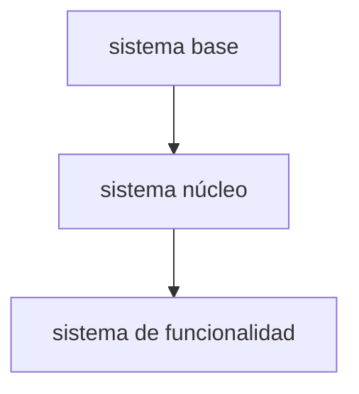

# Índice de sistemas

Da dependencias y prioridad. Un sistema con fórmulas (precio, daño, rendimiento, probabilidades) lleva su archivo en `systems/` (copia `systems/_sistema.md`); el resto son secciones de este archivo. Molde adaptado de `systems-index` de Claude Code Game Studios (MIT, ver `THIRD-PARTY.md`).

## Preguntas que debe responder

1. ¿Qué sistemas necesita el loop de `core-loop.md`? Lista cerrada, uno por línea.
2. Para cada uno: ¿qué módulo del template lo cubre ya (`src/shared/features/<nombre>`, ver `docs/ecosystem-map.md`) y qué falta construir?
3. ¿Qué pieza técnica no existe en el template ni en el ecosistema y es el riesgo mayor? (Por ejemplo, la mecánica central del nicho: si una búsqueda en `docs/` y `src/` no la encuentra, no existe.)
4. ¿Cuál es el orden de diseño y construcción? Capas: base (sin dependencias), núcleo, funcionalidad, presentación, pulido.
5. ¿Hay alguna dependencia circular? Debe ser cero.
6. ¿Cuáles sistemas tienen fórmulas y por eso archivo propio?

## Respuestas

1. TBD
2. TBD
3. TBD
4. TBD
5. TBD
6. TBD

## Sistemas

| Sistema | Capa | Prioridad | Cubierto por | Falta | Archivo o sección |
|---|---|---|---|---|---|
| TBD | TBD | TBD | TBD | TBD | TBD |

## Dependencias

## Criterio de listo

- [ ] Cada sistema del índice tiene archivo en `systems/` o sección propia.
- [ ] Cada sistema con archivo tiene: resumen, reglas, estados, interacciones, fórmulas, casos borde, perillas de ajuste y dependencias.
- [ ] Ninguna dependencia circular.
- [ ] `docs/requirements.md` enlaza cada sistema del índice.
- [ ] Con 2 juegos al mes: archivo propio solo si hay fórmulas.

## Evidencia

Salida de la búsqueda en `src/shared/features/` que respalda cada columna "Cubierto por", o la nota del vault de brechas del ecosistema para el nicho.

- TBD
