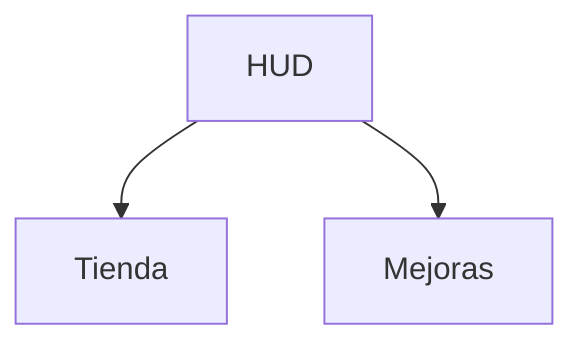

# Flujos de interfaz

Pantallas, botones del HUD y a dónde lleva cada uno. La interfaz es del dueño del arte y la UX (Leon): el template no trae kit de UI (ADR 0071) y la base es su sistema (#214). Este documento define qué pantallas y botones existen; cómo se ven lo decide ese sistema.

## Preguntas que debe responder

1. ¿Qué pantallas existen y cómo se llega a cada una? (Diagrama Mermaid.)
2. ¿Qué botones tiene el HUD? Máximo 6 con teclado y 4 en móvil táctil (ADR 0065); cada uno con su destino.
3. ¿De qué sistema de UI sale el aspecto y quién lo dibuja?
4. ¿Cómo se ve cada pantalla en móvil vertical, móvil horizontal y escritorio?
5. ¿Qué pasa con el gamepad y con el teclado (foco y atajos)?
6. ¿Qué texto y qué iconos requiere, y en qué idioma?

## Respuestas

1. TBD
2. TBD
3. TBD
4. TBD
5. TBD
6. TBD

## Flujo de pantallas

## Botones del HUD

| Botón | Teclado | Móvil | Destino |
|---|---|---|---|
| TBD | TBD | TBD | TBD |

## Criterio de listo

- [ ] Diagrama Mermaid del flujo entre pantallas.
- [ ] Cada botón del HUD con su destino y dentro del límite (6 y 4).
- [ ] Sistema de UI de origen anotado.
- [ ] Vista móvil vertical y horizontal descrita.

## Evidencia

Enlace a las capturas del simulador de dispositivos .

- TBD
