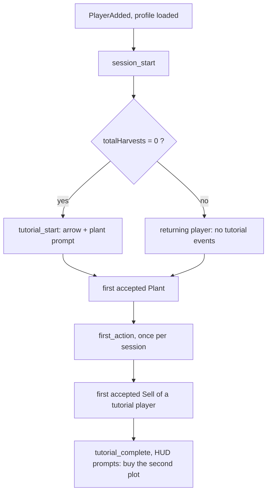
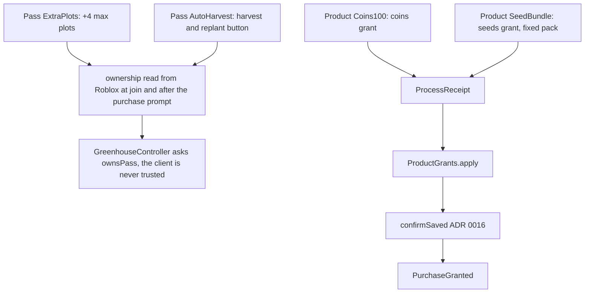

# Greenhouse: flow of the core loop

Game: grow-and-wait timers (design: `roblox-vault-games/games/2026-11-greenhouse/index.md`, a draft that nobody approved). This file is the diagram that precedes the code. Decisions and alternatives: [ADR 0020](adr/0020-greenhouse-server-clock-and-flat-wire.md).

## Rule of the game

The client sends INTENT only (which plot, which crop). The server owns the clock, every timer, every price, the stock and the coins. The client never says that something finished: a plot is ready only when `server now >= readyAt`, and `readyAt` was written by the server when it accepted the plant.

## Plant, wait, harvest, sell, upgrade

```mermaid
sequenceDiagram
  participant C as Client (HUD, parcels)
  participant Z as Zap layer (generated)
  participant H as Server handlers (Main.server)
  participant G as GreenhouseController (pure)
  participant K as Clock port (os.time)
  participant R as Greenhouse rules (pure)
  participant PD as PlayerData (profile)
  C->>Z: Plant(plot, crop)
  Z->>H: decoded, typed
  H->>G: plant(userId, plot, crop)
  G->>G: RateLimiter, then Validation (plot range, crop allow-list)
  G->>K: now()
  G->>R: plant(data, now, plot, crop)
  R->>PD: seeds[crop] -= 1, plots[plot] = { crop, readyAt = now + growSeconds }
  G-->>H: ok, plot marked dirty
  H-->>C: PlotChanged(plot, crop, readyAt) on the next flush (0.5 s)
  Note over C: HUD shows readyAt - GetServerTimeNow(); it decides nothing
  C->>Z: Harvest(plot)
  Z->>H: decoded
  H->>G: harvest(userId, plot)
  G->>K: now()
  alt now < readyAt (the clock is the server's, not the client's)
    R-->>G: rejected "not_ready", nothing changes
    G-->>H: plot marked dirty (client resyncs)
  else ready
    R->>PD: produce[crop] += 1, plot emptied, totalHarvests += 1
    H-->>C: PlotChanged(plot, 0, 0), StockChanged
  end
  C->>Z: Sell()
  Z->>H: decoded
  H->>G: sell(userId)
  G->>R: sell(data): coins += sum(produce x price from the data module)
  H-->>C: CoinsChanged, StockChanged
  C->>Z: BuyPlot() / BuySeed(crop)
  Z->>H: decoded
  H->>G: price re-derived from the saved plot count / the crop table
  H-->>C: PlotChanged, CoinsChanged, StockChanged
```

## Offline growth

`readyAt` is an absolute server time stored in the profile, so a timer keeps running while the player is away. If the server clock is behind the clock that wrote `readyAt`, the remaining time is clamped to the crop's `growSeconds` (`GrowthTimers.remaining`), so a timer can never be longer than its crop allows.

## Funnel in the first 60 seconds



## Monetization



Nothing sells time skips (design: timers that can be brought forward are unpopular on Roblox).
