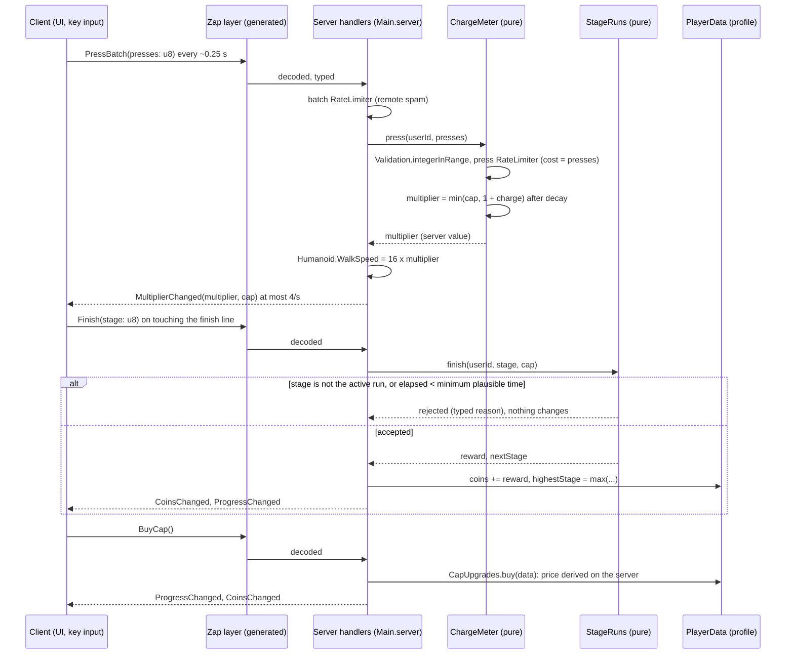
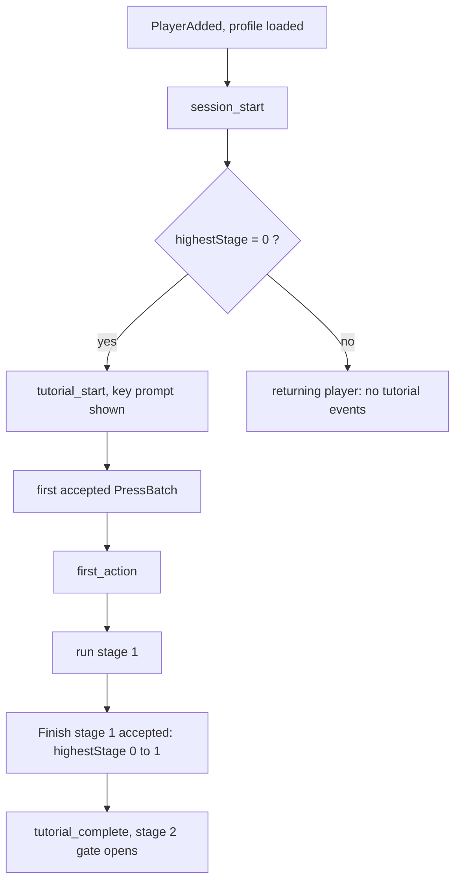
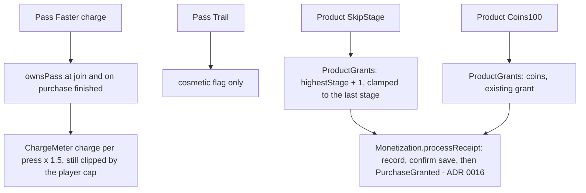

# Key sprint: flow of the core loop

Game: speed multiplier obby (design: `roblox-vault-games/games/2026-11-key-sprint/index.md`, a draft that nobody approved). This file is the diagram that precedes the code. Decisions and alternatives: [ADR 0020](adr/0020-key-sprint-server-authoritative-loop.md).

## Rule of the game

The client sends INTENT only. The server owns the multiplier, the walk speed, the stage progress, the coins and every price. A client that sends a bigger number than the server allows gets the server's number.

## Press, run, bank, upgrade

## Funnel in the first 60 seconds

Each event is sent once per session (`Funnel` remembers what it sent).

## Purchases

## Stage layout

Stages are DATA (`StageSpecs`): a list of segments (platform, gap, mover). `StageLayout` is a pure function from a spec to boxes in stage space; `StageBuilder` (engine adapter, no logic) turns the boxes into Parts at runtime. The world is not built by hand in Studio.
