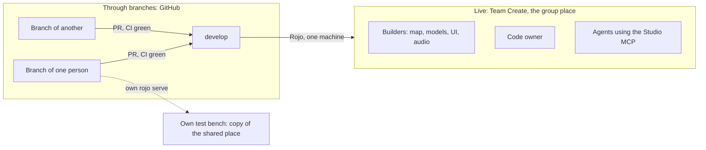

# What is shared live and what goes through branches

**In one sentence:** what is built in Studio (map, models, hand-made UI, lighting) is seen by everyone at the same time. Code is not: it lives in GitHub, each person writes it on their own branch, and it enters Studio through Rojo from one machine only.

The org-level guide is `docs/como-trabajamos.md` in the studio repo (a path, not a link: that repo is private).

Background: [ADR 0047](adr/0047-team-create-and-rojo-split.md), [team-workflow.md](team-workflow.md), [multi-agent.md](multi-agent.md).

## What everyone sees at the same time

Opening the group place from Studio (File, Open from Roblox, the group tab) joins the same Team Create session. The live collaborators panel shows who is connected.

| What | Seen live by the others? | Note |
|---|---|---|
| Terrain, parts, models, Packages | Yes, as soon as it changes | The normal path for map and art |
| Hand-built UI (ScreenGui, Frames) | Yes | |
| Lights, `Atmosphere`, sky, effects | Yes | Anything the code reads (such as `Atmosphere` density) is announced first on the board |
| Experience settings (permissions, API access) | Yes, after Save | |
| Scripts | Visible, but **never edited in Studio** | Rojo overwrites them on the next sync and the change never reaches GitHub |

Team Create autosaves the place every few minutes. Players see nothing until someone publishes, and the code owner decides when to publish.

## What is not live: code

- Everyone codes on **their own branch** (`feat/<task>`), on their own machine. Nobody else sees it until the PR passes CI and enters `develop`. PRs are small and merged the same day, so nobody falls behind.
- **Only the one machine that runs Rojo against the group place (the code owner) connects Rojo to it.** Two Rojo connections to the same place overwrite each other. While the game is private, what gets synced is `develop`. Once it is public, the published version comes from `main` by release.
- The code in the shared place is always `develop`. The Rojo machine serves a folder pinned to `develop`, never someone's branch, and nobody edits scripts in Studio.
- To test your branch: your own test bench and your own `rojo serve`. Never the group place.
- Everyone codes on their own branch; the other person reviews in the PR.

## Test your branch in Studio

Each person has a test bench: a local copy of the shared place with the real world, plus the code of their branch. Never test a branch in the group place itself.

1. **Get the copy once per game**, into `places/dev.rbxl` of the main clone (`places/` is gitignored), and refresh it only when the world changes. Open Cloud first: `GET https://apis.roblox.com/asset-delivery-api/v1/assetId/<place id>` with a key that has `legacy-asset:manage` returns a temporary `location` to download. Without that scope (403), in Studio with the shared place open: File, Download a Copy (Save to File As in some versions), and save it there. An agent with a desktop MCP does that click; it is the only one.
2. **Put your branch's code into it**, from your worktree: `lune run scripts/merge-into-copy <path to places/dev.rbxl> places/<branch>.rbxl`. It runs `rojo build` and replaces only the containers that `default.project.json` maps with `$path`; the world stays as the builders left it.
3. **Open `places/<branch>.rbxl` in Studio** (`RobloxStudioBeta -task EditFile -localPlaceFile <file>` on Windows, `open -a RobloxStudio <file>` on macOS) and test through the Studio MCP: playtest, console, and real input with its keyboard tool.
4. Close that Studio when you stop. After a code change, repeat step 2 and reopen.

Notes:

- Without a DataStore (the copy is not published), the game keeps player data in memory, so a test never touches real data.
- Refresh the copy when the world changes: builders announce it on the board, and you repeat step 1.
- No Rojo connection and no Connect click: the agent does steps 1 to 4 for the person with the Studio MCP and reports what it tested. `rojo serve` plus Connect still works for live editing, but no step depends on it.
- Studio MCP pitfalls seen in testing: a ProximityPrompt only shows when its object is on screen, so restore a minimized Studio before pressing its key; a camera set from `execute_luau` is reset when the call ends; `ProximityPrompt:InputHoldBegin` from `execute_luau` does not reach the engine, use the keyboard tool.

Fallback, only for a game with no shared place yet: build an empty place from your branch with `rojo build default.project.json -o places/<branch>.rbxl` and open it (step 3). If the game has world builders (scripts that generate terrain or props), run them on that place first so it is not empty; the builders live in the repo and any person can rerun them.

## The Rojo machine: keep the place on develop

The one machine that carries code to the group place (the code owner's) runs `tools/place-sync.ps1` so the place follows `develop` without manual steps. It needs a worktree of the repo detached at `origin/develop` (never a branch) and a `.studio.lock` at the main checkout whose `worktree=` and `port=` point to it ([multi-agent.md](multi-agent.md)). Nothing is fixed in the tool: both values come from the lock, or from `-Worktree` and `-Port`.

| Command | What it does |
|---|---|
| `pwsh tools/place-sync.ps1 run` | `git fetch`, `checkout --detach origin/develop` in that worktree if it is behind, and a hidden `rojo serve` if nothing listens on the port |
| `pwsh tools/place-sync.ps1 install` | Registers the job every 5 minutes with no visible window: a scheduled task on Windows (`conhost --headless`), a cron entry on macOS and Linux |
| `pwsh tools/place-sync.ps1 uninstall` | Removes that job |
| `pwsh tools/place-sync.ps1 status` | Prints the current commit, `develop`, the port and whether Rojo listens |

Limits to know:

- Rojo reaches the place only while that machine's Studio is open on the group place **and** connected: after opening Studio, click Connect in the Rojo notice once. With Studio closed, `develop` keeps advancing in the worktree and the place catches up on the next connection.
- Studio MCP and `rojo serve` still follow the lock rules: `place-sync` only runs while the lock names the place worktree.

Rolling back:

1. `pwsh tools/place-sync.ps1 uninstall` so it stops following `develop`.
2. In the place worktree, `git checkout --detach <good commit>` and reconnect Rojo. Fix `develop` through a revert PR, then run `install` again.

## For builders

1. Map, models, UI and audio go in the group place, with Team Create. Others see it instantly, and you see theirs.
2. Before touching a zone that others use or that the code reads, announce it on the board with its issue ([flow notes in team-workflow.md](team-workflow.md)).
3. Do not connect Rojo to the group place and do not edit scripts in Studio.
4. Anything built by a script enters the repo by PR, so anyone can rebuild it the same way.
5. New work goes to the group place. A personal place is not touched or deleted: it stays as an archive.

## For agents

- An agent driving the group place through the Studio MCP counts as one more person in Team Create: it announces the zone on the board before touching it.
- In game repos, `rojo serve` and the Studio MCP run only while holding the worktree's `.studio.lock` ([multi-agent.md](multi-agent.md)).

## Studio access to API services

When the experience setting "Enable Studio Access to API Services" is on, Studio tests read and write the experience's **real** data (DataStores). If the game code does not separate Studio data from production data, everything earned or spent in a test is saved. That is harmless while the game is private. Before opening it to the public, separate that data or turn the access off.
