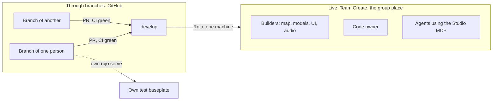

# What is shared live and what goes through branches

**In one sentence:** what is built in Studio (map, models, hand-made UI, lighting) is seen by everyone at the same time. Code is not: it lives in GitHub, each person writes it on their own branch, and it enters Studio through Rojo from one machine only.

Background: [ADR 0047](adr/0047-team-create-and-rojo-split.md), [team-workflow.md](team-workflow.md), [multi-agent.md](multi-agent.md).

## What everyone sees at the same time

Opening the group place from Studio (File, Open from Roblox, the group tab) joins the same Team Create session. The live collaborators panel shows who is connected.

| What | Seen live by the others? | Note |
|---|---|---|
| Terrain, parts, models, Packages | Yes, as soon as it changes | The normal path for map and art |
| Hand-built UI (ScreenGui, Frames) | Yes | |
| Lights, `Atmosphere`, sky, effects | Yes | Anything the code reads (such as `Atmosphere` density) is announced first on the board |
| Experience settings (permissions, API access) | Yes, after Save | |
| Scripts | Visible, but **never edited in Studio** | Rojo overwrites them on the next sync and the change never reaches GitHub |

Team Create autosaves the place every few minutes. Players see nothing until someone publishes, and the code owner decides when to publish.

## What is not live: code

- Everyone codes on **their own branch** (`feat/<task>`), on their own machine. Nobody else sees it until the PR passes CI and enters `develop`. PRs are small and merged the same day, so nobody falls behind.
- **Only the one machine that runs Rojo against the group place (the code owner) connects Rojo to it.** Two Rojo connections to the same place overwrite each other. While the game is private, what gets synced is `develop`. Once it is public, the published version comes from `main` by release.
- To test your branch: your own baseplate and your own `rojo serve`. Never the group place.
- To code together live: **VS Code Live Share**. One person shares their VS Code, both edit the same files on the sharer's branch, and the sharer commits.

## For builders

1. Map, models, UI and audio go in the group place, with Team Create. Others see it instantly, and you see theirs.
2. Before touching a zone that others use or that the code reads, announce it on the board with its issue ([flow notes in team-workflow.md](team-workflow.md)).
3. Do not connect Rojo to the group place and do not edit scripts in Studio.
4. Anything built by a script enters the repo by PR, so anyone can rebuild it the same way.
5. New work goes to the group place. A personal place is not touched or deleted: it stays as an archive.

## For agents

- An agent driving the group place through the Studio MCP counts as one more person in Team Create: it announces the zone on the board before touching it.
- In game repos, `rojo serve` and the Studio MCP run only while holding the worktree's `.studio.lock` ([multi-agent.md](multi-agent.md)).

## Studio access to API services

When the experience setting "Enable Studio Access to API Services" is on, Studio tests read and write the experience's **real** data (DataStores). If the game code does not separate Studio data from production data, everything earned or spent in a test is saved. That is harmless while the game is private. Before opening it to the public, separate that data or turn the access off.
