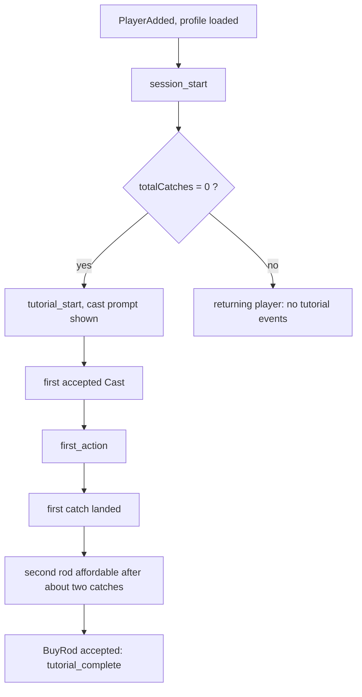
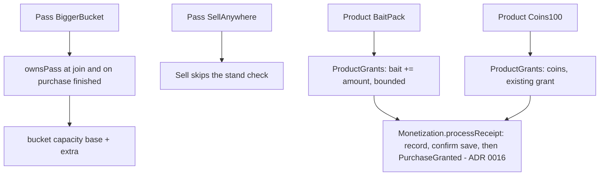

# Reef: flow of the fishing loop

Game: fishing loop with rod upgrades (design: `roblox-vault-games/games/2026-11-reef/index.md`, a draft that nobody approved). This file is the diagram that precedes the code. Decisions and alternatives: [ADR 0021](adr/0021-reef-server-authoritative-fishing.md).

## Rule of the game

The client sends INTENT only (cast, reel, sell, buy a rod). The server owns the catch roll, the rarity, the bite time, the reel window, every price and every coin. A client that reels "at the right moment" is checked against the server's own clock.

## Cast, reel, sell, upgrade

```mermaid
sequenceDiagram
  participant C as Client (UI, input)
  participant Z as Zap layer (generated)
  participant H as Server handlers (Main.server)
  participant R as ReefController (pure)
  participant F as FishRoll (pure)
  participant PD as PlayerData (profile)
  C->>Z: Cast(zone: u8)
  Z->>H: decoded, typed
  H->>H: RateLimiter (remote spam)
  H->>R: cast(userId, zone)
  R->>R: zone <= rod max zone, no cast pending, bucket not full
  R->>F: roll(zone, rodLevel, baitUsed, rng)
  F-->>R: fish, biteDelay (server-side, never sent to the client)
  R->>PD: bait -= 1 when used
  R-->>H: cast accepted
  H-->>C: CastStarted(zone)
  Note over C,H: the client waits; the bite time is secret
  H-->>C: Bite() when the server clock reaches biteAt
  C->>Z: Reel()
  Z->>H: decoded
  H->>R: reel(userId)
  alt now < biteAt or now > biteAt + window
    R-->>H: missed, pending cast cleared
    H-->>C: CatchResult(missed)
  else inside the window
    R->>PD: fishStock[fish] += 1, totalCatches += 1
    R-->>H: caught(fish)
    H-->>C: CatchResult(caught, fishId)
  end
  C->>Z: Sell()
  Z->>H: decoded
  H->>R: sell(userId)
  alt not near the stand and no Sell-anywhere pass
    R-->>H: rejected (typed reason)
  else accepted
    R->>PD: coins += sum(stock x value), stock = empty
    H-->>C: CoinsChanged, StockChanged
  end
  C->>Z: BuyRod()
  Z->>H: decoded
  H->>R: buyRod(userId)
  R->>PD: price derived from the saved rod level
  H-->>C: RodChanged, CoinsChanged
```

## Funnel in the first 60 seconds



Each event is sent once per session. The first cast of a new player always bites within the tutorial delay (`ReefRules.TUTORIAL_BITE_SECONDS`).

## Purchases



Bait raises bite speed by a fixed factor. Nothing paid is random: fish come from play.
