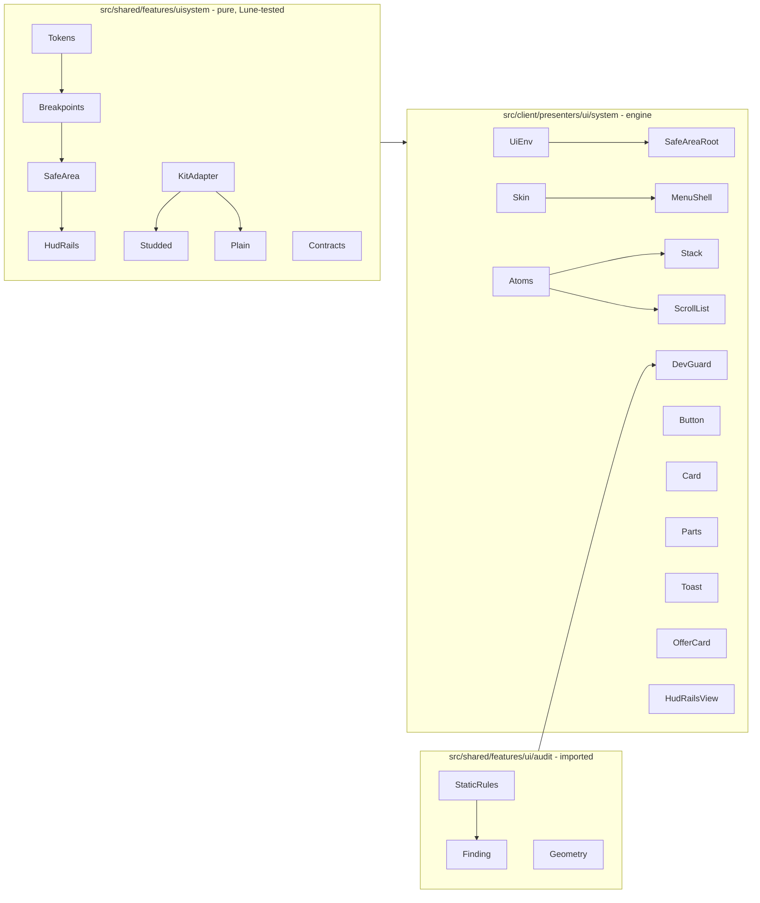

# UI system

Decision: [ADR 0035](adr/0035-ui-system-imperative-builders-over-kit-trees.md). Goal: a correct mobile UI is the only UI that can be built, and a new game only adapts the theme. Refs #81.

## What it is and is not

- Is: tokens, layout primitives that enforce the rules by construction, kit-skinned components, a dev guard that audits what was built, UI Labs stories at four viewports, and a kit adapter contract.
- Is not: a reactive framework, a menu controller (that is `features/ui/MenuController`), or a place for gameplay values. Texts and prices come from the game's Config.

## Layers



## The rules that cannot be broken

| Rule | How it is enforced |
|---|---|
| No list without a gap | `Stack`, `ScrollList`, `Grid` take a spacing KEY and default to `tokens.defaults.gap`; the scale starts above 0. `Skin` fixes kit lists left at 0. `StaticRules` UI-LIST-PADDING and UI-GRID-PADDING. |
| Rows never touch, text never touches its row | Sibling gap at least `spacing.sm`, row padding `defaults.cardPad` (`ScrollList.item`). `EcoRules` UI-LIST-GAP, UI-LIST-OVERLAP, UI-CARD-INSET. |
| No hand-made list | Only the primitive creates a layout (`Atoms`, `ScrollList`, `Widgets`); `SourceRules` UI-RAW-LAYOUT and UI-LITERAL-GAP fail the gate. |
| Controls fit the platform | Each HUD button is in the `ControlRegistry` with purpose and schemes; touch-only buttons give way to a key hint on keyboard and gamepad, live (`InputSchemeWatcher`). UI-HUD-UNREGISTERED, UI-CONTROL-PLATFORM. |
| No text lost | A label cut by its box fails (UI-TEXT-LOST) unless it carries the attribute `Truncatable`. |
| Scroller never clips or touches edges | `ScrollList` sets an automatic canvas and a `UIPadding`. UI-SCROLL-CANVAS, UI-SCROLL-PADDING. |
| Touch target at least 44 px | `Atoms.touchFloor` adds a `UISizeConstraint` to every button and kit button; `Button` is 44 px tall. UI-TOUCH-44. |
| Text always fits | `Atoms.fitText`: `TextScaled`, truncation, `UITextSizeConstraint` 12 to 40. UI-TEXT-FIT. |
| Nothing under the notch, top bar or thumbstick | `SafeAreaRoot` uses `CoreUISafeInsets` plus a design margin; `HudRails` keeps the lower side bands free on touch devices. |
| HUD tiles never overlap | `HudRails.plan` is pure geometry: overlap and containment are checked in the plan and again by `DevGuard.requireAll`. |
| Menu never covers a phone | `Breakpoints.menuBox`: 90 x 80 % on phone, 45 x 75 % elsewhere, aspect-capped. Backdrop swallows input; close button 44 px. |
| UIScale never shrinks, never grows on phones | `Breakpoints.uiScale`. The 1327x496 phone stays at 1. |
| Kit untouched | `Skin` never changes a color, a `UIStroke` `Thickness` or `StrokeSizingMode`. UI-KIT-STROKE. |

In Studio a broken rule raises an error naming the rule and the instance path. In a live server it warns once. Disable only in tests: `DevGuard.enabled = false`.

## Build a screen

```lua
local tokens = Tokens.default()
local skin = Skin.new(Studded, uiKitRoot, tokens)          -- or Skin.new(Plain, nil, tokens)
local env = UiEnv.new(tokens, skin, { width = cam.X, height = cam.Y }, nil)
local root = SafeAreaRoot.new(playerGui, "Hud", 10, env)
local rails = HudRailsView.new(env, root.content, tileSpecs)
camera:GetPropertyChangedSignal("ViewportSize"):Connect(function()
    env = UiEnv.new(tokens, skin, viewport(), nil)
    root:apply(env)
    rails:layout(env)
end)
```

Menus: `MenuShell.new(env, root.content, { id, title, kind, onClose })`, then put rows in `shell.list` (kit) or build a `ScrollList` in `shell.body` (plain). Rows: `Card.new`. Small parts: `Parts.badge`, `Parts.currencyChip`, `Parts.progressBar`, `Parts.tabs`, `Parts.tooltip`. Toasts: `Toast.host(env, root.overlay)` has the `show`/`hide` shape of `ports/ToastRenderer`. Offers: `OfferCard.new`.

## Theme a new game

1. **Pick the kit.** Default: Studded UI (`D:/Victor/Roblox/kits/rblx-essentials-studded-ui`). Copy it to the git-ignored `assets/kits/<slug>` (see CLAUDE.md, ADR 0027) and extract only the pieces the game uses into `assets/ui/*.rbxm` synced to `ReplicatedStorage.UiKit`. Check its licence first (`ships`).
2. **Choose the adapter.** `adapters/Studded` covers all seven slots. Another kit: copy `adapters/Studded.luau`, change the paths and part maps, run `lune run scripts/ui-adapter-check <name> <kit.rbxm>` (add the adapter to the table in the script). Slots the kit lacks are simply omitted; the plain piece covers them.
3. **Set the tokens.** Copy `Tokens.default()` into the game Config and change: `palette` (only for plain pieces and code-drawn parts; a kit keeps its own colors), `font`, `spacing` (keep the 4 px grid), `radius`, `type`. Derive the values from the game domain and write the reason of each into `docs/design/DESIGN.md` (delivery bar rule 4). `Tokens.validate` rejects a scale that does not grow, a touch floor under 44, text under 12 and a palette under WCAG AA.
4. **Pick the icon set.** Icons are uploaded under the creator account and referenced by asset id in Config (ADR 0006); candidates in `D:/Victor/Roblox/kits/studs-icon-pack` and `ui-icon-pack`. Never invent ids: `-- TODO(victor): set id`.
5. **Run the gate and review the stories** (below).

## Quality gate

By exit code, all of: `stylua --check .`, `selene .`, `pwsh scripts/analyze.ps1`, `lune run scripts/test`, `pwsh scripts/coverage.ps1`, `lune run scripts/perf-budget`, `rojo build`, plus `lune run scripts/ui-audit` (static audit over every `assets/ui/**/*.rbxm` a game commits; exits 1 on any finding). The runtime audit (`presenters/ui/audit/RuntimeAudit`, overlap, clipping, safe area, contrast at the four viewports) runs in a playtest through `execute_luau`; its rule ids match the static ones.

The audit modules come from plus-one-mining `feat/ui-audit` at commit 3963f3b. When that branch changes, re-copy `ui/audit/*`, `presenters/ui/audit/RuntimeAudit`, `scripts/ui-audit.luau` and `tests/features/ui/UiAudit.test.luau` and delete the game's copy.

## UI Labs stories

Plugin "UI Labs" (pepeeltoro41). Stories are `*.story` ModuleScripts returning `function(target: Frame) -> cleanup`. In `src/client/stories/ui-system/`: three scenes (Hud, Menu, Components) at each of 844x390, 667x375, 1327x496 and 1920x1080 (12 stories). `StoryHarness` mounts a fixed-size frame, builds the real `UiEnv` and `SafeAreaRoot.layers`, and uses `Studded` when `ReplicatedStorage.UiKit` exists, else `Plain`.

Review checklist per viewport: nothing touches an edge; every list row has a gap; every button looks at least thumb-sized; no text is cut; the HUD rails do not touch each other nor the lower side bands; the menu leaves the world visible around it; the close button is reachable. Record the result in the PR. **Status: unverified in the engine** until a person opens UI Labs (this system was built without Studio).

## Where things live

- `src/shared/features/uisystem/` pure modules and adapters (README there).
- `src/client/presenters/ui/system/` engine builders (README there).
- `src/client/stories/ui-system/` stories.
- Tests: `tests/features/uisystem/UiSystem.test.luau`, `tests/features/ui/UiAudit.test.luau`.

## Kit intake: a new UI kit found online

The procedure is [docs/ui-kit-intake.md](ui-kit-intake.md).
